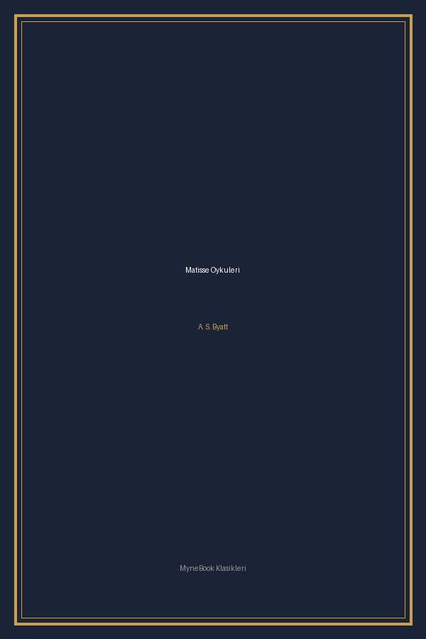
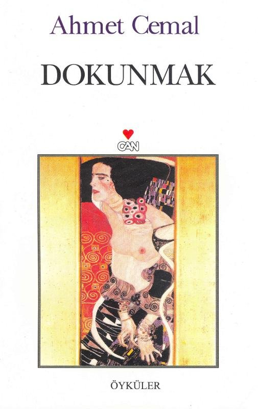
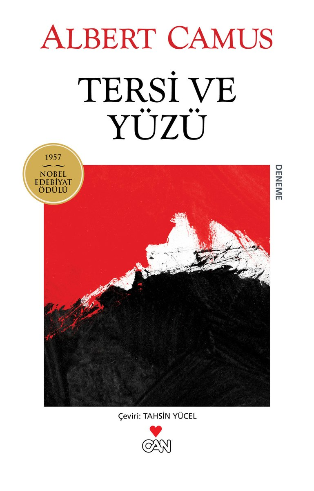
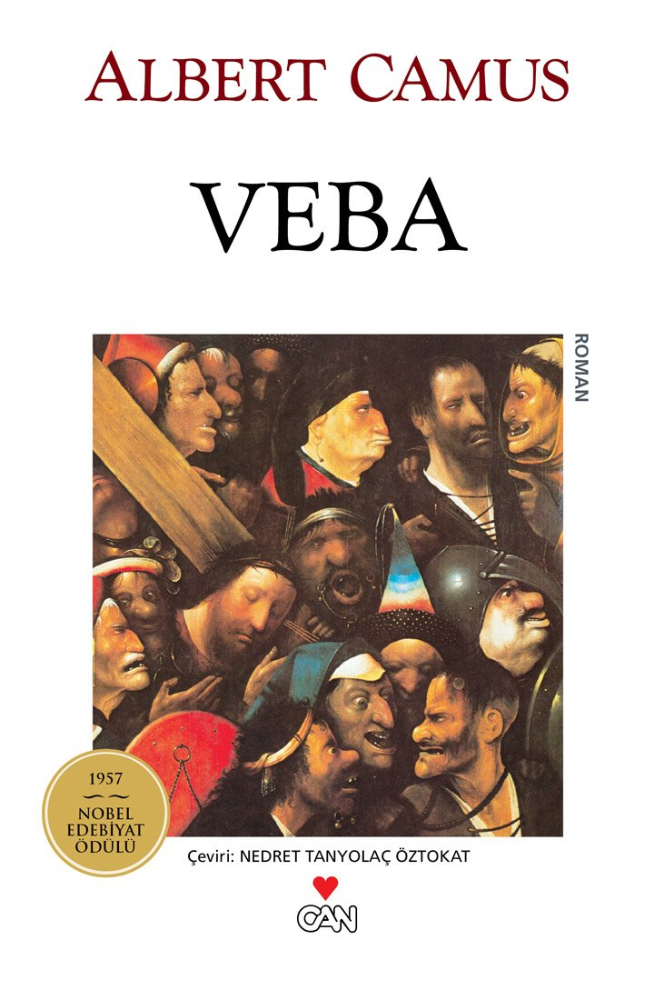
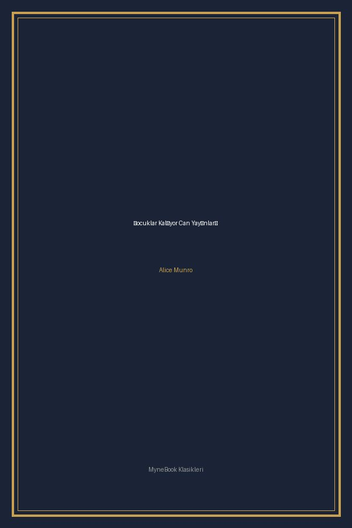
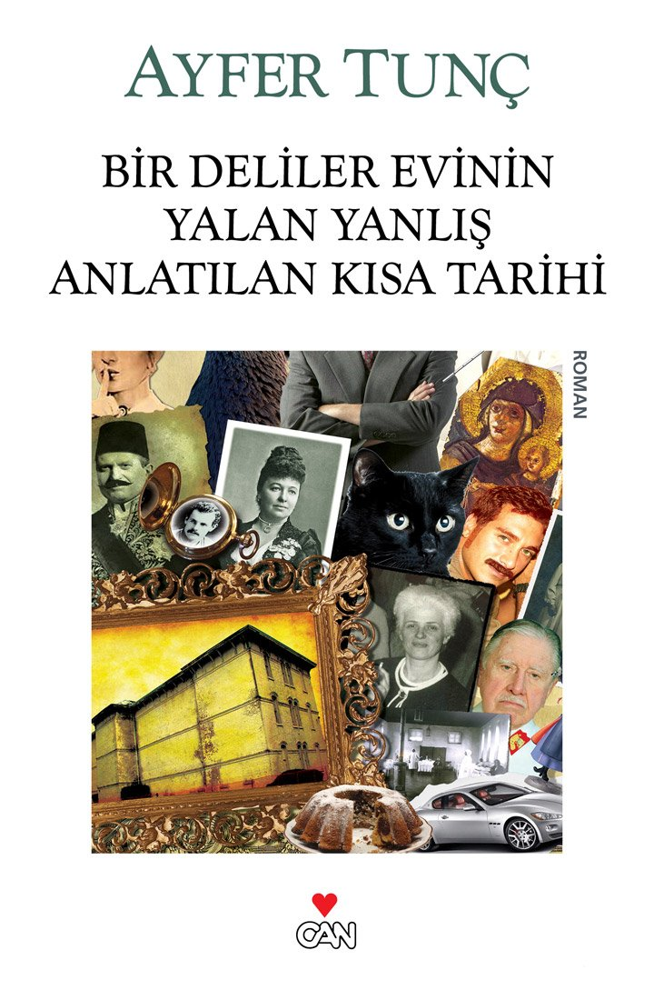

# 📚 MyneBook Türkçe E-Kitap Kataloğu

Bu depo, **MyneBook** Android uygulaması için hazırlanan ücretsiz, tam metin ve yüksek kaliteli Türkçe e-kitap kataloğudur.

> **Katalog Durumu:** Toplam **50** kitap bulunmaktadır.

---

## 📖 Kitap Listesi

| # | Kapak | Başlık | Yazar | İndirme |
|---|---|---|---|---|
| 10001 |  | **Matisse Oykuleri** | A. S. Byatt | [EPUB İndir](https://raw.githubusercontent.com/kimbumuratyavuz/MyneBook-Turkish-Books/main/books/a_s_byatt_matisse_oykuleri_10001.pdf) |
| 10002 |  | **Aldatmak** | Ahmet Altan | [EPUB İndir](https://raw.githubusercontent.com/kimbumuratyavuz/MyneBook-Turkish-Books/main/books/ahmet_altan_aldatmak_10002.epub) |
| 10003 |  | **Karanlıkta Sabah Kuşları** | Ahmet Altan | [EPUB İndir](https://raw.githubusercontent.com/kimbumuratyavuz/MyneBook-Turkish-Books/main/books/ahmet_altan_karanlikta_sabah_kuslari_10003.epub) |
| 10004 |  | **Kılıç Yarası Gibi** | Ahmet Altan | [EPUB İndir](https://raw.githubusercontent.com/kimbumuratyavuz/MyneBook-Turkish-Books/main/books/ahmet_altan_kilic_yarasi_gibi_10004.epub) |
| 10005 |  | **Sudaki İz** | Ahmet Altan | [EPUB İndir](https://raw.githubusercontent.com/kimbumuratyavuz/MyneBook-Turkish-Books/main/books/ahmet_altan_sudaki_iz_10005.epub) |
| 10006 |  | **İsyan Günlerinde Aşk** | Ahmet Altan | [EPUB İndir](https://raw.githubusercontent.com/kimbumuratyavuz/MyneBook-Turkish-Books/main/books/ahmet_altan_isyan_gunlerinde_ask_10006.epub) |
| 10007 |  | **Alnı Mavide** | Ahmet Büke | [EPUB İndir](https://raw.githubusercontent.com/kimbumuratyavuz/MyneBook-Turkish-Books/main/books/ahmet_buke_alni_mavide_10007.epub) |
| 10008 |  | **Dokunmak** | Ahmet Cemal | [EPUB İndir](https://raw.githubusercontent.com/kimbumuratyavuz/MyneBook-Turkish-Books/main/books/ahmet_cemal_dokunmak_10008.epub) |
| 10009 |  | **Başkaldıran İnsan** | Albert Camus | [EPUB İndir](https://raw.githubusercontent.com/kimbumuratyavuz/MyneBook-Turkish-Books/main/books/albert_camus_baskaldiran_insan_10009.epub) |
| 10010 |  | **Düşüş** | Albert Camus | [EPUB İndir](https://raw.githubusercontent.com/kimbumuratyavuz/MyneBook-Turkish-Books/main/books/albert_camus_dusus_10010.epub) |
| 10011 |  | **Ecinniler** | Albert Camus | [EPUB İndir](https://raw.githubusercontent.com/kimbumuratyavuz/MyneBook-Turkish-Books/main/books/albert_camus_ecinniler_10011.epub) |
| 10012 |  | **Mutlu Ölüm** | Albert Camus | [EPUB İndir](https://raw.githubusercontent.com/kimbumuratyavuz/MyneBook-Turkish-Books/main/books/albert_camus_mutlu_olum_10012.epub) |
| 10013 |  | **Sürgün ve Krallık** | Albert Camus | [EPUB İndir](https://raw.githubusercontent.com/kimbumuratyavuz/MyneBook-Turkish-Books/main/books/albert_camus_surgun_ve_krallik_10013.epub) |
| 10014 |  | **Tersi ve Yüzü** | Albert Camus | [EPUB İndir](https://raw.githubusercontent.com/kimbumuratyavuz/MyneBook-Turkish-Books/main/books/albert_camus_tersi_ve_yuzu_10014.epub) |
| 10015 |  | **Veba (Orjinal)** | Albert Camus | [EPUB İndir](https://raw.githubusercontent.com/kimbumuratyavuz/MyneBook-Turkish-Books/main/books/albert_camus_veba_orjinal_10015.epub) |
| 10016 |  | **Yabancı** | Albert Camus | [EPUB İndir](https://raw.githubusercontent.com/kimbumuratyavuz/MyneBook-Turkish-Books/main/books/albert_camus_yabanci_10016.epub) |
| 10017 |  | **Yaz** | Albert Camus | [EPUB İndir](https://raw.githubusercontent.com/kimbumuratyavuz/MyneBook-Turkish-Books/main/books/albert_camus_yaz_10017.epub) |
| 10018 |  | **Emmaus cs** | Alessandro Baricco | [EPUB İndir](https://raw.githubusercontent.com/kimbumuratyavuz/MyneBook-Turkish-Books/main/books/alessandro_baricco_emmaus_cs_10018.pdf) |
| 10019 |  | **Nefret Arkadaƒlìk Flört  Aƒk  Evlilik Can Yayìnlarì** | Alice Munro | [EPUB İndir](https://raw.githubusercontent.com/kimbumuratyavuz/MyneBook-Turkish-Books/main/books/alice_munro_nefret_arkada_l_k_flort_a_k_evlilik_can_yay_nlar_10019.pdf) |
| 10020 |  | **Çocuklar Kalìyor Can Yayìnlarì** | Alice Munro | [EPUB İndir](https://raw.githubusercontent.com/kimbumuratyavuz/MyneBook-Turkish-Books/main/books/alice_munro_cocuklar_kal_yor_can_yay_nlar_10020.pdf) |
| 10021 |  | **Doktor Çehov'dan Öyküler** | Anton Çehov | [EPUB İndir](https://raw.githubusercontent.com/kimbumuratyavuz/MyneBook-Turkish-Books/main/books/anton_cehov_doktor_cehov_dan_oykuler_10021.epub) |
| 10022 |  | **Pereira İddia Ediyor** | Antonio Tabucchi | [EPUB İndir](https://raw.githubusercontent.com/kimbumuratyavuz/MyneBook-Turkish-Books/main/books/antonio_tabucchi_pereira_iddia_ediyor_10022.epub) |
| 10023 |  | **Poetika (Can Yayınları)** | Aristoteles | [EPUB İndir](https://raw.githubusercontent.com/kimbumuratyavuz/MyneBook-Turkish-Books/main/books/aristoteles_poetika_can_yayinlari_10023.epub) |
| 10024 |  | **Küçük Şeylerin Tanrısı** | Arundhati Roy | [EPUB İndir](https://raw.githubusercontent.com/kimbumuratyavuz/MyneBook-Turkish-Books/main/books/arundhati_roy_kucuk_seylerin_tanrisi_10024.epub) |
| 10025 |  | **Aziz Bey Hadisesi** | Ayfer Tunç | [EPUB İndir](https://raw.githubusercontent.com/kimbumuratyavuz/MyneBook-Turkish-Books/main/books/ayfer_tunc_aziz_bey_hadisesi_10025.epub) |
| 10026 |  | **Bir Deliler Evinin Yalan Yanlış Anlatılan Kısa Tarihi** | Ayfer Tunç | [EPUB İndir](https://raw.githubusercontent.com/kimbumuratyavuz/MyneBook-Turkish-Books/main/books/ayfer_tunc_bir_deliler_evinin_yalan_yanlis_anlatilan_kisa_tarihi_10026.epub) |
| 10027 |  | **Evvelotel** | Ayfer Tunç | [EPUB İndir](https://raw.githubusercontent.com/kimbumuratyavuz/MyneBook-Turkish-Books/main/books/ayfer_tunc_evvelotel_10027.epub) |
| 10028 |  | **Diken Ucu** | Behçet Çelik | [EPUB İndir](https://raw.githubusercontent.com/kimbumuratyavuz/MyneBook-Turkish-Books/main/books/behcet_celik_diken_ucu_10028.pdf) |
| 10029 |  | **Düºün Birahanesi** | Behçet Çelik | [EPUB İndir](https://raw.githubusercontent.com/kimbumuratyavuz/MyneBook-Turkish-Books/main/books/behcet_celik_du_un_birahanesi_10029.pdf) |
| 10030 |  | **Gün Ortasìnda Arzu** | Behçet Çelik | [EPUB İndir](https://raw.githubusercontent.com/kimbumuratyavuz/MyneBook-Turkish-Books/main/books/behcet_celik_gun_ortas_nda_arzu_10030.pdf) |
| 10031 |  | **Herkes Kadar** | Behçet Çelik | [EPUB İndir](https://raw.githubusercontent.com/kimbumuratyavuz/MyneBook-Turkish-Books/main/books/behcet_celik_herkes_kadar_10031.pdf) |
| 10032 |  | **Yazyalnìzì ÿki Deli Derviƒ** | Behçet Çelik | [EPUB İndir](https://raw.githubusercontent.com/kimbumuratyavuz/MyneBook-Turkish-Books/main/books/behcet_celik_yazyaln_z_ki_deli_dervi_10032.pdf) |
| 10033 |  | **Kum Adam** | Bodo Kirchhoff | [EPUB İndir](https://raw.githubusercontent.com/kimbumuratyavuz/MyneBook-Turkish-Books/main/books/bodo_kirchhoff_kum_adam_10033.epub) |
| 10034 |  | **Erken Trenlerde** | Boris Pasternak | [EPUB İndir](https://raw.githubusercontent.com/kimbumuratyavuz/MyneBook-Turkish-Books/main/books/boris_pasternak_erken_trenlerde_10034.pdf) |
| 10035 |  | **Pekin'de Sonbahar** | Boris Vian | [EPUB İndir](https://raw.githubusercontent.com/kimbumuratyavuz/MyneBook-Turkish-Books/main/books/boris_vian_pekin_de_sonbahar_10035.epub) |
| 10036 |  | **Dracula (Can Yayınları)** | Bram Stoker | [EPUB İndir](https://raw.githubusercontent.com/kimbumuratyavuz/MyneBook-Turkish-Books/main/books/bram_stoker_dracula_can_yayinlari_10036.epub) |
| 10037 |  | **Çekim Kurallarì (ed.roman)** | Bret Easton Ellis | [EPUB İndir](https://raw.githubusercontent.com/kimbumuratyavuz/MyneBook-Turkish-Books/main/books/bret_easton_ellis_cekim_kurallar_ed_roman_10037.pdf) |
| 10038 |  | **Aƒka Veda** | Can Dündar | [EPUB İndir](https://raw.githubusercontent.com/kimbumuratyavuz/MyneBook-Turkish-Books/main/books/can_dundar_a_ka_veda_10038.pdf) |
| 10039 |  | **Kìrmìzì Bisiklet** | Can Dündar | [EPUB İndir](https://raw.githubusercontent.com/kimbumuratyavuz/MyneBook-Turkish-Books/main/books/can_dundar_k_rm_z_bisiklet_10039.pdf) |
| 10040 |  | **Lüsyen** | Can Dündar | [EPUB İndir](https://raw.githubusercontent.com/kimbumuratyavuz/MyneBook-Turkish-Books/main/books/can_dundar_lusyen_10040.pdf) |
| 10041 |  | **Yìldìzlar** | Can Dündar | [EPUB İndir](https://raw.githubusercontent.com/kimbumuratyavuz/MyneBook-Turkish-Books/main/books/can_dundar_y_ld_zlar_10041.pdf) |
| 10042 |  | **Erkeğin Yarısı Kadın** | Cang Şianliyen | [EPUB İndir](https://raw.githubusercontent.com/kimbumuratyavuz/MyneBook-Turkish-Books/main/books/cang_sianliyen_erkegin_yarisi_kadin_10042.epub) |
| 10043 |  | **Artemio Crus'un Ölümü** | Carlos Fuentes | [EPUB İndir](https://raw.githubusercontent.com/kimbumuratyavuz/MyneBook-Turkish-Books/main/books/carlos_fuentes_artemio_crus_un_olumu_10043.pdf) |
| 10044 |  | **Aura** | Carlos Fuentes | [EPUB İndir](https://raw.githubusercontent.com/kimbumuratyavuz/MyneBook-Turkish-Books/main/books/carlos_fuentes_aura_10044.pdf) |
| 10045 |  | **Deri Deºiƒtirmek** | Carlos Fuentes | [EPUB İndir](https://raw.githubusercontent.com/kimbumuratyavuz/MyneBook-Turkish-Books/main/books/carlos_fuentes_deri_de_i_tirmek_10045.pdf) |
| 10046 |  | **Kaygì Veren Dostluklar** | Carlos Fuentes | [EPUB İndir](https://raw.githubusercontent.com/kimbumuratyavuz/MyneBook-Turkish-Books/main/books/carlos_fuentes_kayg_veren_dostluklar_10046.pdf) |
| 10047 |  | **Körlerin ×arkìsì** | Carlos Fuentes | [EPUB İndir](https://raw.githubusercontent.com/kimbumuratyavuz/MyneBook-Turkish-Books/main/books/carlos_fuentes_korlerin_ark_s_10047.pdf) |
| 10048 |  | **Sefer** | Carlos Fuentes | [EPUB İndir](https://raw.githubusercontent.com/kimbumuratyavuz/MyneBook-Turkish-Books/main/books/carlos_fuentes_sefer_10048.pdf) |
| 10049 |  | **Yanìk Sular** | Carlos Fuentes | [EPUB İndir](https://raw.githubusercontent.com/kimbumuratyavuz/MyneBook-Turkish-Books/main/books/carlos_fuentes_yan_k_sular_10049.pdf) |
| 10050 |  | **İnez'in sezgisi** | Carlos Fuentes | [EPUB İndir](https://raw.githubusercontent.com/kimbumuratyavuz/MyneBook-Turkish-Books/main/books/carlos_fuentes_inez_in_sezgisi_10050.epub) |

---
Made with ❤️ for MyneBook by Murat Yavuz (MimuEngine).