# 📚 MyneBook Türkçe E-Kitap Kataloğu

Bu depo, **MyneBook** Android uygulaması için hazırlanan ücretsiz, tam metin ve yüksek kaliteli Türkçe e-kitap kataloğudur.

> **Katalog Durumu:** Toplam **1019** kitap bulunmaktadır.

---

## 📖 Kitap Listesi

| # | Kapak | Başlık | Yazar | İndirme |
|---|---|---|---|---|
| 10001 |  | **Matisse Öyküleri** | A. S. Byatt | [EPUB İndir](https://raw.githubusercontent.com/kimbumuratyavuz/MyneBook-Turkish-Books/main/books/a_s_byatt_matisse_oykuleri_10001.pdf) |
| 10002 |  | **Aldatmak** | Ahmet Altan | [EPUB İndir](https://raw.githubusercontent.com/kimbumuratyavuz/MyneBook-Turkish-Books/main/books/ahmet_altan_aldatmak_10002.epub) |
| 10003 |  | **Karanlıkta Sabah Kuşları** | Ahmet Altan | [EPUB İndir](https://raw.githubusercontent.com/kimbumuratyavuz/MyneBook-Turkish-Books/main/books/ahmet_altan_karanlikta_sabah_kuslari_10003.epub) |
| 10004 |  | **Kılıç Yarası Gibi** | Ahmet Altan | [EPUB İndir](https://raw.githubusercontent.com/kimbumuratyavuz/MyneBook-Turkish-Books/main/books/ahmet_altan_kilic_yarasi_gibi_10004.epub) |
| 10005 | 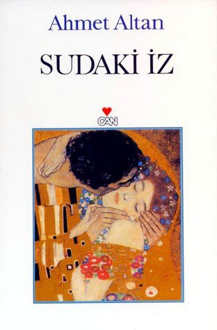 | **Sudaki İz** | Ahmet Altan | [EPUB İndir](https://raw.githubusercontent.com/kimbumuratyavuz/MyneBook-Turkish-Books/main/books/ahmet_altan_sudaki_iz_10005.epub) |
| 10006 | 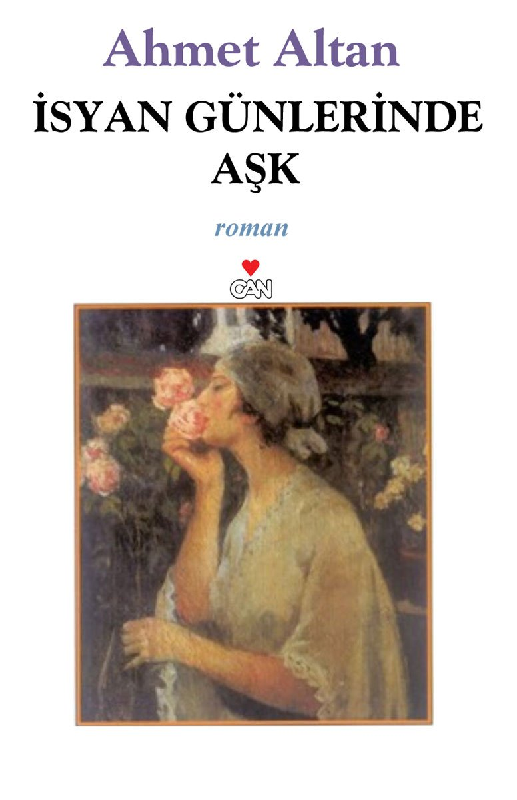 | **İsyan Günlerinde Aşk** | Ahmet Altan | [EPUB İndir](https://raw.githubusercontent.com/kimbumuratyavuz/MyneBook-Turkish-Books/main/books/ahmet_altan_isyan_gunlerinde_ask_10006.epub) |
| 10007 |  | **Alnı Mavide** | Ahmet Büke | [EPUB İndir](https://raw.githubusercontent.com/kimbumuratyavuz/MyneBook-Turkish-Books/main/books/ahmet_buke_alni_mavide_10007.epub) |
| 10008 |  | **Dokunmak** | Ahmet Cemal | [EPUB İndir](https://raw.githubusercontent.com/kimbumuratyavuz/MyneBook-Turkish-Books/main/books/ahmet_cemal_dokunmak_10008.epub) |
| 10009 |  | **Başkaldıran İnsan** | Albert Camus | [EPUB İndir](https://raw.githubusercontent.com/kimbumuratyavuz/MyneBook-Turkish-Books/main/books/albert_camus_baskaldiran_insan_10009.epub) |
| 10010 |  | **Düşüş** | Albert Camus | [EPUB İndir](https://raw.githubusercontent.com/kimbumuratyavuz/MyneBook-Turkish-Books/main/books/albert_camus_dusus_10010.epub) |
| 10011 |  | **Ecinniler** | Albert Camus | [EPUB İndir](https://raw.githubusercontent.com/kimbumuratyavuz/MyneBook-Turkish-Books/main/books/albert_camus_ecinniler_10011.epub) |
| 10012 |  | **Mutlu Ölüm** | Albert Camus | [EPUB İndir](https://raw.githubusercontent.com/kimbumuratyavuz/MyneBook-Turkish-Books/main/books/albert_camus_mutlu_olum_10012.epub) |
| 10013 |  | **Sürgün ve Krallık** | Albert Camus | [EPUB İndir](https://raw.githubusercontent.com/kimbumuratyavuz/MyneBook-Turkish-Books/main/books/albert_camus_surgun_ve_krallik_10013.epub) |
| 10014 |  | **Tersi ve Yüzü** | Albert Camus | [EPUB İndir](https://raw.githubusercontent.com/kimbumuratyavuz/MyneBook-Turkish-Books/main/books/albert_camus_tersi_ve_yuzu_10014.epub) |
| 10015 |  | **Veba (Orjinal)** | Albert Camus | [EPUB İndir](https://raw.githubusercontent.com/kimbumuratyavuz/MyneBook-Turkish-Books/main/books/albert_camus_veba_orjinal_10015.epub) |
| 10016 |  | **Yabancı** | Albert Camus | [EPUB İndir](https://raw.githubusercontent.com/kimbumuratyavuz/MyneBook-Turkish-Books/main/books/albert_camus_yabanci_10016.epub) |
| 10017 |  | **Yaz** | Albert Camus | [EPUB İndir](https://raw.githubusercontent.com/kimbumuratyavuz/MyneBook-Turkish-Books/main/books/albert_camus_yaz_10017.epub) |
| 10018 |  | **Emmaus** | Alessandro Baricco | [EPUB İndir](https://raw.githubusercontent.com/kimbumuratyavuz/MyneBook-Turkish-Books/main/books/alessandro_baricco_emmaus_cs_10018.pdf) |
| 10019 |  | **Nefret, Arkadaşlık, Flört, Aşk, Evlilik** | Alice Munro | [EPUB İndir](https://raw.githubusercontent.com/kimbumuratyavuz/MyneBook-Turkish-Books/main/books/alice_munro_nefret_arkada_l_k_flort_a_k_evlilik_can_yay_nlar_10019.pdf) |
| 10020 |  | **Çocuklar Kalıyor** | Alice Munro | [EPUB İndir](https://raw.githubusercontent.com/kimbumuratyavuz/MyneBook-Turkish-Books/main/books/alice_munro_cocuklar_kal_yor_can_yay_nlar_10020.pdf) |
| 10021 |  | **Doktor Çehov'dan Öyküler** | Anton Çehov | [EPUB İndir](https://raw.githubusercontent.com/kimbumuratyavuz/MyneBook-Turkish-Books/main/books/anton_cehov_doktor_cehov_dan_oykuler_10021.epub) |
| 10022 |  | **Pereira İddia Ediyor** | Antonio Tabucchi | [EPUB İndir](https://raw.githubusercontent.com/kimbumuratyavuz/MyneBook-Turkish-Books/main/books/antonio_tabucchi_pereira_iddia_ediyor_10022.epub) |
| 10023 |  | **Poetika** | Aristoteles | [EPUB İndir](https://raw.githubusercontent.com/kimbumuratyavuz/MyneBook-Turkish-Books/main/books/aristoteles_poetika_can_yayinlari_10023.epub) |
| 10024 |  | **Küçük Şeylerin Tanrısı** | Arundhati Roy | [EPUB İndir](https://raw.githubusercontent.com/kimbumuratyavuz/MyneBook-Turkish-Books/main/books/arundhati_roy_kucuk_seylerin_tanrisi_10024.epub) |
| 10025 | 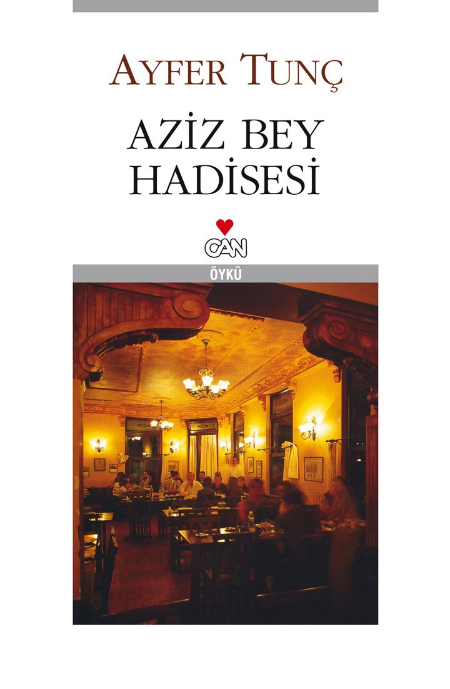 | **Aziz Bey Hadisesi** | Ayfer Tunç | [EPUB İndir](https://raw.githubusercontent.com/kimbumuratyavuz/MyneBook-Turkish-Books/main/books/ayfer_tunc_aziz_bey_hadisesi_10025.epub) |
| 10026 |  | **Bir Deliler Evinin Yalan Yanlış Anlatılan Kısa Tarihi** | Ayfer Tunç | [EPUB İndir](https://raw.githubusercontent.com/kimbumuratyavuz/MyneBook-Turkish-Books/main/books/ayfer_tunc_bir_deliler_evinin_yalan_yanlis_anlatilan_kisa_tarihi_10026.epub) |
| 10027 |  | **Evvelotel** | Ayfer Tunç | [EPUB İndir](https://raw.githubusercontent.com/kimbumuratyavuz/MyneBook-Turkish-Books/main/books/ayfer_tunc_evvelotel_10027.epub) |
| 10028 |  | **Diken Ucu** | Behçet Çelik | [EPUB İndir](https://raw.githubusercontent.com/kimbumuratyavuz/MyneBook-Turkish-Books/main/books/behcet_celik_diken_ucu_10028.pdf) |
| 10029 |  | **Düğün Birahanesi** | Behçet Çelik | [EPUB İndir](https://raw.githubusercontent.com/kimbumuratyavuz/MyneBook-Turkish-Books/main/books/behcet_celik_du_un_birahanesi_10029.pdf) |
| 10030 |  | **Gün Ortasında Arzu** | Behçet Çelik | [EPUB İndir](https://raw.githubusercontent.com/kimbumuratyavuz/MyneBook-Turkish-Books/main/books/behcet_celik_gun_ortas_nda_arzu_10030.pdf) |
| 10031 |  | **Herkes Kadar** | Behçet Çelik | [EPUB İndir](https://raw.githubusercontent.com/kimbumuratyavuz/MyneBook-Turkish-Books/main/books/behcet_celik_herkes_kadar_10031.pdf) |
| 10032 |  | **İki Deli Derviş - Yazyalnızı** | Behçet Çelik | [EPUB İndir](https://raw.githubusercontent.com/kimbumuratyavuz/MyneBook-Turkish-Books/main/books/behcet_celik_yazyaln_z_ki_deli_dervi_10032.pdf) |
| 10033 |  | **Kum Adam** | Bodo Kirchhoff | [EPUB İndir](https://raw.githubusercontent.com/kimbumuratyavuz/MyneBook-Turkish-Books/main/books/bodo_kirchhoff_kum_adam_10033.epub) |
| 10034 |  | **Erken Trenlerde** | Boris Pasternak | [EPUB İndir](https://raw.githubusercontent.com/kimbumuratyavuz/MyneBook-Turkish-Books/main/books/boris_pasternak_erken_trenlerde_10034.pdf) |
| 10035 |  | **Pekin'de Sonbahar** | Boris Vian | [EPUB İndir](https://raw.githubusercontent.com/kimbumuratyavuz/MyneBook-Turkish-Books/main/books/boris_vian_pekin_de_sonbahar_10035.epub) |
| 10036 |  | **Dracula** | Bram Stoker | [EPUB İndir](https://raw.githubusercontent.com/kimbumuratyavuz/MyneBook-Turkish-Books/main/books/bram_stoker_dracula_can_yayinlari_10036.epub) |
| 10038 |  | **Aşka Veda** | Can Dündar | [EPUB İndir](https://raw.githubusercontent.com/kimbumuratyavuz/MyneBook-Turkish-Books/main/books/can_dundar_a_ka_veda_10038.pdf) |
| 10039 |  | **Kırmızı Bisiklet** | Can Dündar | [EPUB İndir](https://raw.githubusercontent.com/kimbumuratyavuz/MyneBook-Turkish-Books/main/books/can_dundar_k_rm_z_bisiklet_10039.pdf) |
| 10040 |  | **Lüsyen** | Can Dündar | [EPUB İndir](https://raw.githubusercontent.com/kimbumuratyavuz/MyneBook-Turkish-Books/main/books/can_dundar_lusyen_10040.pdf) |
| 10041 |  | **Yıldızlar** | Can Dündar | [EPUB İndir](https://raw.githubusercontent.com/kimbumuratyavuz/MyneBook-Turkish-Books/main/books/can_dundar_y_ld_zlar_10041.pdf) |
| 10042 |  | **Erkeğin Yarısı Kadın** | Cang Şianliyen | [EPUB İndir](https://raw.githubusercontent.com/kimbumuratyavuz/MyneBook-Turkish-Books/main/books/cang_sianliyen_erkegin_yarisi_kadin_10042.epub) |
| 10043 |  | **Artemio Crus'un Ölümü** | Carlos Fuentes | [EPUB İndir](https://raw.githubusercontent.com/kimbumuratyavuz/MyneBook-Turkish-Books/main/books/carlos_fuentes_artemio_crus_un_olumu_10043.pdf) |
| 10044 |  | **Aura** | Carlos Fuentes | [EPUB İndir](https://raw.githubusercontent.com/kimbumuratyavuz/MyneBook-Turkish-Books/main/books/carlos_fuentes_aura_10044.pdf) |
| 10045 |  | **Deri Değiştirmek** | Carlos Fuentes | [EPUB İndir](https://raw.githubusercontent.com/kimbumuratyavuz/MyneBook-Turkish-Books/main/books/carlos_fuentes_deri_de_i_tirmek_10045.pdf) |
| 10046 |  | **Kaygı Veren Dostluklar** | Carlos Fuentes | [EPUB İndir](https://raw.githubusercontent.com/kimbumuratyavuz/MyneBook-Turkish-Books/main/books/carlos_fuentes_kayg_veren_dostluklar_10046.pdf) |
| 10047 |  | **Körlerin Şarkısı** | Carlos Fuentes | [EPUB İndir](https://raw.githubusercontent.com/kimbumuratyavuz/MyneBook-Turkish-Books/main/books/carlos_fuentes_korlerin_ark_s_10047.pdf) |
| 10048 |  | **Sefer** | Carlos Fuentes | [EPUB İndir](https://raw.githubusercontent.com/kimbumuratyavuz/MyneBook-Turkish-Books/main/books/carlos_fuentes_sefer_10048.pdf) |
| 10049 |  | **Yanık Sular** | Carlos Fuentes | [EPUB İndir](https://raw.githubusercontent.com/kimbumuratyavuz/MyneBook-Turkish-Books/main/books/carlos_fuentes_yan_k_sular_10049.pdf) |
| 10050 |  | **İnez'in sezgisi** | Carlos Fuentes | [EPUB İndir](https://raw.githubusercontent.com/kimbumuratyavuz/MyneBook-Turkish-Books/main/books/carlos_fuentes_inez_in_sezgisi_10050.epub) |
| 10051 |  | **Furuğ'un Öyküsü** | Celâl Hosrovşahi | [EPUB İndir](https://raw.githubusercontent.com/kimbumuratyavuz/MyneBook-Turkish-Books/main/books/cel_l_hosrovsahi_furug_un_oykusu_10051.epub) |
| 10052 |  | **Aynadaki Zaman** | Cemil Kavukçu | [EPUB İndir](https://raw.githubusercontent.com/kimbumuratyavuz/MyneBook-Turkish-Books/main/books/cemil_kavukcu_aynadaki_zaman_10052.epub) |
| 10053 | 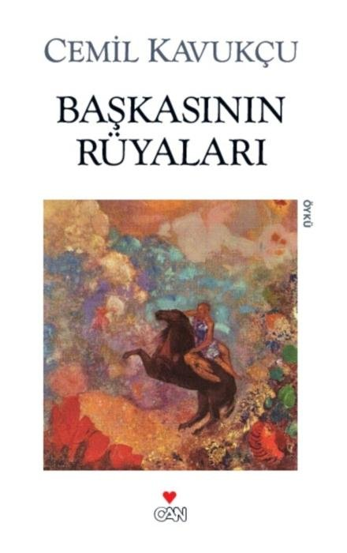 | **Başkasının Rüyaları** | Cemil Kavukçu | [EPUB İndir](https://raw.githubusercontent.com/kimbumuratyavuz/MyneBook-Turkish-Books/main/books/cemil_kavukcu_baskasinin_ruyalari_10053.epub) |
| 10054 |  | **Dört Duvar Beş Pencere** | Cemil Kavukçu | [EPUB İndir](https://raw.githubusercontent.com/kimbumuratyavuz/MyneBook-Turkish-Books/main/books/cemil_kavukcu_dort_duvar_bes_pencere_10054.epub) |
| 10055 |  | **Düşkaçıran** | Cemil Kavukçu | [EPUB İndir](https://raw.githubusercontent.com/kimbumuratyavuz/MyneBook-Turkish-Books/main/books/cemil_kavukcu_duskaciran_10055.epub) |
| 10056 |  | **Gemiler de Ağlarmış** | Cemil Kavukçu | [EPUB İndir](https://raw.githubusercontent.com/kimbumuratyavuz/MyneBook-Turkish-Books/main/books/cemil_kavukcu_gemiler_de_aglarmis_10056.epub) |
| 10057 |  | **O Vakit Son Mimoza** | Cemil Kavukçu | [EPUB İndir](https://raw.githubusercontent.com/kimbumuratyavuz/MyneBook-Turkish-Books/main/books/cemil_kavukcu_o_vakit_son_mimoza_10057.pdf) |
| 10058 |  | **Suda Bulanık Oyunlar** | Cemil Kavukçu | [EPUB İndir](https://raw.githubusercontent.com/kimbumuratyavuz/MyneBook-Turkish-Books/main/books/cemil_kavukcu_suda_bulanik_oyunlar_10058.epub) |
| 10059 | 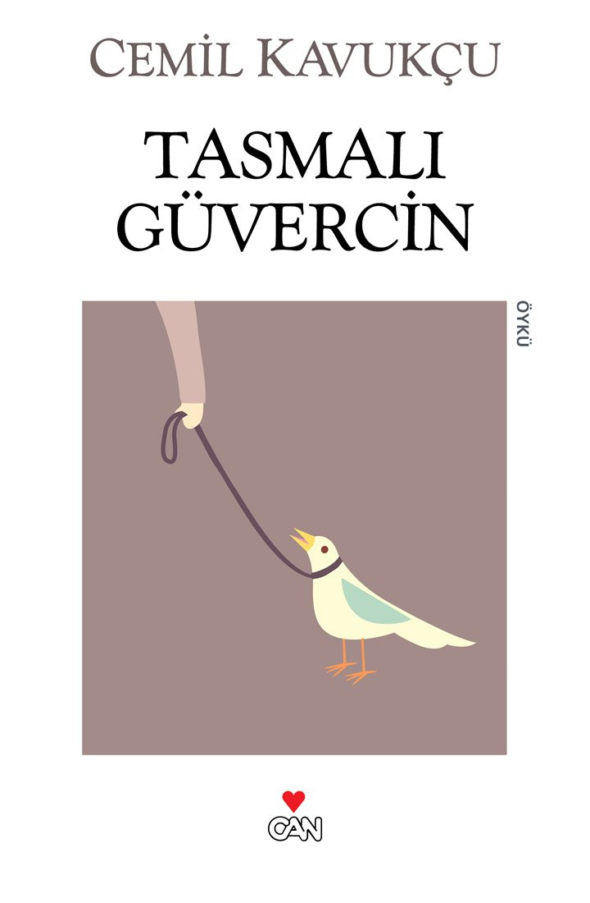 | **Tasmalı Güvercin** | Cemil Kavukçu | [EPUB İndir](https://raw.githubusercontent.com/kimbumuratyavuz/MyneBook-Turkish-Books/main/books/cemil_kavukcu_tasmali_guvercin_10059.epub) |
| 10060 |  | **Yalnız Uyuyanlar İçin** | Cemil Kavukçu | [EPUB İndir](https://raw.githubusercontent.com/kimbumuratyavuz/MyneBook-Turkish-Books/main/books/cemil_kavukcu_yalniz_uyuyanlar_icin_10060.epub) |
| 10061 |  | **Üstü Kalsìn** | Cemil Kavukçu | [EPUB İndir](https://raw.githubusercontent.com/kimbumuratyavuz/MyneBook-Turkish-Books/main/books/cemil_kavukcu_ustu_kals_n_10061.pdf) |
| 10062 | 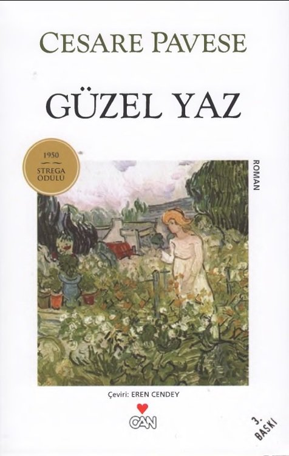 | **Güzel Yaz** | Cesare Pavese | [EPUB İndir](https://raw.githubusercontent.com/kimbumuratyavuz/MyneBook-Turkish-Books/main/books/cesare_pavese_guzel_yaz_10062.epub) |
| 10063 |  | **Tepedeki Ev** | Cesare Pavese | [EPUB İndir](https://raw.githubusercontent.com/kimbumuratyavuz/MyneBook-Turkish-Books/main/books/cesare_pavese_tepedeki_ev_10063.epub) |
| 10064 |  | **Büyük Umutlar** | Charles Dickens | [EPUB İndir](https://raw.githubusercontent.com/kimbumuratyavuz/MyneBook-Turkish-Books/main/books/charles_dickens_buyuk_umutlar_10064.epub) |
| 10065 |  | **Oliver Twist** | Charles Dickens | [EPUB İndir](https://raw.githubusercontent.com/kimbumuratyavuz/MyneBook-Turkish-Books/main/books/charles_dickens_oliver_twist_10065.epub) |
| 10066 |  | **İki Şehrin Hikâyesi** | Charles Dickens | [EPUB İndir](https://raw.githubusercontent.com/kimbumuratyavuz/MyneBook-Turkish-Books/main/books/charles_dickens_iki_sehrin_hik_yesi_10066.epub) |
| 10067 |  | **Jane Eyre** | Charlotte Brontë | [EPUB İndir](https://raw.githubusercontent.com/kimbumuratyavuz/MyneBook-Turkish-Books/main/books/charlotte_bront_jane_eyre_10067.epub) |
| 10068 | 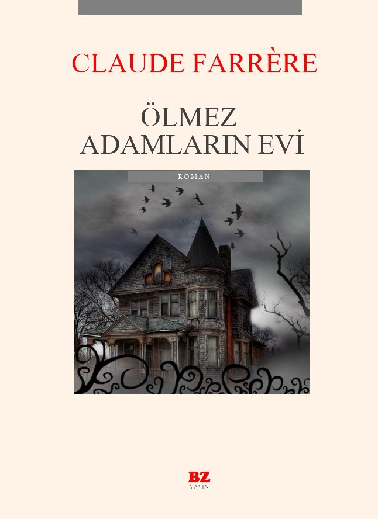 | **Ölmez Adamların Evi** | Claude Farrère | [EPUB İndir](https://raw.githubusercontent.com/kimbumuratyavuz/MyneBook-Turkish-Books/main/books/claude_farr_re_olmez_adamlarin_evi_10068.epub) |
| 10069 | 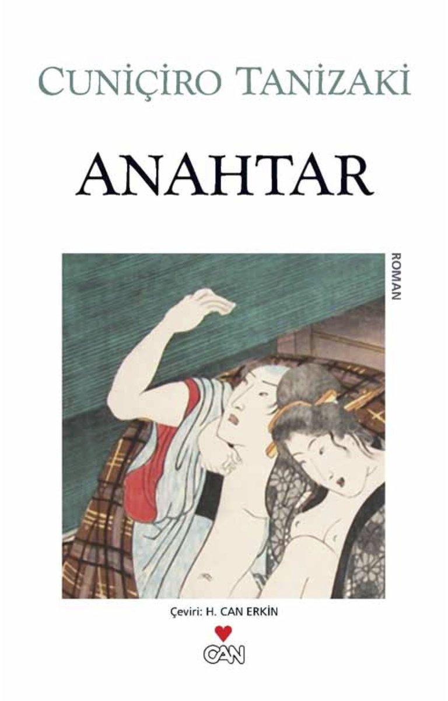 | **Anahtar** | Cuniçiro Tanizaki | [EPUB İndir](https://raw.githubusercontent.com/kimbumuratyavuz/MyneBook-Turkish-Books/main/books/cunic_iro_tanizaki_anahtar_10069.epub) |
| 10070 | 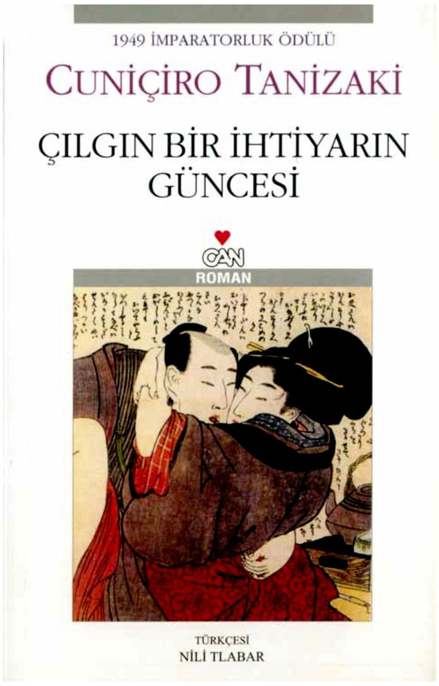 | **Çılgın Bir İhtiyarın Güncesi** | Cuniçiro Tanizaki | [EPUB İndir](https://raw.githubusercontent.com/kimbumuratyavuz/MyneBook-Turkish-Books/main/books/cunic_iro_tanizaki_c_ilgin_bir_i_htiyarin_gu_ncesi_10070.epub) |
| 10071 |  | **Şazende Şunkin** | Cuniçiro Tanizaki | [EPUB İndir](https://raw.githubusercontent.com/kimbumuratyavuz/MyneBook-Turkish-Books/main/books/cunic_iro_tanizaki_s_azende_s_unkin_10071.epub) |
| 10072 | 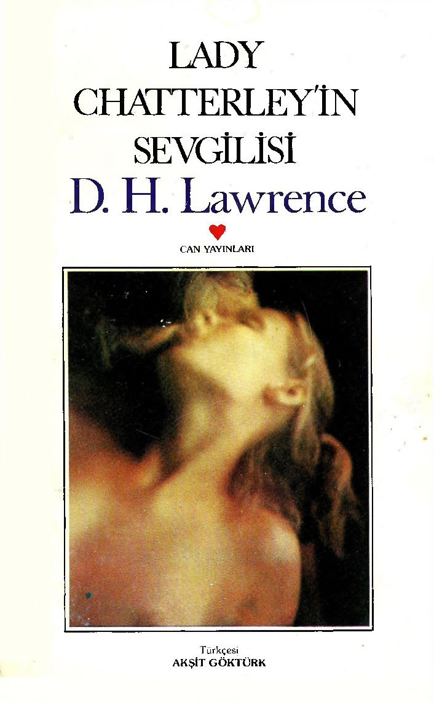 | **Lady Chatterley'in Sevgilisi** | D.H. Lawrence | [EPUB İndir](https://raw.githubusercontent.com/kimbumuratyavuz/MyneBook-Turkish-Books/main/books/d_h_lawrence_lady_chatterley_in_sevgilisi_10072.epub) |
| 10073 |  | **Teşekkür Ederim** | Daniel Pennac | [EPUB İndir](https://raw.githubusercontent.com/kimbumuratyavuz/MyneBook-Turkish-Books/main/books/daniel_pennac_tesekkur_ederim_10073.epub) |
| 10074 |  | **Türk Sokağındaki Ev** | Dashiell Hammett | [EPUB İndir](https://raw.githubusercontent.com/kimbumuratyavuz/MyneBook-Turkish-Books/main/books/dashiell_hammett_turk_sokagindaki_ev_10074.epub) |
| 10075 |  | **Bir Intihar Efsanesi** | David Vann | [EPUB İndir](https://raw.githubusercontent.com/kimbumuratyavuz/MyneBook-Turkish-Books/main/books/david_vann_bir_intihar_efsanesi_10075.pdf) |
| 10076 |  | **Öylesine Bir Aşk** | Dino Buzzati | [EPUB İndir](https://raw.githubusercontent.com/kimbumuratyavuz/MyneBook-Turkish-Books/main/books/dino_buzzati_oylesine_bir_ask_10076.epub) |
| 10077 |  | **Ufacìktìm - Can Yay-1982** | Dora Gabe | [EPUB İndir](https://raw.githubusercontent.com/kimbumuratyavuz/MyneBook-Turkish-Books/main/books/dora_gabe_ufac_kt_m_can_yay_1982_10077.pdf) |
| 10078 | 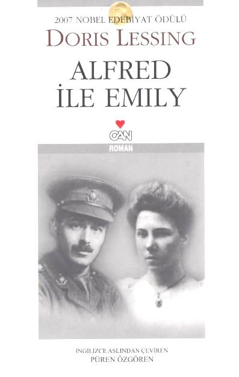 | **Alfred ile Emily** | Doris Lessing | [EPUB İndir](https://raw.githubusercontent.com/kimbumuratyavuz/MyneBook-Turkish-Books/main/books/doris_lessing_alfred_ile_emily_10078.epub) |
| 10079 |  | **Hayatta Kalma Güncesi** | Doris Lessing | [EPUB İndir](https://raw.githubusercontent.com/kimbumuratyavuz/MyneBook-Turkish-Books/main/books/doris_lessing_hayatta_kalma_guncesi_10079.epub) |
| 10080 |  | **Şeytanın İksirleri** | E.T.A. Hoffmann | [EPUB İndir](https://raw.githubusercontent.com/kimbumuratyavuz/MyneBook-Turkish-Books/main/books/e_t_a_hoffmann_seytanin_iksirleri_10080.epub) |
| 10081 |  | **Gölgede ve Güneşte Futbol** | Eduardo Galeano | [EPUB İndir](https://raw.githubusercontent.com/kimbumuratyavuz/MyneBook-Turkish-Books/main/books/eduardo_galeano_golgede_ve_guneste_futbol_10081.epub) |
| 10082 |  | **Gölgede ve Güneƒte Futbol** | Eduardo Galeano | [EPUB İndir](https://raw.githubusercontent.com/kimbumuratyavuz/MyneBook-Turkish-Books/main/books/eduardo_galeano_golgede_ve_gune_te_futbol_10082.pdf) |
| 10083 |  | **Kucaklaşmanın Kitabı** | Eduardo Galeano | [EPUB İndir](https://raw.githubusercontent.com/kimbumuratyavuz/MyneBook-Turkish-Books/main/books/eduardo_galeano_kucakla_man_n_kitab_10083.pdf) |
| 10084 |  | **Ateş Anıları 1 / Yaratılış** | Eduardo Galeano | [EPUB İndir](https://raw.githubusercontent.com/kimbumuratyavuz/MyneBook-Turkish-Books/main/books/eduardo_galeano_yarat_l_ate_an_lar_1_10084.pdf) |
| 10085 |  | **Ateş Anıları III - Rüzgârın Yüzyılı** | Eduardo Galeano | [EPUB İndir](https://raw.githubusercontent.com/kimbumuratyavuz/MyneBook-Turkish-Books/main/books/eduardogaleano_ruzgar_n_yuzy_l_atesanilari3_10085.pdf) |
| 10086 |  | **Germinal** | Emile Zola | [EPUB İndir](https://raw.githubusercontent.com/kimbumuratyavuz/MyneBook-Turkish-Books/main/books/emile_zola_germinal_can_10086.epub) |
| 10087 | 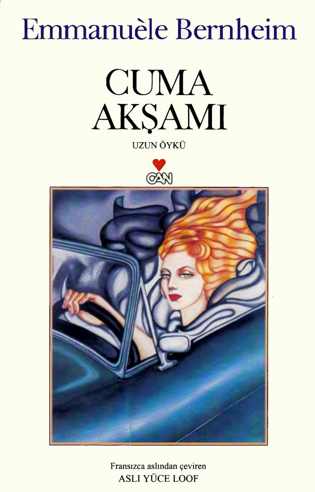 | **Cuma Akşamı** | Emmanuele Bernheim | [EPUB İndir](https://raw.githubusercontent.com/kimbumuratyavuz/MyneBook-Turkish-Books/main/books/emmanuele_bernheim_cuma_aks_ami_10087.epub) |
| 10088 |  | **Onun Karısı** | Emmanuele Bernheim | [EPUB İndir](https://raw.githubusercontent.com/kimbumuratyavuz/MyneBook-Turkish-Books/main/books/emmanuele_bernheim_onun_karisi_10088.epub) |
| 10089 |  | **Sustalı** | Emmanuèle Bernheim | [EPUB İndir](https://raw.githubusercontent.com/kimbumuratyavuz/MyneBook-Turkish-Books/main/books/emmanu_le_bernheim_sustali_10089.epub) |
| 10090 |  | **Gülünün Solduğu Akşam** | Erdal Öz | [EPUB İndir](https://raw.githubusercontent.com/kimbumuratyavuz/MyneBook-Turkish-Books/main/books/erdal_oz_gulunun_soldu_u_ak_am_can_yay_1986_10090.pdf) |
| 10091 |  | **Havada Kar Sesi Var - Can Yay-1987** | Erdal Öz | [EPUB İndir](https://raw.githubusercontent.com/kimbumuratyavuz/MyneBook-Turkish-Books/main/books/erdal_oz_havada_kar_sesi_var_can_yay_1987_10091.pdf) |
| 10092 |  | **Yaralìsìn - Can Yayìnlarì - 1983** | Erdal Öz | [EPUB İndir](https://raw.githubusercontent.com/kimbumuratyavuz/MyneBook-Turkish-Books/main/books/erdal_oz_yaral_s_n_can_yay_nlar_1983_10092.pdf) |
| 10093 | 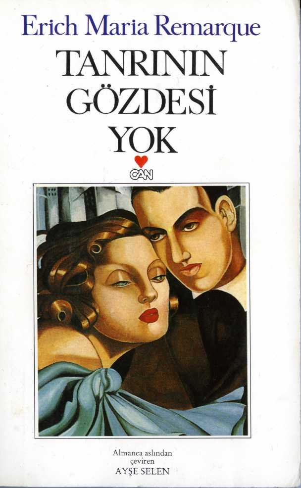 | **Tanrının Gözdesi Yok** | Erich Maria Remarque | [EPUB İndir](https://raw.githubusercontent.com/kimbumuratyavuz/MyneBook-Turkish-Books/main/books/erich_maria_remarque_tanrinin_gozdesi_yok_10093.epub) |
| 10094 |  | **Yaşamak Zamanı Ölmek Zamanı** | Erich Maria Remarque | [EPUB İndir](https://raw.githubusercontent.com/kimbumuratyavuz/MyneBook-Turkish-Books/main/books/erich_maria_remarque_yasamak_zamani_olmek_zamani_10094.epub) |
| 10095 | 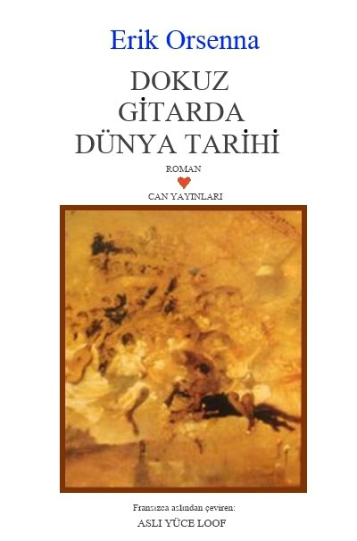 | **Dokuz Gitarda Dünya Tarihi** | Erik Orsenna | [EPUB İndir](https://raw.githubusercontent.com/kimbumuratyavuz/MyneBook-Turkish-Books/main/books/erik_orsenna_dokuz_gitarda_dunya_tarihi_10095.epub) |
| 10096 |  | **Tatsìz Bir Olay** | F. M. Dostoyevski | [EPUB İndir](https://raw.githubusercontent.com/kimbumuratyavuz/MyneBook-Turkish-Books/main/books/f_m_dostoyevski_tats_z_bir_olay_10096.pdf) |
| 10097 |  | **Pal Sokağı Çocukları** | Ferenc Molnar | [EPUB İndir](https://raw.githubusercontent.com/kimbumuratyavuz/MyneBook-Turkish-Books/main/books/ferenc_molnar_pal_sokagi_cocuklari_10097.epub) |
| 10098 |  | **Anarşist Banker - Şeytanın Saati** | Fernando Pessoa | [EPUB İndir](https://raw.githubusercontent.com/kimbumuratyavuz/MyneBook-Turkish-Books/main/books/fernando_pessoa_anarsist_banker_seytanin_saati_10098.epub) |
| 10099 |  | **Huzursuzluğun Kitabı** | Fernando Pessoa | [EPUB İndir](https://raw.githubusercontent.com/kimbumuratyavuz/MyneBook-Turkish-Books/main/books/fernando_pessoa_huzursuzlugun_kitabi_10099.epub) |
| 10101 |  | **Amerika** | Franz Kafka | [EPUB İndir](https://raw.githubusercontent.com/kimbumuratyavuz/MyneBook-Turkish-Books/main/books/franz_kafka_amerika_10101.epub) |
| 10102 |  | **Babaya Mektup** | Franz Kafka | [EPUB İndir](https://raw.githubusercontent.com/kimbumuratyavuz/MyneBook-Turkish-Books/main/books/franz_kafka_babaya_mektup_10102.epub) |
| 10103 |  | **Ceza Kolonisinde** | Franz Kafka | [EPUB İndir](https://raw.githubusercontent.com/kimbumuratyavuz/MyneBook-Turkish-Books/main/books/franz_kafka_ceza_kolonisinde_10103.epub) |
| 10104 |  | **Dava** | Franz Kafka | [EPUB İndir](https://raw.githubusercontent.com/kimbumuratyavuz/MyneBook-Turkish-Books/main/books/franz_kafka_dava_10104.epub) |
| 10105 |  | **Donusum** | Franz Kafka | [EPUB İndir](https://raw.githubusercontent.com/kimbumuratyavuz/MyneBook-Turkish-Books/main/books/franz_kafka_donusum_10105.pdf) |
| 10106 |  | **Günübirlik Acı** | Françoise Sagan | [EPUB İndir](https://raw.githubusercontent.com/kimbumuratyavuz/MyneBook-Turkish-Books/main/books/francoise_sagan_gunubirlik_aci_10106.epub) |
| 10107 |  | **Yeryüzü Ayetleri** | Füruğ Ferruhzad | [EPUB İndir](https://raw.githubusercontent.com/kimbumuratyavuz/MyneBook-Turkish-Books/main/books/furu_ferruhzad_yeryuzu_ayetleri_can_yay_nlar_10107.pdf) |
| 10108 |  | **Yufka Yürek** | Fyodor Mihailoviç Dostoyevski | [EPUB İndir](https://raw.githubusercontent.com/kimbumuratyavuz/MyneBook-Turkish-Books/main/books/fyodor_mihailovic_dostoyevski_yufka_yurek_can_yayinlari_10108.epub) |
| 10109 | 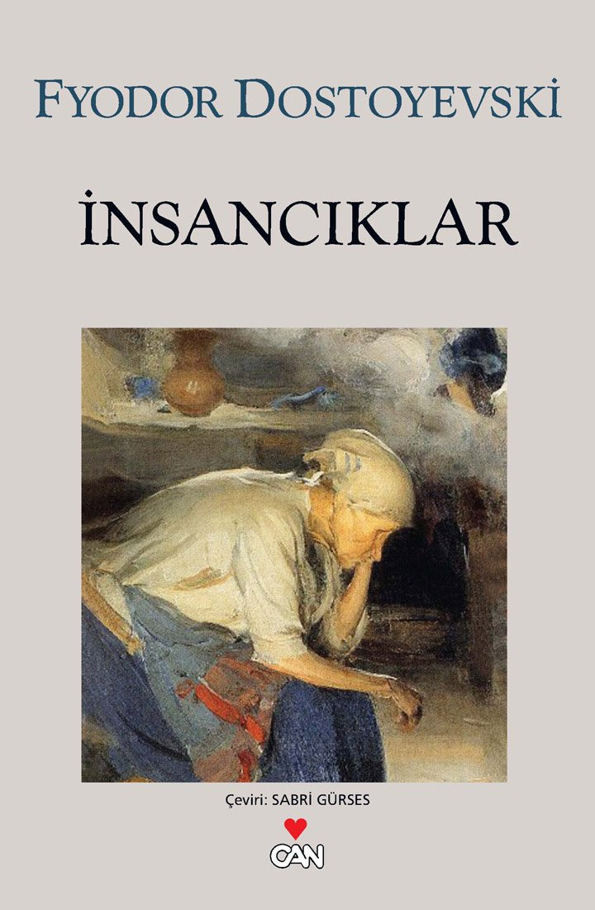 | **İnsancıklar** | Fyodor Mihailoviç Dostoyevski | [EPUB İndir](https://raw.githubusercontent.com/kimbumuratyavuz/MyneBook-Turkish-Books/main/books/fyodor_mihailovic_dostoyevski_insanciklar_can_10109.epub) |
| 10110 | 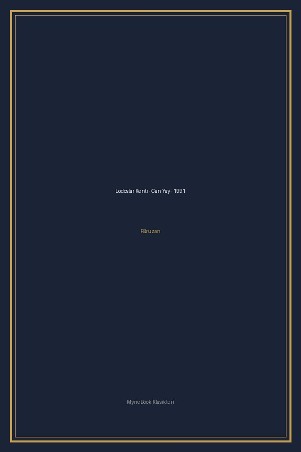 | **Lodoslar Kenti** | Füruzan | [EPUB İndir](https://raw.githubusercontent.com/kimbumuratyavuz/MyneBook-Turkish-Books/main/books/furuzan_lodoslar_kenti_can_yay_1991_10110.pdf) |
| 10111 | 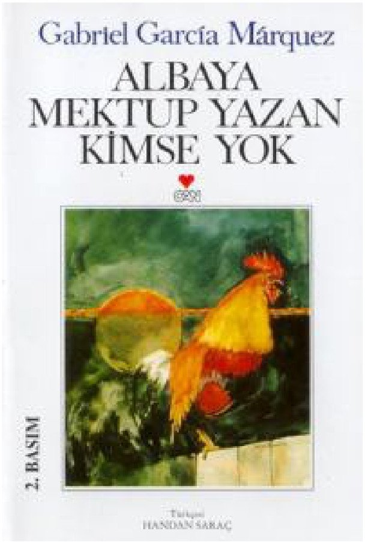 | **Albaya Mektup Yazan Kimse Yok** | Gabriel Garcia Marquez | [EPUB İndir](https://raw.githubusercontent.com/kimbumuratyavuz/MyneBook-Turkish-Books/main/books/gabriel_garcia_marquez_albaya_mektup_yazan_kimse_yok_10111.epub) |
| 10112 |  | **Anlatmak Icin Yasamak** | Gabriel Garcia Marquez | [EPUB İndir](https://raw.githubusercontent.com/kimbumuratyavuz/MyneBook-Turkish-Books/main/books/gabriel_garcia_marquez_anlatmak_icin_yasamak_10112.pdf) |
| 10113 | 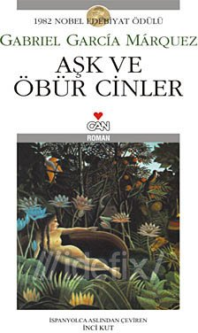 | **Aşk ve Öbür Cinler** | Gabriel Garcia Marquez | [EPUB İndir](https://raw.githubusercontent.com/kimbumuratyavuz/MyneBook-Turkish-Books/main/books/gabriel_garcia_marquez_ask_ve_obur_cinler_10113.epub) |
| 10114 |  | **Başkan Babamızın Sonbaharı** | Gabriel Garcia Marquez | [EPUB İndir](https://raw.githubusercontent.com/kimbumuratyavuz/MyneBook-Turkish-Books/main/books/gabriel_garcia_marquez_baskan_babamizin_sonbahari_10114.epub) |
| 10115 |  | **Bir Kaçırılma Öyküsü** | Gabriel Garcia Marquez | [EPUB İndir](https://raw.githubusercontent.com/kimbumuratyavuz/MyneBook-Turkish-Books/main/books/gabriel_garcia_marquez_bir_kac_r_lma_oykusu_10115.pdf) |
| 10116 |  | **Hanım Ana'nın Cenaze Töreni** | Gabriel Garcia Marquez | [EPUB İndir](https://raw.githubusercontent.com/kimbumuratyavuz/MyneBook-Turkish-Books/main/books/gabriel_garcia_marquez_han_m_ana_n_n_cenaze_toreni_10116.pdf) |
| 10117 |  | **Kolera Günlerinde Aşk** | Gabriel Garcia Marquez | [EPUB İndir](https://raw.githubusercontent.com/kimbumuratyavuz/MyneBook-Turkish-Books/main/books/gabriel_garcia_marquez_kolera_gunlerinde_a_k_10117.pdf) |
| 10118 |  | **Kırmızı Pazartesi** | Gabriel Garcia Marquez | [EPUB İndir](https://raw.githubusercontent.com/kimbumuratyavuz/MyneBook-Turkish-Books/main/books/gabriel_garcia_marquez_kirmizi_pazartesi_10118.epub) |
| 10119 |  | **On İki Gezici Öykü** | Gabriel Garcia Marquez | [EPUB İndir](https://raw.githubusercontent.com/kimbumuratyavuz/MyneBook-Turkish-Books/main/books/gabriel_garcia_marquez_on_ki_gezici_oyku_10119.pdf) |
| 10120 |  | **Yaprak Fırtınası** | Gabriel Garcia Marquez | [EPUB İndir](https://raw.githubusercontent.com/kimbumuratyavuz/MyneBook-Turkish-Books/main/books/gabriel_garcia_marquez_yaprak_f_rt_nas_10120.pdf) |
| 10121 |  | **Yüzyıllık Yalnızlık** | Gabriel Garcia Marquez | [EPUB İndir](https://raw.githubusercontent.com/kimbumuratyavuz/MyneBook-Turkish-Books/main/books/gabriel_garcia_marquez_yuzy_ll_k_yaln_zl_k_10121.pdf) |
| 10122 |  | **Şer Saati** | Gabriel Garcia Marquez | [EPUB İndir](https://raw.githubusercontent.com/kimbumuratyavuz/MyneBook-Turkish-Books/main/books/gabriel_garcia_marquez_er_saati_10122.pdf) |
| 10123 |  | **İyi Kalpli Erendira** | Gabriel Garcia Marquez | [EPUB İndir](https://raw.githubusercontent.com/kimbumuratyavuz/MyneBook-Turkish-Books/main/books/gabriel_garcia_marquez_yi_kalpli_erendira_10123.pdf) |
| 10124 |  | **Benim Hüzünlü Orospularım** | Gabriel Garcí­a Márquez | [EPUB İndir](https://raw.githubusercontent.com/kimbumuratyavuz/MyneBook-Turkish-Books/main/books/gabriel_garc_a_m_rquez_benim_huzunlu_orospularim_10124.epub) |
| 10125 |  | **Kolera Günlerinde Aşk** | Gabriel Garcia Marquez | [EPUB İndir](https://raw.githubusercontent.com/kimbumuratyavuz/MyneBook-Turkish-Books/main/books/gabriel_garcia_marquez_kolera_gunlerinde_ask_10125.epub) |
| 10127 |  | **Aspidistra** | George Orwell | [EPUB İndir](https://raw.githubusercontent.com/kimbumuratyavuz/MyneBook-Turkish-Books/main/books/george_orwell_aspidistra_10127.epub) |
| 10128 | 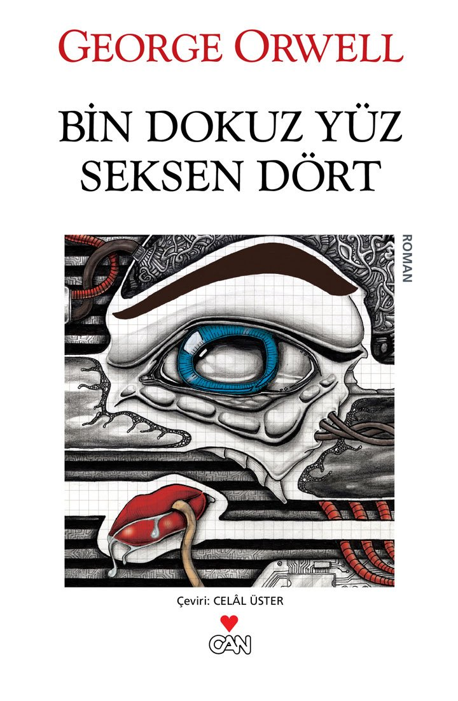 | **Bin Dokuz Yüz Seksen Dört** | George Orwell | [EPUB İndir](https://raw.githubusercontent.com/kimbumuratyavuz/MyneBook-Turkish-Books/main/books/george_orwell_bin_dokuz_yuz_seksen_dort_10128.epub) |
| 10129 | 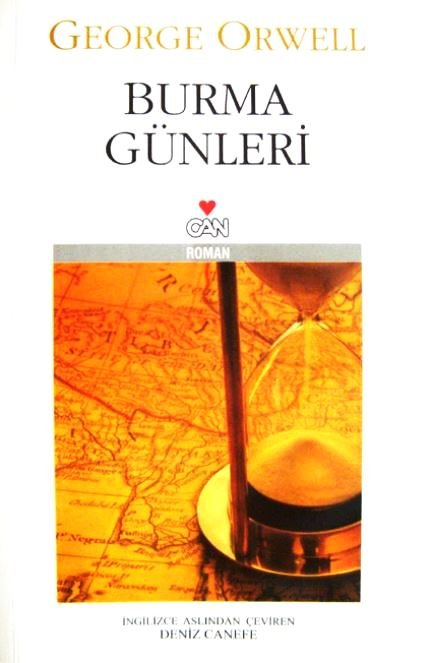 | **Burma Günleri** | George Orwell | [EPUB İndir](https://raw.githubusercontent.com/kimbumuratyavuz/MyneBook-Turkish-Books/main/books/george_orwell_burma_gunleri_10129.epub) |
| 10130 |  | **Hayvan Çiftliği** | George Orwell | [EPUB İndir](https://raw.githubusercontent.com/kimbumuratyavuz/MyneBook-Turkish-Books/main/books/george_orwell_hayvan_ciftligi_10130.epub) |
| 10131 |  | **Seçilmiş Mektuplar** | Goethe | [EPUB İndir](https://raw.githubusercontent.com/kimbumuratyavuz/MyneBook-Turkish-Books/main/books/goethe_secilmi_mektuplar_can_yay_nlar_10131.pdf) |
| 10132 |  | **Ay Işığı** | Guy de Maupassant | [EPUB İndir](https://raw.githubusercontent.com/kimbumuratyavuz/MyneBook-Turkish-Books/main/books/guy_de_maupassant_ay_isigi_10132.epub) |
| 10133 | 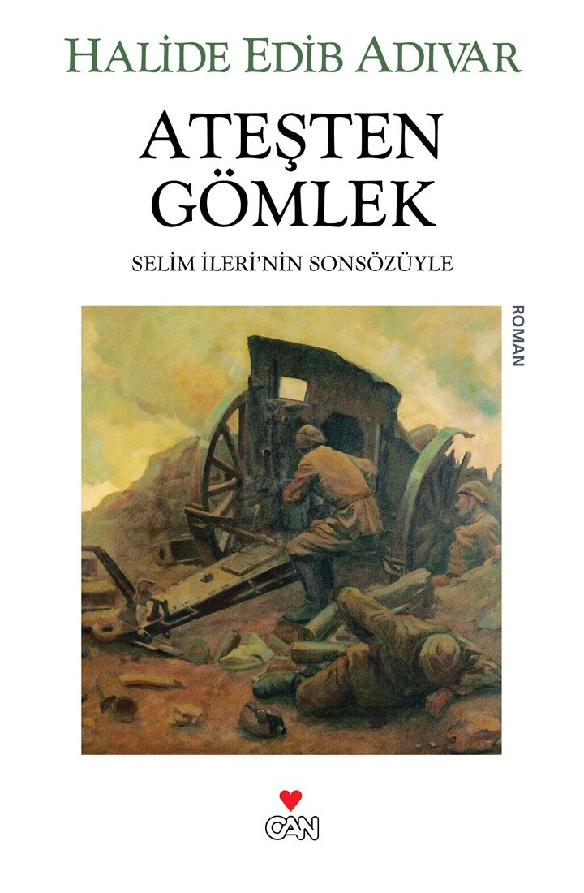 | **Ateşten Gömlek** | Halide Edib Adıvar | [EPUB İndir](https://raw.githubusercontent.com/kimbumuratyavuz/MyneBook-Turkish-Books/main/books/halide_edib_adivar_atesten_gomlek_10133.epub) |
| 10134 |  | **Handan** | Halide Edib Adıvar | [EPUB İndir](https://raw.githubusercontent.com/kimbumuratyavuz/MyneBook-Turkish-Books/main/books/halide_edib_adivar_handan_10134.epub) |
| 10135 |  | **Kalp Ağrısı** | Halide Edib Adıvar | [EPUB İndir](https://raw.githubusercontent.com/kimbumuratyavuz/MyneBook-Turkish-Books/main/books/halide_edib_adivar_kalp_agrisi_10135.epub) |
| 10136 | 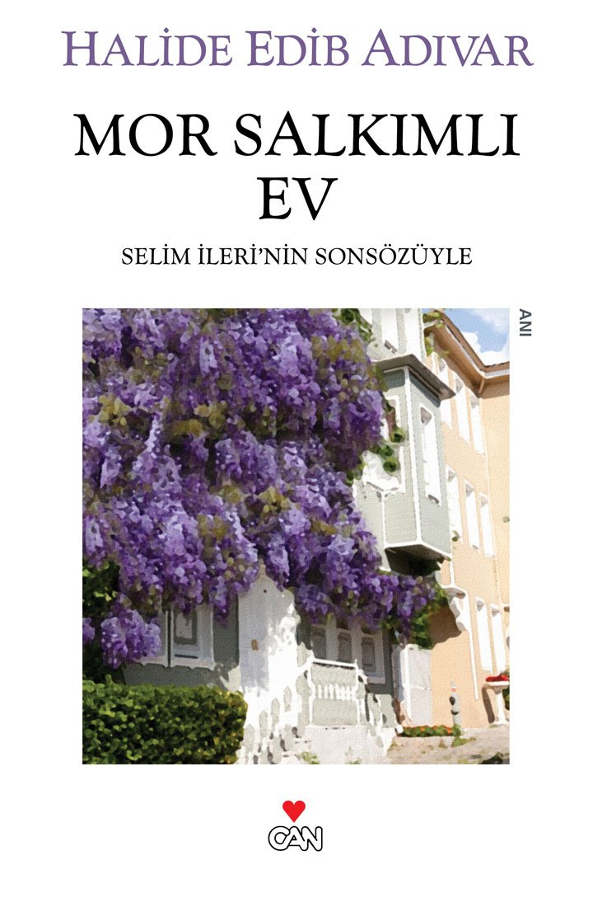 | **Mor Salkımlı Ev** | Halide Edib Adıvar | [EPUB İndir](https://raw.githubusercontent.com/kimbumuratyavuz/MyneBook-Turkish-Books/main/books/halide_edib_adivar_mor_salkimli_ev_10136.epub) |
| 10137 | 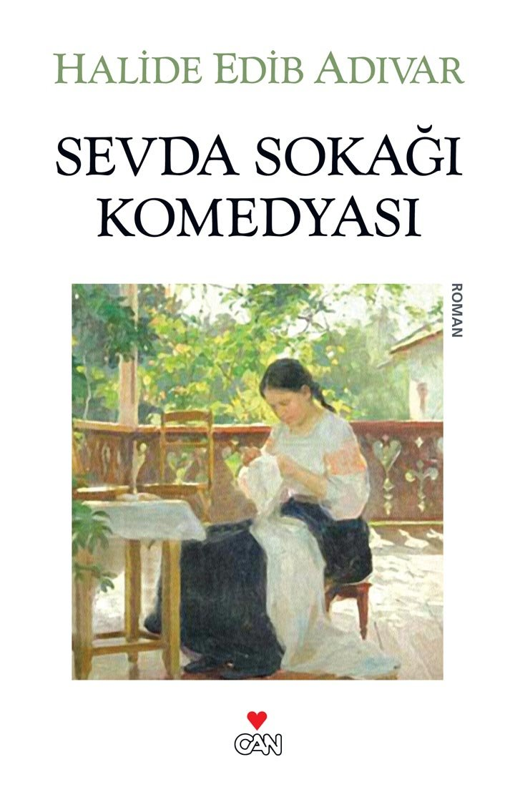 | **Sevda Sokağı Komedyası** | Halide Edib Adıvar | [EPUB İndir](https://raw.githubusercontent.com/kimbumuratyavuz/MyneBook-Turkish-Books/main/books/halide_edib_adivar_sevda_sokagi_komedyasi_10137.epub) |
| 10138 |  | **Sinekli Bakkal** | Halide Edib Adıvar | [EPUB İndir](https://raw.githubusercontent.com/kimbumuratyavuz/MyneBook-Turkish-Books/main/books/halide_edib_adivar_sinekli_bakkal_10138.epub) |
| 10139 |  | **Tatarcık** | Halide Edib Adıvar | [EPUB İndir](https://raw.githubusercontent.com/kimbumuratyavuz/MyneBook-Turkish-Books/main/books/halide_edib_adivar_tatarcik_10139.epub) |
| 10140 |  | **Türk'ün Ateşle İmtihanı** | Halide Edib Adıvar | [EPUB İndir](https://raw.githubusercontent.com/kimbumuratyavuz/MyneBook-Turkish-Books/main/books/halide_edib_adivar_tu_rk_u_n_atesle_imtihani_10140.epub) |
| 10142 |  | **Vurun Kahpeye** | Halide Edib Adıvar | [EPUB İndir](https://raw.githubusercontent.com/kimbumuratyavuz/MyneBook-Turkish-Books/main/books/halide_edib_adivar_vurun_kahpeye_10142.epub) |
| 10143 | 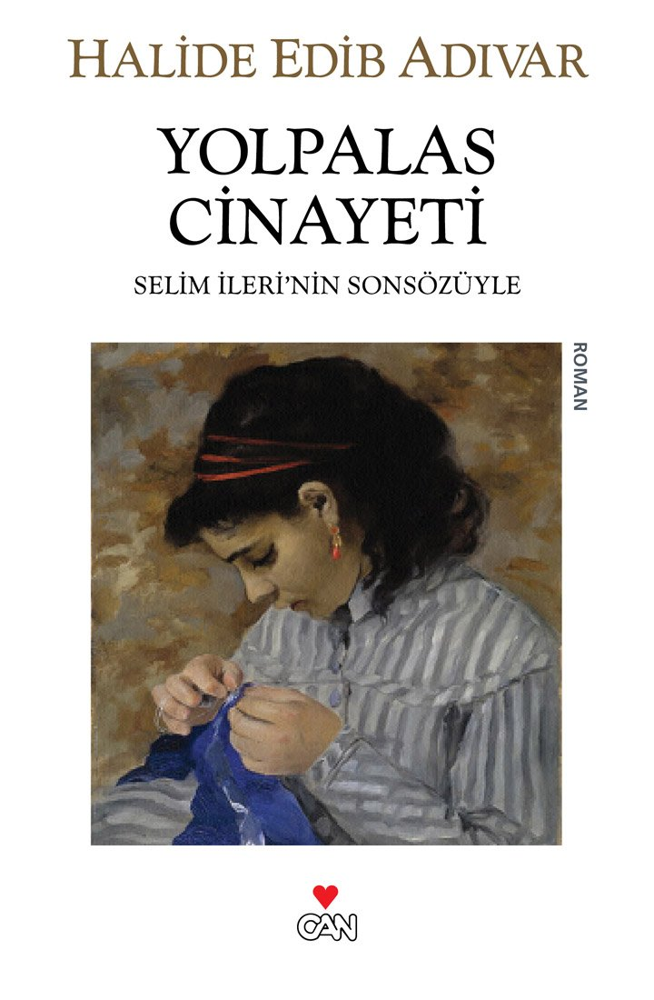 | **Yolpalas Cinayeti** | Halide Edib Adıvar | [EPUB İndir](https://raw.githubusercontent.com/kimbumuratyavuz/MyneBook-Turkish-Books/main/books/halide_edib_adivar_yolpalas_cinayeti_10143.epub) |
| 10144 |  | **Çaresaz** | Halide Edib Adıvar | [EPUB İndir](https://raw.githubusercontent.com/kimbumuratyavuz/MyneBook-Turkish-Books/main/books/halide_edib_adivar_caresaz_10144.epub) |
| 10145 |  | **Mavi Melek-Profesör Unrat** | Heinrich Mann | [EPUB İndir](https://raw.githubusercontent.com/kimbumuratyavuz/MyneBook-Turkish-Books/main/books/heinrich_mann_mavi_melek_profesor_unrat_can_yay_1992_10145.pdf) |
| 10146 |  | **Çocuk ve Irmak** | Henri Bosco | [EPUB İndir](https://raw.githubusercontent.com/kimbumuratyavuz/MyneBook-Turkish-Books/main/books/henri_bosco_cocuk_ve_irmak_can_yay_1982_10146.pdf) |
| 10147 | 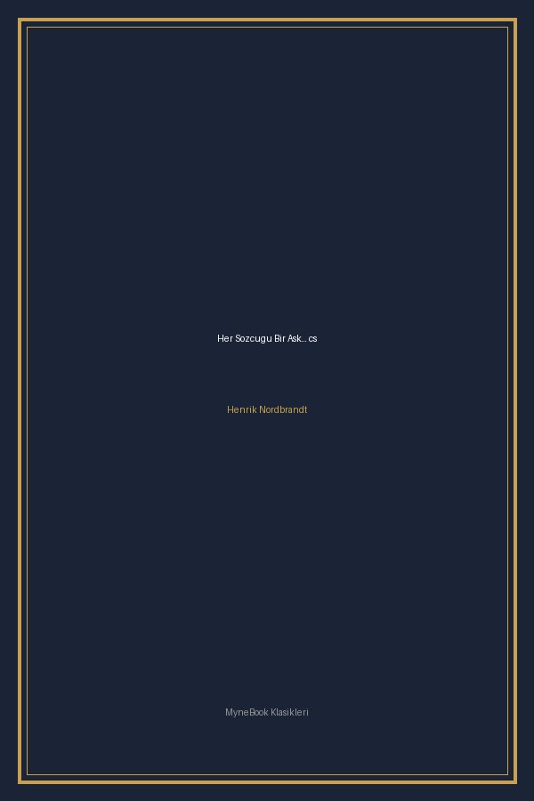 | **Her Sözcüğü Bir Aşk** | Henrik Nordbrandt | [EPUB İndir](https://raw.githubusercontent.com/kimbumuratyavuz/MyneBook-Turkish-Books/main/books/henrik_nordbrandt_her_sozcugu_bir_ask_cs_10147.pdf) |
| 10148 |  | **Masallar** | Hermann Hesse | [EPUB İndir](https://raw.githubusercontent.com/kimbumuratyavuz/MyneBook-Turkish-Books/main/books/hermann_hesse_masallar_10148.pdf) |
| 10149 |  | **Aydınlar Üzerine** | Jean Paul Sartre | [EPUB İndir](https://raw.githubusercontent.com/kimbumuratyavuz/MyneBook-Turkish-Books/main/books/jean_paul_sartre_ayd_nlar_uzerine_10149.pdf) |
| 10150 |  | **Bulantı** | Jean Paul Sartre | [EPUB İndir](https://raw.githubusercontent.com/kimbumuratyavuz/MyneBook-Turkish-Books/main/books/jean_paul_sartre_bulant_10150.pdf) |
| 10151 |  | **Edebiyat Nedir** | Jean Paul Sartre | [EPUB İndir](https://raw.githubusercontent.com/kimbumuratyavuz/MyneBook-Turkish-Books/main/books/jean_paul_sartre_edebiyat_nedir_10151.pdf) |
| 10152 |  | **Sözcükler** | Jean Paul Sartre | [EPUB İndir](https://raw.githubusercontent.com/kimbumuratyavuz/MyneBook-Turkish-Books/main/books/jean_paul_sartre_sozcukler_10152.pdf) |
| 10153 |  | **Özgürlük Yolları 1 Akıl Çağı** | Jean Paul Sartre | [EPUB İndir](https://raw.githubusercontent.com/kimbumuratyavuz/MyneBook-Turkish-Books/main/books/jean_paul_sartre_ozgurluk_yollar_1_ak_l_ca_10153.pdf) |
| 10154 | 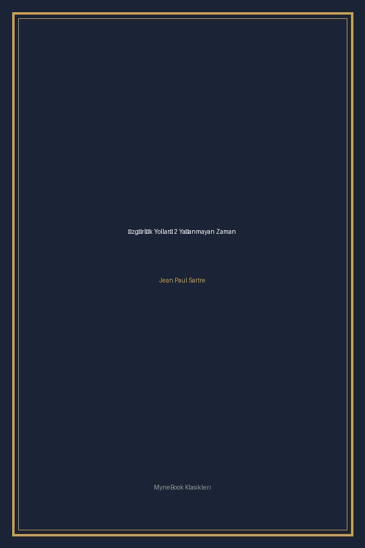 | **Özgürlük Yolları 2 Yaşanmayan Zaman** | Jean Paul Sartre | [EPUB İndir](https://raw.githubusercontent.com/kimbumuratyavuz/MyneBook-Turkish-Books/main/books/jean_paul_sartre_ozgurluk_yollar_2_ya_anmayan_zaman_10154.pdf) |
| 10155 |  | **Özgürlük Yolları 3 Yıkılış** | Jean Paul Sartre | [EPUB İndir](https://raw.githubusercontent.com/kimbumuratyavuz/MyneBook-Turkish-Books/main/books/jean_paul_sartre_ozgurluk_yollar_3_y_k_l_10155.pdf) |
| 10156 |  | **Kızgın Toprak** | Jorge Amado | [EPUB İndir](https://raw.githubusercontent.com/kimbumuratyavuz/MyneBook-Turkish-Books/main/books/jorge_amado_k_zg_n_toprak_10156.pdf) |
| 10157 | 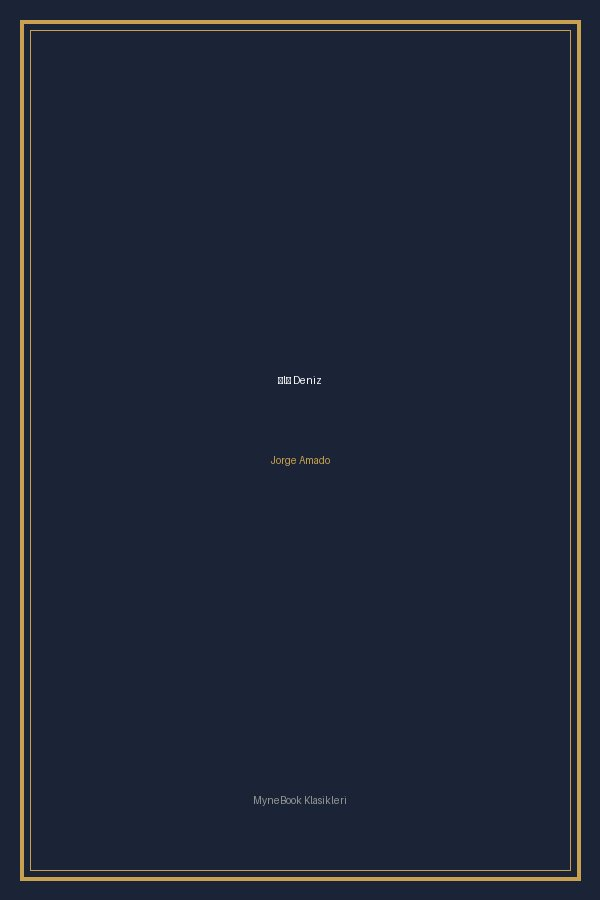 | **Ölü Deniz** | Jorge Amado | [EPUB İndir](https://raw.githubusercontent.com/kimbumuratyavuz/MyneBook-Turkish-Books/main/books/jorge_amado_olu_deniz_10157.pdf) |
| 10158 | 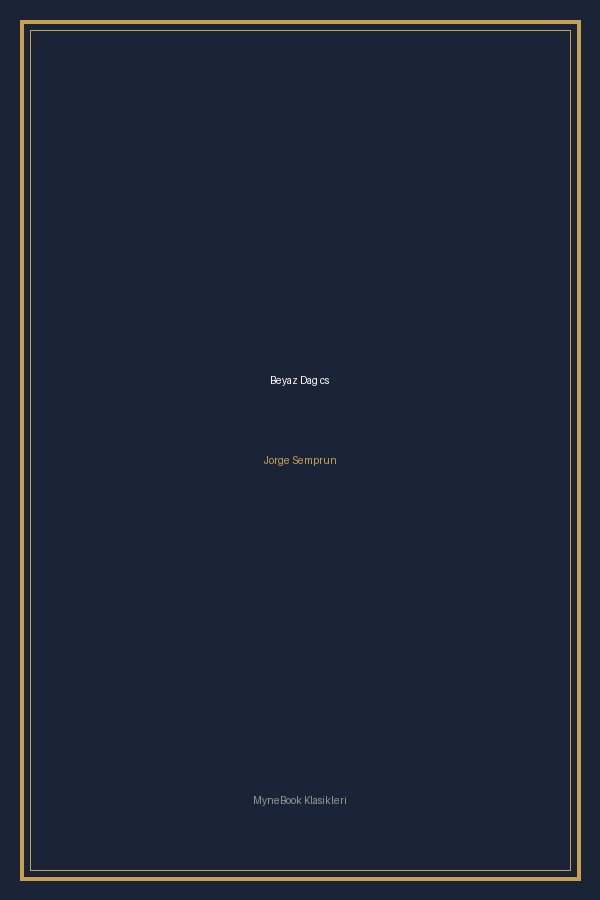 | **Beyaz Dağ** | Jorge Semprun | [EPUB İndir](https://raw.githubusercontent.com/kimbumuratyavuz/MyneBook-Turkish-Books/main/books/jorge_semprun_beyaz_dag_cs_10158.pdf) |
| 10159 |  | **Bir Ölü Lazım** | Jorge Semprun | [EPUB İndir](https://raw.githubusercontent.com/kimbumuratyavuz/MyneBook-Turkish-Books/main/books/jorge_semprun_bir_olu_laz_m_10159.pdf) |
| 10160 |  | **Hoşçakal Güzel Aydınlık** | Jorge Semprun | [EPUB İndir](https://raw.githubusercontent.com/kimbumuratyavuz/MyneBook-Turkish-Books/main/books/jorge_semprun_ho_cakal_guzel_ayd_nl_k_10160.pdf) |
| 10161 |  | **Ramon Mercaderin İkinci Ölümü** | Jorge Semprun | [EPUB İndir](https://raw.githubusercontent.com/kimbumuratyavuz/MyneBook-Turkish-Books/main/books/jorge_semprun_ramon_mercaderin_kinci_olumu_c_s_10161.pdf) |
| 10162 |  | **Şeker Portakalı** | Jose Mauro De Vasconcelos | [EPUB İndir](https://raw.githubusercontent.com/kimbumuratyavuz/MyneBook-Turkish-Books/main/books/jose_mauro_de_vasconcelos_seker_portakali_10162.epub) |
| 10163 |  | **Kuşatma Hali** | Juan Goytisolo | [EPUB İndir](https://raw.githubusercontent.com/kimbumuratyavuz/MyneBook-Turkish-Books/main/books/juan_goytisolo_kusatma_hali_10163.pdf) |
| 10164 | 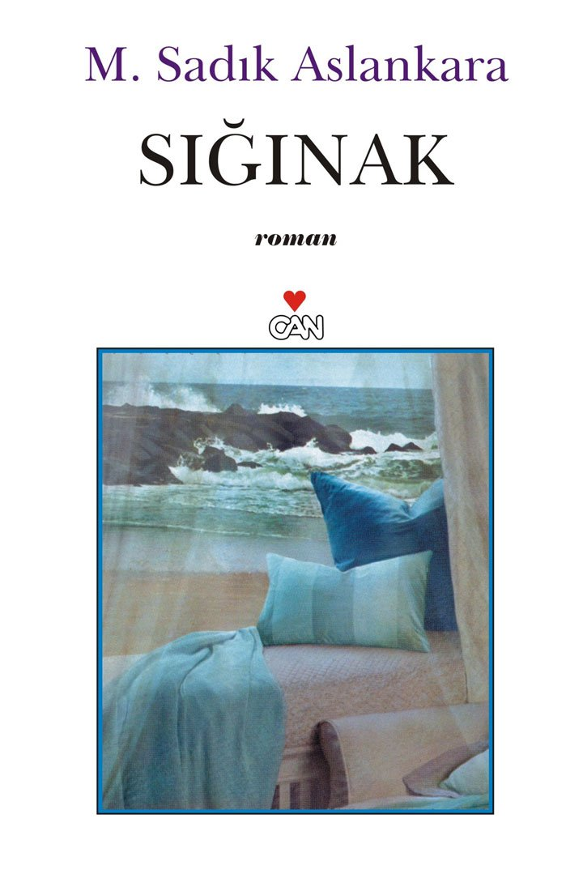 | **Sığınak** | M. Sadık Aslankara | [EPUB İndir](https://raw.githubusercontent.com/kimbumuratyavuz/MyneBook-Turkish-Books/main/books/m_sadik_aslankara_siginak_10164.epub) |
| 10165 | 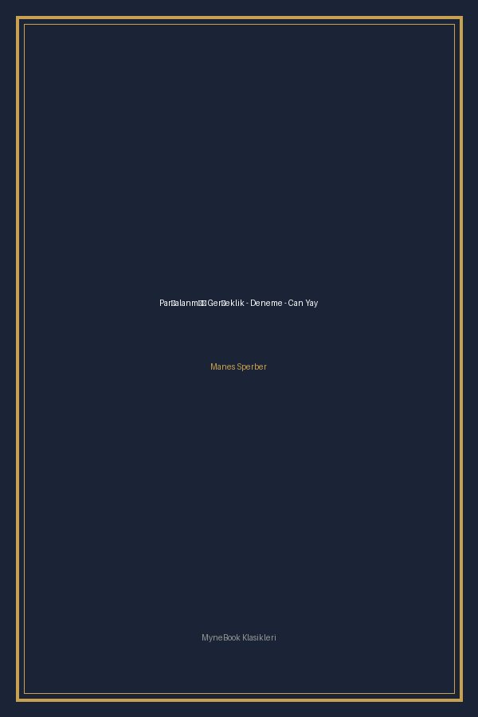 | **Parçalanmış Gerçeklik - Deneme** | Manes Sperber | [EPUB İndir](https://raw.githubusercontent.com/kimbumuratyavuz/MyneBook-Turkish-Books/main/books/manes_sperber_parcalanm_gerceklik_deneme_can_yay_1991_10165.pdf) |
| 10166 |  | **Dostlarım ve Aşklarım** | Marc Levy | [EPUB İndir](https://raw.githubusercontent.com/kimbumuratyavuz/MyneBook-Turkish-Books/main/books/marc_levy_dostlar_m_ve_asklar_m_cs_10166.pdf) |
| 10167 |  | **Sizi Tekrar Görmek** | Marc Levy | [EPUB İndir](https://raw.githubusercontent.com/kimbumuratyavuz/MyneBook-Turkish-Books/main/books/marc_levy_sizi_tekrar_gormek_c_s_10167.pdf) |
| 10168 |  | **Özgürlük ÿçin c s** | Marc Levy | [EPUB İndir](https://raw.githubusercontent.com/kimbumuratyavuz/MyneBook-Turkish-Books/main/books/marc_levy_ozgurluk_cin_c_s_10168.pdf) |
| 10169 |  | **Askìya Alìnmìs Tutku** | Marguerite Duras | [EPUB İndir](https://raw.githubusercontent.com/kimbumuratyavuz/MyneBook-Turkish-Books/main/books/marguerite_duras_ask_ya_al_nm_s_tutku_10169.pdf) |
| 10170 |  | **Bahce** | Marguerite Duras | [EPUB İndir](https://raw.githubusercontent.com/kimbumuratyavuz/MyneBook-Turkish-Books/main/books/marguerite_duras_bahce_10170.pdf) |
| 10171 | 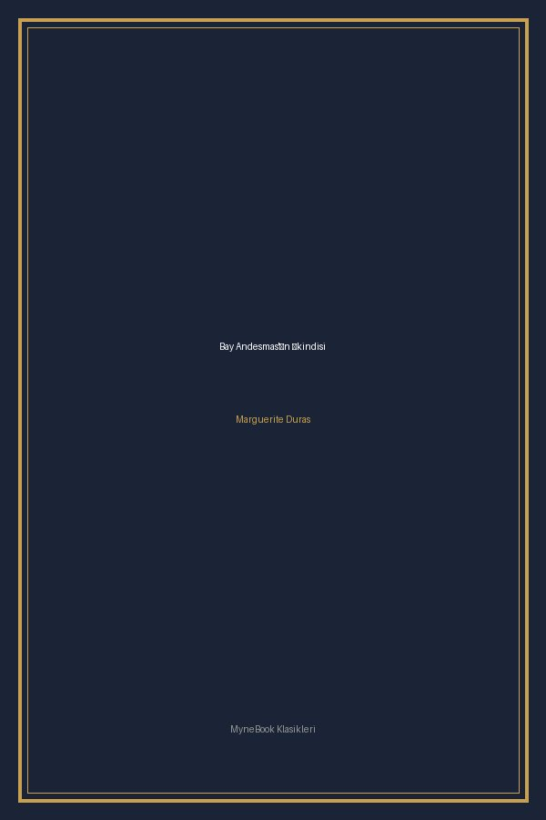 | **Bay Andesmas'ìn ÿkindisi** | Marguerite Duras | [EPUB İndir](https://raw.githubusercontent.com/kimbumuratyavuz/MyneBook-Turkish-Books/main/books/marguerite_duras_bay_andesmas_n_kindisi_10171.pdf) |
| 10172 |  | **Bir Kìs Gunu Ogleden Sonra** | Marguerite Duras | [EPUB İndir](https://raw.githubusercontent.com/kimbumuratyavuz/MyneBook-Turkish-Books/main/books/marguerite_duras_bir_k_s_gunu_ogleden_sonra_10172.pdf) |
| 10173 |  | **Denemeler - Somut Yaƒam - Can Yay-1996** | Marguerite Duras | [EPUB İndir](https://raw.githubusercontent.com/kimbumuratyavuz/MyneBook-Turkish-Books/main/books/marguerite_duras_denemeler_somut_ya_am_can_yay_1996_10173.pdf) |
| 10174 |  | **Mavi Gozler Siyah Saclar** | Marguerite Duras | [EPUB İndir](https://raw.githubusercontent.com/kimbumuratyavuz/MyneBook-Turkish-Books/main/books/marguerite_duras_mavi_gozler_siyah_saclar_10174.pdf) |
| 10175 |  | **Pasifik'e Karsi Bir Bent** | Marguerite Duras | [EPUB İndir](https://raw.githubusercontent.com/kimbumuratyavuz/MyneBook-Turkish-Books/main/books/marguerite_duras_pasifik_e_karsi_bir_bent_10175.pdf) |
| 10176 |  | **Tarquinia'nìn Kucuk Atlari** | Marguerite Duras | [EPUB İndir](https://raw.githubusercontent.com/kimbumuratyavuz/MyneBook-Turkish-Books/main/books/marguerite_duras_tarquinia_n_n_kucuk_atlari_10176.pdf) |
| 10177 |  | **And Daºlarìnda Terör** | Mario Vargas Llosa | [EPUB İndir](https://raw.githubusercontent.com/kimbumuratyavuz/MyneBook-Turkish-Books/main/books/mario_vargas_llosa_and_da_lar_nda_teror_10177.pdf) |
| 10178 |  | **Elebaƒìlar Hergeleler** | Mario Vargas Llosa | [EPUB İndir](https://raw.githubusercontent.com/kimbumuratyavuz/MyneBook-Turkish-Books/main/books/mario_vargas_llosa_eleba_lar_hergeleler_10178.pdf) |
| 10179 |  | **Kelt Rüyasì** | Mario Vargas Llosa | [EPUB İndir](https://raw.githubusercontent.com/kimbumuratyavuz/MyneBook-Turkish-Books/main/books/mario_vargas_llosa_kelt_ruyas_10179.pdf) |
| 10180 |  | **Masalcì** | Mario Vargas Llosa | [EPUB İndir](https://raw.githubusercontent.com/kimbumuratyavuz/MyneBook-Turkish-Books/main/books/mario_vargas_llosa_masalc_10180.pdf) |
| 10181 |  | **Üveyanneye Övgü** | Mario Vargas Llosa | [EPUB İndir](https://raw.githubusercontent.com/kimbumuratyavuz/MyneBook-Turkish-Books/main/books/mario_vargas_llosa_uveyanneye_ovgu_10181.pdf) |
| 10182 |  | **Geç Kalmìƒ Ölü** | Mehmet Eroºlu | [EPUB İndir](https://raw.githubusercontent.com/kimbumuratyavuz/MyneBook-Turkish-Books/main/books/mehmet_ero_lu_gec_kalm_olu_10182.pdf) |
| 10183 |  | **Dünya ×airi Nazìm Hikmet** | Nedim Gürsel | [EPUB İndir](https://raw.githubusercontent.com/kimbumuratyavuz/MyneBook-Turkish-Books/main/books/nedim_gursel_dunya_airi_naz_m_hikmet_10183.pdf) |
| 10184 |  | **Hala Geceyarìsì Bu Yìldìzda** | Nelly Sachs | [EPUB İndir](https://raw.githubusercontent.com/kimbumuratyavuz/MyneBook-Turkish-Books/main/books/nelly_sachs_hala_geceyar_s_bu_y_ld_zda_10184.pdf) |
| 10185 |  | **Eglence Baslasìn cs** | Niccolo Ammaniti | [EPUB İndir](https://raw.githubusercontent.com/kimbumuratyavuz/MyneBook-Turkish-Books/main/books/niccolo_ammaniti_eglence_baslas_n_cs_10185.pdf) |
| 10186 |  | **Tanrì Nasìl ÿsterse c s -** | Niccolo Ammaniti | [EPUB İndir](https://raw.githubusercontent.com/kimbumuratyavuz/MyneBook-Turkish-Books/main/books/niccolo_ammaniti_tanr_nas_l_sterse_c_s_10186.pdf) |
| 10187 |  | **Cinsellik ve Korku - Can yay - 2001** | Pascal Quignard | [EPUB İndir](https://raw.githubusercontent.com/kimbumuratyavuz/MyneBook-Turkish-Books/main/books/pascal_quignard_cinsellik_ve_korku_can_yay_2001_10187.pdf) |
| 10188 |  | **En Uzagından Unutuşun** | Patrick Modiano | [EPUB İndir](https://raw.githubusercontent.com/kimbumuratyavuz/MyneBook-Turkish-Books/main/books/patrick_modiano_en_uzagindan_unutusun_10188.epub) |
| 10189 |  | **Kötü Bir İlkbahar** | Patrick Modiano | [EPUB İndir](https://raw.githubusercontent.com/kimbumuratyavuz/MyneBook-Turkish-Books/main/books/patrick_modiano_kotu_bir_ilkbahar_10189.epub) |
| 10190 |  | **Yıkıntı Çiçekleri** | Patrick Modiano | [EPUB İndir](https://raw.githubusercontent.com/kimbumuratyavuz/MyneBook-Turkish-Books/main/books/patrick_modiano_yikinti_cicekleri_10190.epub) |
| 10191 |  | **Görünmeyen** | Paul Auster | [EPUB İndir](https://raw.githubusercontent.com/kimbumuratyavuz/MyneBook-Turkish-Books/main/books/paul_auster_gorunmeyen_10191.epub) |
| 10192 |  | **Kış Günlüğü** | Paul Auster | [EPUB İndir](https://raw.githubusercontent.com/kimbumuratyavuz/MyneBook-Turkish-Books/main/books/paul_auster_kis_gunlugu_10192.epub) |
| 10193 |  | **Lulu Koprude** | Paul Auster | [EPUB İndir](https://raw.githubusercontent.com/kimbumuratyavuz/MyneBook-Turkish-Books/main/books/paul_auster_lulu_koprude_10193.pdf) |
| 10194 |  | **Sunset Park** | Paul Auster | [EPUB İndir](https://raw.githubusercontent.com/kimbumuratyavuz/MyneBook-Turkish-Books/main/books/paul_auster_sunset_park_10194.epub) |
| 10195 | 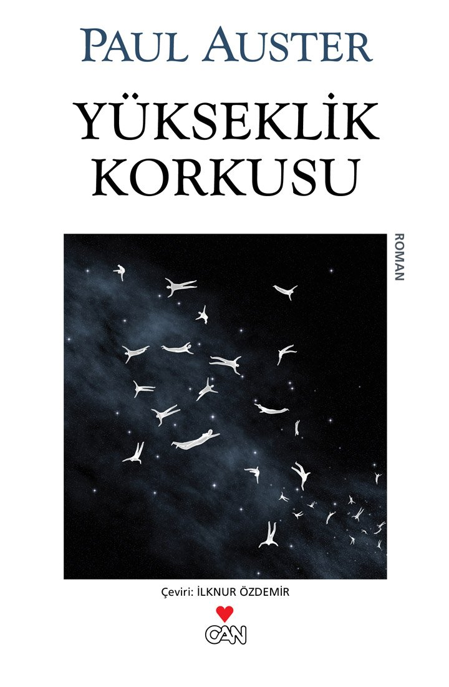 | **Yükseklik Korkusu** | Paul Auster | [EPUB İndir](https://raw.githubusercontent.com/kimbumuratyavuz/MyneBook-Turkish-Books/main/books/paul_auster_yukseklik_korkusu_10195.epub) |
| 10196 |  | **Irmagìnìn Kìyìsìnda Oturdum Aºladìm** | Paulo Coelho | [EPUB İndir](https://raw.githubusercontent.com/kimbumuratyavuz/MyneBook-Turkish-Books/main/books/paulo_coelho_irmag_n_n_k_y_s_nda_oturdum_a_lad_m_10196.pdf) |
| 10197 |  | **Piedra Irmaºìnìn Kìyìsìnda Oturdum Aºladìm** | Paulo Coelho | [EPUB İndir](https://raw.githubusercontent.com/kimbumuratyavuz/MyneBook-Turkish-Books/main/books/paulo_coelho_piedra_irma_n_n_k_y_s_nda_oturdum_a_lad_m_10197.pdf) |
| 10198 |  | **Kanatları Ölü Açıklığında** | Pelin Buzluk | [EPUB İndir](https://raw.githubusercontent.com/kimbumuratyavuz/MyneBook-Turkish-Books/main/books/pelin_buzluk_kanatlari_olu_acikliginda_10198.epub) |
| 10199 |  | **Karanlìk Bir Gecede** | Peter Handke | [EPUB İndir](https://raw.githubusercontent.com/kimbumuratyavuz/MyneBook-Turkish-Books/main/books/peter_handke_karanl_k_bir_gecede_10199.pdf) |
| 10200 | 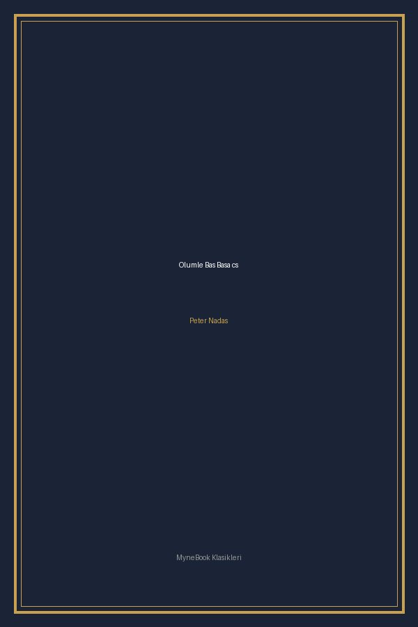 | **Olumle Bas Basa cs** | Peter Nadas | [EPUB İndir](https://raw.githubusercontent.com/kimbumuratyavuz/MyneBook-Turkish-Books/main/books/peter_nadas_olumle_bas_basa_cs_10200.pdf) |
| 10201 | 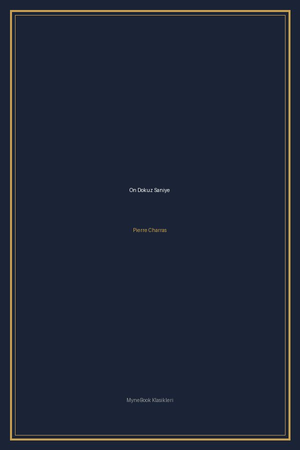 | **On Dokuz Saniye** | Pierre Charras | [EPUB İndir](https://raw.githubusercontent.com/kimbumuratyavuz/MyneBook-Turkish-Books/main/books/pierre_charras_on_dokuz_saniye_10201.pdf) |
| 10202 | 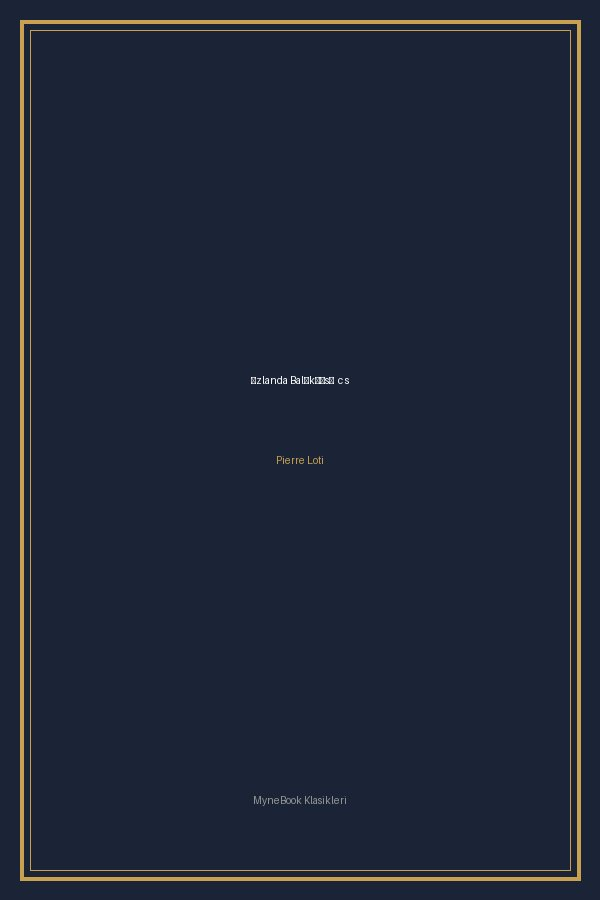 | **ÿzlanda Balìkçìsì  c s** | Pierre Loti | [EPUB İndir](https://raw.githubusercontent.com/kimbumuratyavuz/MyneBook-Turkish-Books/main/books/pierre_loti_zlanda_bal_kc_s_c_s_10202.pdf) |
| 10203 |  | **Amcam Oswald** | Roald Dahl | [EPUB İndir](https://raw.githubusercontent.com/kimbumuratyavuz/MyneBook-Turkish-Books/main/books/roald_dahl_amcam_oswald_10203.pdf) |
| 10204 |  | **Benden Bu Kadar** | Roald Dahl | [EPUB İndir](https://raw.githubusercontent.com/kimbumuratyavuz/MyneBook-Turkish-Books/main/books/roald_dahl_benden_bu_kadar_10204.pdf) |
| 10205 | 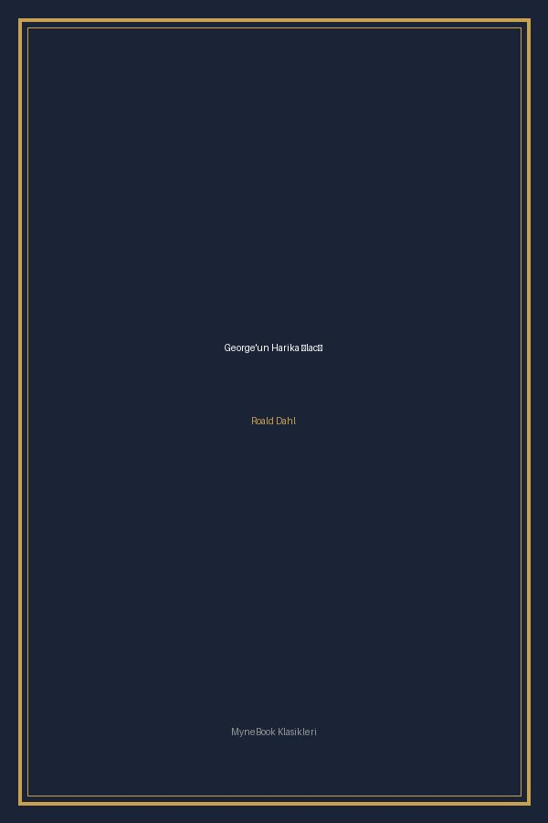 | **George'un Harika ÿlacì** | Roald Dahl | [EPUB İndir](https://raw.githubusercontent.com/kimbumuratyavuz/MyneBook-Turkish-Books/main/books/roald_dahl_george_un_harika_lac_10205.pdf) |
| 10206 | 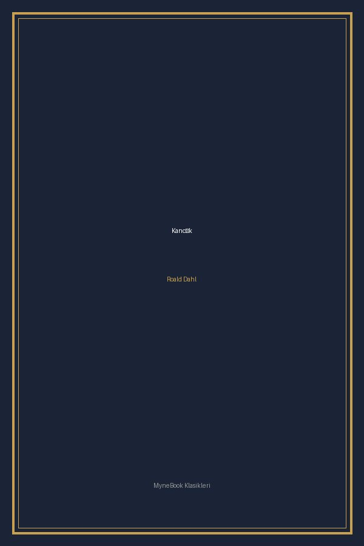 | **Kancìk** | Roald Dahl | [EPUB İndir](https://raw.githubusercontent.com/kimbumuratyavuz/MyneBook-Turkish-Books/main/books/roald_dahl_kanc_k_10206.pdf) |
| 10207 |  | **Matilda** | Roald Dahl | [EPUB İndir](https://raw.githubusercontent.com/kimbumuratyavuz/MyneBook-Turkish-Books/main/books/roald_dahl_matilda_10207.pdf) |
| 10208 |  | **Senin Gibi Biri** | Roald Dahl | [EPUB İndir](https://raw.githubusercontent.com/kimbumuratyavuz/MyneBook-Turkish-Books/main/books/roald_dahl_senin_gibi_biri_10208.pdf) |
| 10209 |  | **Son Perde** | Roald Dahl | [EPUB İndir](https://raw.githubusercontent.com/kimbumuratyavuz/MyneBook-Turkish-Books/main/books/roald_dahl_son_perde_10209.pdf) |
| 10210 |  | **×eker Henry'nin Akìlalmaz Öyküsü** | Roald Dahl | [EPUB İndir](https://raw.githubusercontent.com/kimbumuratyavuz/MyneBook-Turkish-Books/main/books/roald_dahl_eker_henry_nin_ak_lalmaz_oykusu_10210.pdf) |
| 10211 |  | **Modernizim ve Postmodernizim** | Semih Gümüş - Can Yayınları | [EPUB İndir](https://raw.githubusercontent.com/kimbumuratyavuz/MyneBook-Turkish-Books/main/books/semih_gumus_can_yayinlari_modernizim_ve_postmodernizim_10211.epub) |
| 10212 | 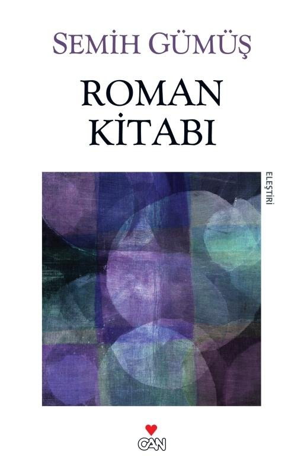 | **Roman Kitabı** | Semih Gümüş | [EPUB İndir](https://raw.githubusercontent.com/kimbumuratyavuz/MyneBook-Turkish-Books/main/books/semih_gumus_roman_kitabi_10212.epub) |
| 10213 |  | **Yazının Sarkacı Roman** | Semih Gümüş | [EPUB İndir](https://raw.githubusercontent.com/kimbumuratyavuz/MyneBook-Turkish-Books/main/books/semih_gumus_yazinin_sarkaci_roman_10213.epub) |
| 10214 |  | **Bazen Hayat** | Sine Ergün | [EPUB İndir](https://raw.githubusercontent.com/kimbumuratyavuz/MyneBook-Turkish-Books/main/books/sine_ergun_bazen_hayat_10214.epub) |
| 10215 | 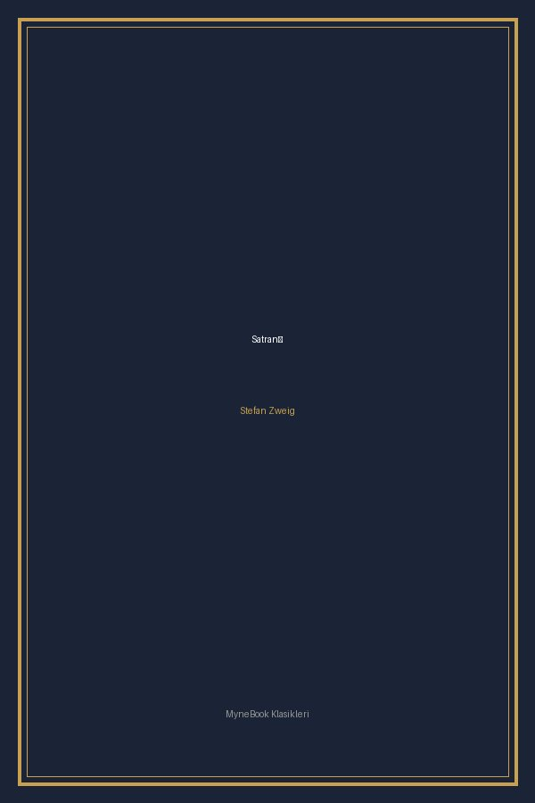 | **Satranç** | Stefan Zweig | [EPUB İndir](https://raw.githubusercontent.com/kimbumuratyavuz/MyneBook-Turkish-Books/main/books/stefan_zweig_satranc_10215.pdf) |
| 10216 | 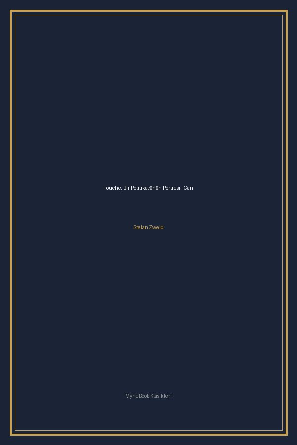 | **Fouche, Bir Politikacìnìn Portresi - Can Yay-1995** | Stefan Zweiº | [EPUB İndir](https://raw.githubusercontent.com/kimbumuratyavuz/MyneBook-Turkish-Books/main/books/stefan_zwei_fouche_bir_politikac_n_n_portresi_can_yay_1995_10216.pdf) |
| 10217 |  | **izil ile Kara  c s** | Stendhal | [EPUB İndir](https://raw.githubusercontent.com/kimbumuratyavuz/MyneBook-Turkish-Books/main/books/stendhal_izil_ile_kara_c_s_10217.pdf) |
| 10218 |  | **Parma Manastìrì c s** | Stendhal | [EPUB İndir](https://raw.githubusercontent.com/kimbumuratyavuz/MyneBook-Turkish-Books/main/books/stendhal_parma_manast_r_c_s_10218.pdf) |
| 10219 | 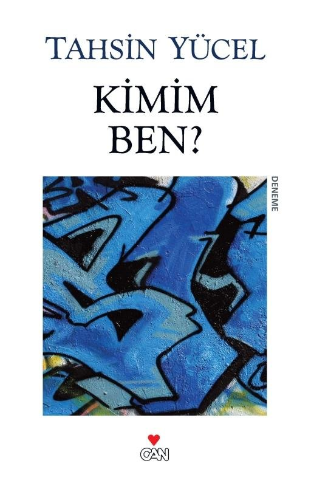 | **Kimim Ben?** | Tahsin Yücel | [EPUB İndir](https://raw.githubusercontent.com/kimbumuratyavuz/MyneBook-Turkish-Books/main/books/tahsin_yucel_kimim_ben_10219.epub) |
| 10220 | 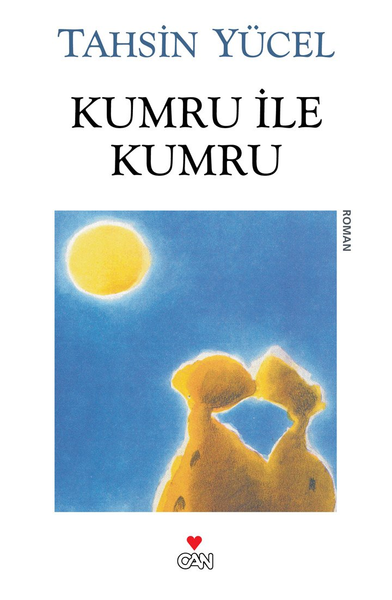 | **Kumru ile Kumru** | Tahsin Yücel | [EPUB İndir](https://raw.githubusercontent.com/kimbumuratyavuz/MyneBook-Turkish-Books/main/books/tahsin_yucel_kumru_ile_kumru_10220.epub) |
| 10221 | 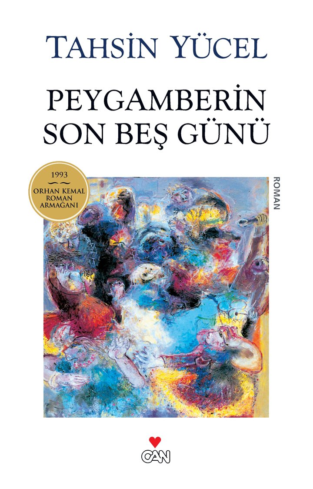 | **Peygamberin Son Beş Günü** | Tahsin Yücel | [EPUB İndir](https://raw.githubusercontent.com/kimbumuratyavuz/MyneBook-Turkish-Books/main/books/tahsin_yucel_peygamberin_son_bes_gunu_10221.epub) |
| 10222 | 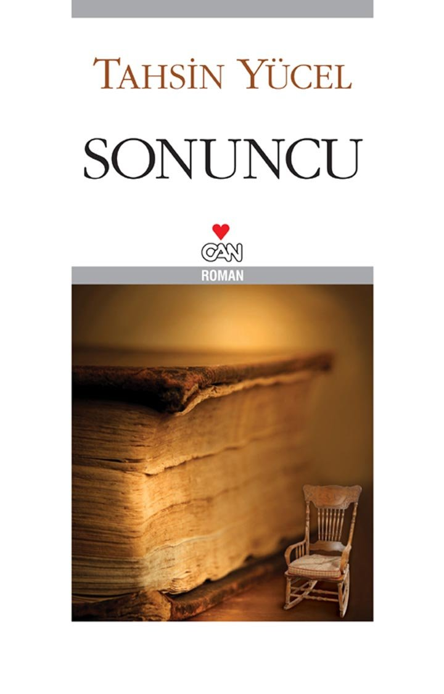 | **Sonuncu** | Tahsin Yücel | [EPUB İndir](https://raw.githubusercontent.com/kimbumuratyavuz/MyneBook-Turkish-Books/main/books/tahsin_yucel_sonuncu_10222.epub) |
| 10223 | 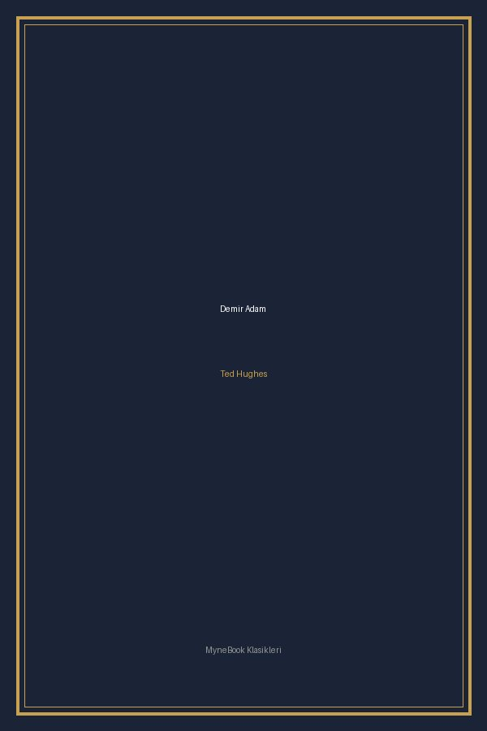 | **Demir Adam** | Ted Hughes | [EPUB İndir](https://raw.githubusercontent.com/kimbumuratyavuz/MyneBook-Turkish-Books/main/books/ted_hughes_demir_adam_10223.pdf) |
| 10224 |  | **Çılgın Kalabalıktan Uzak** | Thomas Hardy | [EPUB İndir](https://raw.githubusercontent.com/kimbumuratyavuz/MyneBook-Turkish-Books/main/books/thomas_hardy_cilgin_kalabaliktan_uzak_10224.epub) |
| 10225 |  | **Aldanan Kadın** | Thomas Mann | [EPUB İndir](https://raw.githubusercontent.com/kimbumuratyavuz/MyneBook-Turkish-Books/main/books/thomas_mann_aldanan_kadin_10225.epub) |
| 10226 |  | **Büyülü Daº I** | Thomas Mann | [EPUB İndir](https://raw.githubusercontent.com/kimbumuratyavuz/MyneBook-Turkish-Books/main/books/thomas_mann_buyulu_da_i_10226.pdf) |
| 10227 |  | **Büyülü Daº II** | Thomas Mann | [EPUB İndir](https://raw.githubusercontent.com/kimbumuratyavuz/MyneBook-Turkish-Books/main/books/thomas_mann_buyulu_da_ii_10227.pdf) |
| 10228 |  | **Ates Karalamalari cs** | Tomas Tranströmer | [EPUB İndir](https://raw.githubusercontent.com/kimbumuratyavuz/MyneBook-Turkish-Books/main/books/tomas_transtromer_ates_karalamalari_cs_10228.pdf) |
| 10229 |  | **Dünyanìn En Güzel Arabistanì** | Turgut Uyar | [EPUB İndir](https://raw.githubusercontent.com/kimbumuratyavuz/MyneBook-Turkish-Books/main/books/turgut_uyar_dunyan_n_en_guzel_arabistan_10229.pdf) |
| 10230 |  | **Bes Ahlak Yazisi** | Umberto Eco | [EPUB İndir](https://raw.githubusercontent.com/kimbumuratyavuz/MyneBook-Turkish-Books/main/books/umberto_eco_bes_ahlak_yazisi_10230.pdf) |
| 10231 |  | **Günlük Yaƒamdan Sanata** | Umberto Eco | [EPUB İndir](https://raw.githubusercontent.com/kimbumuratyavuz/MyneBook-Turkish-Books/main/books/umberto_eco_gunluk_ya_amdan_sanata_10231.pdf) |
| 10232 |  | **Lolita** | Vladimir Nabokov | [EPUB İndir](https://raw.githubusercontent.com/kimbumuratyavuz/MyneBook-Turkish-Books/main/books/vladimir_nabokov_lolita_10232.pdf) |
| 10233 |  | **1939 Yazì** | Werner Biermann | [EPUB İndir](https://raw.githubusercontent.com/kimbumuratyavuz/MyneBook-Turkish-Books/main/books/werner_biermann_1939_yaz_10233.pdf) |
| 10234 |  | **Dilek Aºacì** | William Faulkner | [EPUB İndir](https://raw.githubusercontent.com/kimbumuratyavuz/MyneBook-Turkish-Books/main/books/william_faulkner_dilek_a_ac_10234.pdf) |
| 10235 |  | **Sartoris** | William Faulkner | [EPUB İndir](https://raw.githubusercontent.com/kimbumuratyavuz/MyneBook-Turkish-Books/main/books/william_faulkner_sartoris_10235.pdf) |
| 10236 |  | **İçimde Kim Var** | Yekta Kopan | [EPUB İndir](https://raw.githubusercontent.com/kimbumuratyavuz/MyneBook-Turkish-Books/main/books/yekta_kopan_icimde_kim_var_10236.epub) |
| 10237 |  | **ÿçimizdeki Ermeni (1915-2015)** | Yiºit Bener | [EPUB İndir](https://raw.githubusercontent.com/kimbumuratyavuz/MyneBook-Turkish-Books/main/books/yi_it_bener_cimizdeki_ermeni_1915_2015_10237.pdf) |
| 10238 |  | **Miƒima-Denizi-Yitiren-Denizci** | Yukio | [EPUB İndir](https://raw.githubusercontent.com/kimbumuratyavuz/MyneBook-Turkish-Books/main/books/yukio_mi_ima_denizi_yitiren_denizci_10238.pdf) |
| 10239 |  | **Altì Çaºdaƒ No Oyunu** | Yukio Miƒima | [EPUB İndir](https://raw.githubusercontent.com/kimbumuratyavuz/MyneBook-Turkish-Books/main/books/yukio_mi_ima_alt_ca_da_no_oyunu_10239.pdf) |
| 10240 | 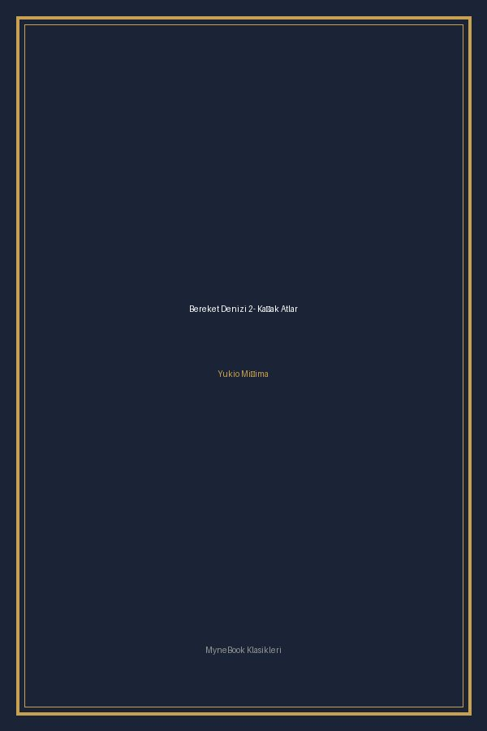 | **Bereket Denizi 2- Kaçak Atlar** | Yukio Miƒima | [EPUB İndir](https://raw.githubusercontent.com/kimbumuratyavuz/MyneBook-Turkish-Books/main/books/yukio_mi_ima_bereket_denizi_2_kacak_atlar_10240.pdf) |
| 10241 |  | **Bereket Denizi 3- ×afak Tapìnaºì** | Yukio Miƒima | [EPUB İndir](https://raw.githubusercontent.com/kimbumuratyavuz/MyneBook-Turkish-Books/main/books/yukio_mi_ima_bereket_denizi_3_afak_tap_na_10241.pdf) |
| 10242 | 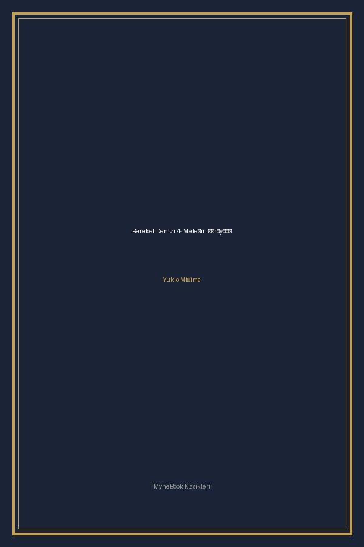 | **Bereket Denizi 4- Meleºin Çürüyüƒü** | Yukio Miƒima | [EPUB İndir](https://raw.githubusercontent.com/kimbumuratyavuz/MyneBook-Turkish-Books/main/books/yukio_mi_ima_bereket_denizi_4_mele_in_curuyu_u_10242.pdf) |
| 10243 |  | **Bir Maskenin ÿtiraflarì** | Yukio Miƒima | [EPUB İndir](https://raw.githubusercontent.com/kimbumuratyavuz/MyneBook-Turkish-Books/main/books/yukio_mi_ima_bir_maskenin_tiraflar_10243.pdf) |
| 10244 |  | **Yaz Ortasìnda Ölüm** | Yukio Miƒima | [EPUB İndir](https://raw.githubusercontent.com/kimbumuratyavuz/MyneBook-Turkish-Books/main/books/yukio_mi_ima_yaz_ortas_nda_olum_10244.pdf) |
| 10245 |  | **Saba Cümlemiz** | Ziya Osman | [EPUB İndir](https://raw.githubusercontent.com/kimbumuratyavuz/MyneBook-Turkish-Books/main/books/ziya_osman_saba_cumlemiz_10245.pdf) |
| 10246 |  | **Suçluyorum** | Émile Zola | [EPUB İndir](https://raw.githubusercontent.com/kimbumuratyavuz/MyneBook-Turkish-Books/main/books/mile_zola_sucluyorum_10246.epub) |
| 10247 |  | **Yüz Uzun Yìl cs** | ×emsettin Ünlü | [EPUB İndir](https://raw.githubusercontent.com/kimbumuratyavuz/MyneBook-Turkish-Books/main/books/emsettin_unlu_yuz_uzun_y_l_cs_10247.pdf) |
| 10248 |  | **Telli Horoz'un Oykusu cs** | ÿlhan Yuce | [EPUB İndir](https://raw.githubusercontent.com/kimbumuratyavuz/MyneBook-Turkish-Books/main/books/lhan_yuce_telli_horoz_un_oykusu_cs_10248.pdf) |
| 10249 |  | **Yunus Emre Hayatı ve Bütün Şiirleri** | Abdülbaki Gölpınarlı | [EPUB İndir](https://raw.githubusercontent.com/kimbumuratyavuz/MyneBook-Turkish-Books/main/books/abdulbaki_golpinarli_yunus_emre_hayati_ve_butun_siirleri_10249.epub) |
| 10250 |  | **Milletlerin Zenginliği** | Adam Smith | [EPUB İndir](https://raw.githubusercontent.com/kimbumuratyavuz/MyneBook-Turkish-Books/main/books/adam_smith_milletlerin_zenginligi_10250.epub) |
| 10251 |  | **Zincire Vurulmuş Prometheus** | Aiskhylos | [EPUB İndir](https://raw.githubusercontent.com/kimbumuratyavuz/MyneBook-Turkish-Books/main/books/aiskhylos_zincire_vurulmus_prometheus_10251.pdf) |
| 10252 | 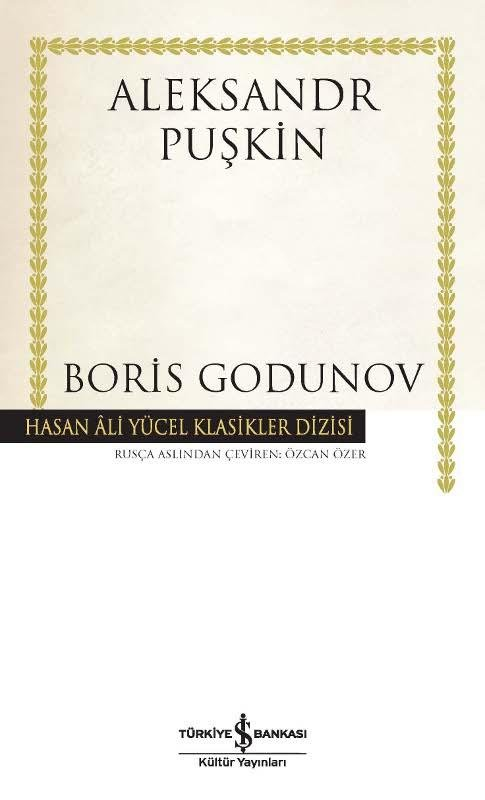 | **Boris Godunov** | Aleksandr Puşkin | [EPUB İndir](https://raw.githubusercontent.com/kimbumuratyavuz/MyneBook-Turkish-Books/main/books/aleksandr_puskin_boris_godunov_10252.epub) |
| 10253 | 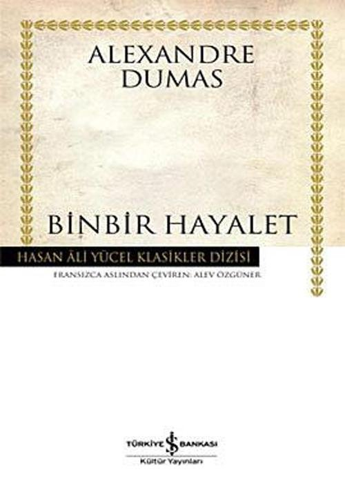 | **Binbir Hayalet** | Alexandre Dumas | [EPUB İndir](https://raw.githubusercontent.com/kimbumuratyavuz/MyneBook-Turkish-Books/main/books/alexandre_dumas_binbir_hayalet_10253.epub) |
| 10254 |  | **Üç Silahşör** | Alexandre Dumas | [EPUB İndir](https://raw.githubusercontent.com/kimbumuratyavuz/MyneBook-Turkish-Books/main/books/alexandre_dumas_uc_silahsor_10254.pdf) |
| 10255 |  | **Yüzbaşının Kızı** | Alexsandr Sergeyeviç Puşkin | [EPUB İndir](https://raw.githubusercontent.com/kimbumuratyavuz/MyneBook-Turkish-Books/main/books/alexsandr_sergeyevic_puskin_yuzbasinin_kizi_10255.pdf) |
| 10256 | 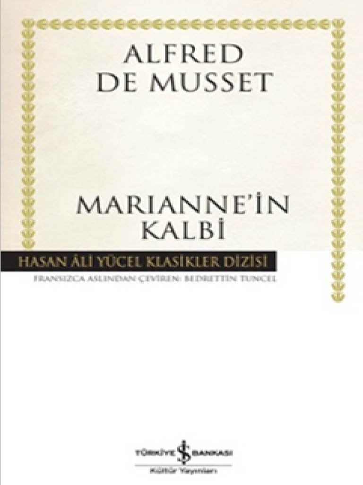 | **Marianne'in Kalbi** | Alfred De Musset | [EPUB İndir](https://raw.githubusercontent.com/kimbumuratyavuz/MyneBook-Turkish-Books/main/books/alfred_de_musset_marianne_in_kalbi_10256.epub) |
| 10257 |  | **Ayı** | Anton Çehov | [EPUB İndir](https://raw.githubusercontent.com/kimbumuratyavuz/MyneBook-Turkish-Books/main/books/anton_cehov_ayi_10257.epub) |
| 10258 |  | **Büyük Oyunlar** | Anton Çehov | [EPUB İndir](https://raw.githubusercontent.com/kimbumuratyavuz/MyneBook-Turkish-Books/main/books/anton_cehov_buyuk_oyunlar_10258.epub) |
| 10259 |  | **Atinalıların Devleti** | Aristoteles | [EPUB İndir](https://raw.githubusercontent.com/kimbumuratyavuz/MyneBook-Turkish-Books/main/books/aristoteles_atinalilarin_devleti_10259.epub) |
| 10260 |  | **Illuminations Fransızca - Türkçe** | Arthur Rimbaud - Türkiye İş Bankası Kültür Yayınları | [EPUB İndir](https://raw.githubusercontent.com/kimbumuratyavuz/MyneBook-Turkish-Books/main/books/arthur_rimbaud_turkiye_is_bankasi_kultur_yayinlari_illuminations_fransizca_10260.epub) |
| 10261 |  | **Yaşam Bilgeliği Üzerine Aforizmalar** | Arthur Schopenhauer | [EPUB İndir](https://raw.githubusercontent.com/kimbumuratyavuz/MyneBook-Turkish-Books/main/books/arthur_schopenhauer_yasam_bilgeligi_uzerine_aforizmalar_10261.pdf) |
| 10262 |  | **Hayat Bir Rüyadır** | Calderon De La Barca | [EPUB İndir](https://raw.githubusercontent.com/kimbumuratyavuz/MyneBook-Turkish-Books/main/books/calderon_de_la_barca_hayat_bir_ruyadir_10262.pdf) |
| 10263 |  | **Paris Sıkıntısı** | Charles Baudelaire | [EPUB İndir](https://raw.githubusercontent.com/kimbumuratyavuz/MyneBook-Turkish-Books/main/books/charles_baudelaire_paris_sikintisi_10263.pdf) |
| 10264 |  | **Robinson Crusoe** | Daniel Defoe | [EPUB İndir](https://raw.githubusercontent.com/kimbumuratyavuz/MyneBook-Turkish-Books/main/books/daniel_defoe_robinson_crusoe_10264.epub) |
| 10265 |  | **Siyasal İktisadın ve Vergilendirmenin İlkeleri** | David Ricardo | [EPUB İndir](https://raw.githubusercontent.com/kimbumuratyavuz/MyneBook-Turkish-Books/main/books/david_ricardo_siyasal_iktisadin_ve_vergilendirmenin_ilkeleri_10265.epub) |
| 10266 |  | **Stepançikovo Köyü** | Dostoyevski | [EPUB İndir](https://raw.githubusercontent.com/kimbumuratyavuz/MyneBook-Turkish-Books/main/books/dostoyevski_stepancikovo_koyu_10266.pdf) |
| 10267 |  | **Dedektif Auguste Dupin Öyküleri** | Edgar Allan Poe | [EPUB İndir](https://raw.githubusercontent.com/kimbumuratyavuz/MyneBook-Turkish-Books/main/books/edgar_allan_poe_dedektif_auguste_dupin_oykuleri_10267.epub) |
| 10268 |  | **Mantık Al-Tayr** | Feridüddin Attar | [EPUB İndir](https://raw.githubusercontent.com/kimbumuratyavuz/MyneBook-Turkish-Books/main/books/feriduddin_attar_mantik_al_tayr_10268.epub) |
| 10269 |  | **Gargantua** | Francois Rabelais | [EPUB İndir](https://raw.githubusercontent.com/kimbumuratyavuz/MyneBook-Turkish-Books/main/books/francois_rabelais_gargantua_10269.pdf) |
| 10270 |  | **Putların Alacakaranlığı** | Friedrich Nitzsche | [EPUB İndir](https://raw.githubusercontent.com/kimbumuratyavuz/MyneBook-Turkish-Books/main/books/friedrich_nitzsche_putlarin_alacakaranligi_10270.epub) |
| 10271 |  | **Tragedyanın Doğuşu** | Friedrich Wilhelm Nietzsche | [EPUB İndir](https://raw.githubusercontent.com/kimbumuratyavuz/MyneBook-Turkish-Books/main/books/friedrich_wilhelm_nietzsche_tragedyanin_dogusu_10271.epub) |
| 10272 |  | **Dionysos Dithyrambosları** | Friedrich Wilhelm Nietzsche - İş Bankası Kültür Yayınları | [EPUB İndir](https://raw.githubusercontent.com/kimbumuratyavuz/MyneBook-Turkish-Books/main/books/friedrich_wilhelm_nietzsche_is_bankasi_kultur_yayinlari_dionysos_dithyrambo_10272.epub) |
| 10273 |  | **İnsanca, Pek İnsanca 2** | Friedrich Nietzsche | [EPUB İndir](https://raw.githubusercontent.com/kimbumuratyavuz/MyneBook-Turkish-Books/main/books/friedrich_nietzsche_insanca_pek_insanca_2_10273.epub) |
| 10274 |  | **İnsanca, Pek İnsanca-1** | Friedrich Wilhelm Nietzsche | [EPUB İndir](https://raw.githubusercontent.com/kimbumuratyavuz/MyneBook-Turkish-Books/main/books/friedrich_wilhelm_nietzsche_insanca_pek_insanca_1_10274.epub) |
| 10275 |  | **Böyle Söyledi Zerdüşt** | Friedrich Wilhelm Nietzsche | [EPUB İndir](https://raw.githubusercontent.com/kimbumuratyavuz/MyneBook-Turkish-Books/main/books/friedrich_wilhelm_nietzsche_boyle_soyledi_zerdust_10275.epub) |
| 10276 |  | **Budala** | Fyodor Mihailovic Dostoyevski | [EPUB İndir](https://raw.githubusercontent.com/kimbumuratyavuz/MyneBook-Turkish-Books/main/books/fyodor_mihailovic_dostoyevski_budala_10276.pdf) |
| 10277 |  | **Ölüler Evinden Anılar** | Fyodor Mihailovic Dostoyevski | [EPUB İndir](https://raw.githubusercontent.com/kimbumuratyavuz/MyneBook-Turkish-Books/main/books/fyodor_mihailovic_dostoyevski_oluler_evinden_anilar_10277.pdf) |
| 10278 |  | **Ev Sahibesi** | Fyodor Mihailoviç Dostoyevski | [EPUB İndir](https://raw.githubusercontent.com/kimbumuratyavuz/MyneBook-Turkish-Books/main/books/fyodor_mihailovic_dostoyevski_ev_sahibesi_10278.epub) |
| 10279 |  | **Karamazov Kardeşler** | Fyodor Mihailoviç Dostoyevski | [EPUB İndir](https://raw.githubusercontent.com/kimbumuratyavuz/MyneBook-Turkish-Books/main/books/fyodor_mihailovic_dostoyevski_karamazov_kardesler_10279.epub) |
| 10280 |  | **Suç ve Ceza** | Fyodor Mihailoviç Dostoyevski | [EPUB İndir](https://raw.githubusercontent.com/kimbumuratyavuz/MyneBook-Turkish-Books/main/books/fyodor_mihailovic_dostoyevski_suc_ve_ceza_10280.epub) |
| 10281 |  | **Yeraltından Notlar** | Fyodor Mihailoviç Dostoyevski | [EPUB İndir](https://raw.githubusercontent.com/kimbumuratyavuz/MyneBook-Turkish-Books/main/books/fyodor_mihailovic_dostoyevski_yeraltindan_notlar_10281.pdf) |
| 10282 |  | **Iki Büyük Dünya Sistemi Hakkında Diyalog** | Galileo Galilei | [EPUB İndir](https://raw.githubusercontent.com/kimbumuratyavuz/MyneBook-Turkish-Books/main/books/galileo_galilei_iki_buyuk_dunya_sistemi_hakkinda_diyalog_10282.pdf) |
| 10283 |  | **Dördüncü Haçlı Seferi Kronikleri** | Geoffroi de Villehardouin | [EPUB İndir](https://raw.githubusercontent.com/kimbumuratyavuz/MyneBook-Turkish-Books/main/books/geoffroi_de_villehardouin_dorduncu_hacli_seferi_kronikleri_10283.epub) |
| 10284 |  | **Ermiş Antonius ve Şeytan** | Gustave Flaubert | [EPUB İndir](https://raw.githubusercontent.com/kimbumuratyavuz/MyneBook-Turkish-Books/main/books/gustave_flaubert_ermis_antonius_ve_seytan_10284.pdf) |
| 10285 |  | **Madame Bovary** | Gustave Flaubert | [EPUB İndir](https://raw.githubusercontent.com/kimbumuratyavuz/MyneBook-Turkish-Books/main/books/gustave_flaubert_madame_bovary_10285.epub) |
| 10286 |  | **Gezgin satıcı** | Guy De Maupassant | [EPUB İndir](https://raw.githubusercontent.com/kimbumuratyavuz/MyneBook-Turkish-Books/main/books/guy_de_maupassant_gezgin_satici_10286.epub) |
| 10287 |  | **Güzel Dostlar** | Guy De Maupassant | [EPUB İndir](https://raw.githubusercontent.com/kimbumuratyavuz/MyneBook-Turkish-Books/main/books/guy_de_maupassant_guzel_dostlar_10287.epub) |
| 10288 |  | **Düello** | Heinrich von Kleist | [EPUB İndir](https://raw.githubusercontent.com/kimbumuratyavuz/MyneBook-Turkish-Books/main/books/heinrich_von_kleist_duello_10288.epub) |
| 10289 |  | **Gülme** | Henri Bergson | [EPUB İndir](https://raw.githubusercontent.com/kimbumuratyavuz/MyneBook-Turkish-Books/main/books/henri_bergson_gulme_10289.pdf) |
| 10290 |  | **Güvercinin Kanatları** | Henry James | [EPUB İndir](https://raw.githubusercontent.com/kimbumuratyavuz/MyneBook-Turkish-Books/main/books/henry_james_guvercinin_kanatlari_10290.epub) |
| 10291 |  | **Tarih** | Herodotos | [EPUB İndir](https://raw.githubusercontent.com/kimbumuratyavuz/MyneBook-Turkish-Books/main/books/herodotos_tarih_10291.pdf) |
| 10292 |  | **Bir Havva Kızı** | Honoré De Balzac | [EPUB İndir](https://raw.githubusercontent.com/kimbumuratyavuz/MyneBook-Turkish-Books/main/books/honor_de_balzac_bir_havva_kizi_10292.pdf) |
| 10293 |  | **Evde Kalmış Kız** | Honoré de Balzac | [EPUB İndir](https://raw.githubusercontent.com/kimbumuratyavuz/MyneBook-Turkish-Books/main/books/honor_de_balzac_evde_kalmis_kiz_10293.epub) |
| 10294 |  | **Louis Lambert** | Honoré de Balzac | [EPUB İndir](https://raw.githubusercontent.com/kimbumuratyavuz/MyneBook-Turkish-Books/main/books/honor_de_balzac_louis_lambert_10294.epub) |
| 10295 |  | **Modeste Mignon** | Honoré De Balzac | [EPUB İndir](https://raw.githubusercontent.com/kimbumuratyavuz/MyneBook-Turkish-Books/main/books/honor_de_balzac_modeste_mignon_10295.pdf) |
| 10296 |  | **Mutlak Peşinde** | Honoré De Balzac | [EPUB İndir](https://raw.githubusercontent.com/kimbumuratyavuz/MyneBook-Turkish-Books/main/books/honor_de_balzac_mutlak_pesinde_10296.pdf) |
| 10297 |  | **Pierrette** | Honoré de Balzac | [EPUB İndir](https://raw.githubusercontent.com/kimbumuratyavuz/MyneBook-Turkish-Books/main/books/honor_de_balzac_pierrette_10297.epub) |
| 10298 |  | **Piertette** | Honoré De Balzac | [EPUB İndir](https://raw.githubusercontent.com/kimbumuratyavuz/MyneBook-Turkish-Books/main/books/honor_de_balzac_piertette_10298.pdf) |
| 10299 |  | **Suyu Bulandıran Kız** | Honoré de Balzac | [EPUB İndir](https://raw.githubusercontent.com/kimbumuratyavuz/MyneBook-Turkish-Books/main/books/honor_de_balzac_suyu_bulandiran_kiz_10299.epub) |
| 10300 |  | **Tılsımlı Deri** | Honoré de Balzac | [EPUB İndir](https://raw.githubusercontent.com/kimbumuratyavuz/MyneBook-Turkish-Books/main/books/honor_de_balzac_tilsimli_deri_10300.epub) |
| 10301 |  | **Ursule Mirouet** | Honoré de Balzac | [EPUB İndir](https://raw.githubusercontent.com/kimbumuratyavuz/MyneBook-Turkish-Books/main/books/honor_de_balzac_ursule_mirouet_10301.epub) |
| 10302 |  | **Duman** | Ivan Sergeyeviç Turgenyev | [EPUB İndir](https://raw.githubusercontent.com/kimbumuratyavuz/MyneBook-Turkish-Books/main/books/ivan_sergeyevic_turgenyev_duman_10302.epub) |
| 10303 |  | **Akıl ve Tutku** | Jane Austen | [EPUB İndir](https://raw.githubusercontent.com/kimbumuratyavuz/MyneBook-Turkish-Books/main/books/jane_austen_akil_ve_tutku_10303.epub) |
| 10304 |  | **Gurur ve Önyargı** | Jane Austen | [EPUB İndir](https://raw.githubusercontent.com/kimbumuratyavuz/MyneBook-Turkish-Books/main/books/jane_austen_gurur_ve_onyargi_10304.epub) |
| 10305 |  | **Northanger Manastırı** | Jane Austen | [EPUB İndir](https://raw.githubusercontent.com/kimbumuratyavuz/MyneBook-Turkish-Books/main/books/jane_austen_northanger_manastiri_10305.pdf) |
| 10306 |  | **Emile Ya Da Eğitim Üzerine** | Jean-Jacques Rousseau | [EPUB İndir](https://raw.githubusercontent.com/kimbumuratyavuz/MyneBook-Turkish-Books/main/books/jean_jacques_rousseau_emile_ya_da_egitim_uzerine_10306.epub) |
| 10307 |  | **Melodi ve Müziksel Taklit ile İlişki İçinde Dillerin Kökeni Üstüne Deneme** | Jean-Jacques Rousseau | [EPUB İndir](https://raw.githubusercontent.com/kimbumuratyavuz/MyneBook-Turkish-Books/main/books/jean_jacques_rousseau_melodi_ve_muziksel_taklit_ile_iliski_icinde_dillerin_10307.epub) |
| 10308 |  | **Toplum Sözleşmesi** | Jean Jacques Rousseau | [EPUB İndir](https://raw.githubusercontent.com/kimbumuratyavuz/MyneBook-Turkish-Books/main/books/jean_jacques_rousseau_toplum_sozlesmesi_10308.pdf) |
| 10309 |  | **Yarat Ey Sanatçı** | Johann Woldgang Von Goethe | [EPUB İndir](https://raw.githubusercontent.com/kimbumuratyavuz/MyneBook-Turkish-Books/main/books/johann_woldgang_von_goethe_yarat_ey_sanatci_10309.pdf) |
| 10310 |  | **Genç Werther'in Acıları** | Goethe | [EPUB İndir](https://raw.githubusercontent.com/kimbumuratyavuz/MyneBook-Turkish-Books/main/books/goethe_genc_werther_in_acilari_10310.epub) |
| 10311 |  | **Para Üzerine Bir İnceleme** | John Maynard Keynes | [EPUB İndir](https://raw.githubusercontent.com/kimbumuratyavuz/MyneBook-Turkish-Books/main/books/john_maynard_keynes_para_uzerine_bir_inceleme_10311.epub) |
| 10312 |  | **Alçakgönüllü Bir Öneri** | Jonathan Swift | [EPUB İndir](https://raw.githubusercontent.com/kimbumuratyavuz/MyneBook-Turkish-Books/main/books/jonathan_swift_alcakgonullu_bir_oneri_10312.epub) |
| 10313 |  | **Gulliver'in Gezileri** | Jonathan Swift | [EPUB İndir](https://raw.githubusercontent.com/kimbumuratyavuz/MyneBook-Turkish-Books/main/books/jonathan_swift_gulliver_in_gezileri_10313.pdf) |
| 10314 |  | **Kitlelerin Ayaklanması** | José Ortega Y Gasset | [EPUB İndir](https://raw.githubusercontent.com/kimbumuratyavuz/MyneBook-Turkish-Books/main/books/jos_ortega_y_gasset_kitlelerin_ayaklanmasi_10314.pdf) |
| 10315 |  | **Sistem Olarak Tarih** | José Ortega Y Gasset | [EPUB İndir](https://raw.githubusercontent.com/kimbumuratyavuz/MyneBook-Turkish-Books/main/books/jos_ortega_y_gasset_sistem_olarak_tarih_10315.pdf) |
| 10316 |  | **Diriliş** | L. N. Tolstoy | [EPUB İndir](https://raw.githubusercontent.com/kimbumuratyavuz/MyneBook-Turkish-Books/main/books/l_n_tolstoy_dirilis_10316.pdf) |
| 10317 |  | **Kafkas Tuzağı** | L. N. Tolstoy | [EPUB İndir](https://raw.githubusercontent.com/kimbumuratyavuz/MyneBook-Turkish-Books/main/books/l_n_tolstoy_kafkas_tuzagi_10317.pdf) |
| 10318 |  | **Sanat Nedir-** | L. N. Tolstoy | [EPUB İndir](https://raw.githubusercontent.com/kimbumuratyavuz/MyneBook-Turkish-Books/main/books/l_n_tolstoy_sanat_nedir_10318.pdf) |
| 10319 |  | **İnsan Neyle Yaşar?** | Lev Nikolayeviç Tolstoy | [EPUB İndir](https://raw.githubusercontent.com/kimbumuratyavuz/MyneBook-Turkish-Books/main/books/lev_nikolayevic_tolstoy_insan_neyle_yasar_10319.epub) |
| 10320 |  | **Seçme Öyküler** | Mark Twain | [EPUB İndir](https://raw.githubusercontent.com/kimbumuratyavuz/MyneBook-Turkish-Books/main/books/mark_twain_secme_oykuler_10320.epub) |
| 10321 |  | **Kadın Haklarının Gerekçelendirilmesi** | Mary Wollstonecraft | [EPUB İndir](https://raw.githubusercontent.com/kimbumuratyavuz/MyneBook-Turkish-Books/main/books/mary_wollstonecraft_kadin_haklarinin_gerekcelendirilmesi_10321.pdf) |
| 10322 |  | **Yüce Sultan** | Miguel De Cervantes | [EPUB İndir](https://raw.githubusercontent.com/kimbumuratyavuz/MyneBook-Turkish-Books/main/books/miguel_de_cervantes_yuce_sultan_10322.pdf) |
| 10323 |  | **Sis** | Miguel De Unamuno | [EPUB İndir](https://raw.githubusercontent.com/kimbumuratyavuz/MyneBook-Turkish-Books/main/books/miguel_de_unamuno_sis_10323.epub) |
| 10324 |  | **George Dandin veya Bir Koca Nasıl Rezil Edilir** | Moliere | [EPUB İndir](https://raw.githubusercontent.com/kimbumuratyavuz/MyneBook-Turkish-Books/main/books/moliere_george_dandin_veya_bir_koca_nasil_rezil_edilir_10324.epub) |
| 10325 |  | **Cimri** | Moliére | [EPUB İndir](https://raw.githubusercontent.com/kimbumuratyavuz/MyneBook-Turkish-Books/main/books/moli_re_cimri_10325.pdf) |
| 10326 |  | **Denemeler** | Montaigne | [EPUB İndir](https://raw.githubusercontent.com/kimbumuratyavuz/MyneBook-Turkish-Books/main/books/montaigne_denemeler_10326.pdf) |
| 10327 |  | **Murasaki Shikibu'nun Günlüğü** | Murasaki Shikibu | [EPUB İndir](https://raw.githubusercontent.com/kimbumuratyavuz/MyneBook-Turkish-Books/main/books/murasaki_shikibu_murasaki_shikibu_nun_gunlugu_10327.pdf) |
| 10328 |  | **Hitopadeşa** | Narayana | [EPUB İndir](https://raw.githubusercontent.com/kimbumuratyavuz/MyneBook-Turkish-Books/main/books/narayana_hitopadesa_10328.epub) |
| 10329 |  | **Hükümdar** | Niccolò Machiavelli | [EPUB İndir](https://raw.githubusercontent.com/kimbumuratyavuz/MyneBook-Turkish-Books/main/books/niccol_machiavelli_hukumdar_10329.epub) |
| 10330 |  | **Göksel Kürelerin Devinimleri Üzerine** | Nicolaus Copernicus | [EPUB İndir](https://raw.githubusercontent.com/kimbumuratyavuz/MyneBook-Turkish-Books/main/books/nicolaus_copernicus_goksel_kurelerin_devinimleri_uzerine_10330.epub) |
| 10331 |  | **Arabeskler** | Nikolay Vasilyeviç Gogol | [EPUB İndir](https://raw.githubusercontent.com/kimbumuratyavuz/MyneBook-Turkish-Books/main/books/nikolay_vasilyevic_gogol_arabeskler_10331.pdf) |
| 10332 |  | **Bir Delinin Anı Defteri Palto-Burun** | Nikolay Vasilyeviç Gogol | [EPUB İndir](https://raw.githubusercontent.com/kimbumuratyavuz/MyneBook-Turkish-Books/main/books/nikolay_vasilyevic_gogol_bir_delinin_ani_defteri_palto_burun_10332.pdf) |
| 10333 |  | **Dikanka Yakınlarında Bir Çiftlikte Akşam Toplantıları** | Nikolay Vasilyeviç Gogol | [EPUB İndir](https://raw.githubusercontent.com/kimbumuratyavuz/MyneBook-Turkish-Books/main/books/nikolay_vasilyevic_gogol_dikanka_yakinlarinda_bir_ciftlikte_aksam_toplantil_10333.epub) |
| 10334 |  | **Evlenme Kumarbazlar** | Nikolay Vasilyeviç Gogol | [EPUB İndir](https://raw.githubusercontent.com/kimbumuratyavuz/MyneBook-Turkish-Books/main/books/nikolay_vasilyevic_gogol_evlenme_kumarbazlar_10334.pdf) |
| 10335 |  | **Ölü Canlar** | Nikolay Vasilyeviç Gogol | [EPUB İndir](https://raw.githubusercontent.com/kimbumuratyavuz/MyneBook-Turkish-Books/main/books/nikolay_vasilyevic_gogol_olu_canlar_10335.epub) |
| 10336 |  | **Geceye Övgüler** | Novalis | [EPUB İndir](https://raw.githubusercontent.com/kimbumuratyavuz/MyneBook-Turkish-Books/main/books/novalis_geceye_ovguler_10336.pdf) |
| 10337 |  | **Bütün Masallar, Bütün Öyküler** | Oscar Wilde | [EPUB İndir](https://raw.githubusercontent.com/kimbumuratyavuz/MyneBook-Turkish-Books/main/books/oscar_wilde_butun_masallar_butun_oykuler_10337.epub) |
| 10338 |  | **Mülkiyet Nedir-** | Pierre-Joseph Proudhon | [EPUB İndir](https://raw.githubusercontent.com/kimbumuratyavuz/MyneBook-Turkish-Books/main/books/pierre_joseph_proudhon_mulkiyet_nedir_10338.pdf) |
| 10339 |  | **Devlet** | Platon | [EPUB İndir](https://raw.githubusercontent.com/kimbumuratyavuz/MyneBook-Turkish-Books/main/books/platon_devlet_10339.pdf) |
| 10340 |  | **Gorgias** | Platon | [EPUB İndir](https://raw.githubusercontent.com/kimbumuratyavuz/MyneBook-Turkish-Books/main/books/platon_gorgias_10340.pdf) |
| 10341 |  | **DUINO AĞITLARI (ALMANCA - TÜRKÇE)** | RAINER MARIA RILKE | [EPUB İndir](https://raw.githubusercontent.com/kimbumuratyavuz/MyneBook-Turkish-Books/main/books/rainer_maria_rilke_duino_agitlari_almanca_turkce.epub) |
| 10342 |  | **Felsefe Parçaları ya da Bir Parça Felsefe** | Søren Kierkegaard | [EPUB İndir](https://raw.githubusercontent.com/kimbumuratyavuz/MyneBook-Turkish-Books/main/books/s_ren_kierkegaard_felsefe_parcalari_ya_da_bir_parca_felsefe.pdf) |
| 10343 |  | **Kaygı Kavramı** | Søren Kierkegaard | [EPUB İndir](https://raw.githubusercontent.com/kimbumuratyavuz/MyneBook-Turkish-Books/main/books/s_ren_kierkegaard_kaygi_kavrami.pdf) |
| 10344 |  | **Utopia** | Thomas More | [EPUB İndir](https://raw.githubusercontent.com/kimbumuratyavuz/MyneBook-Turkish-Books/main/books/thomas_more_utopia.epub) |
| 10345 |  | **Akıl Çağı** | Thomas Paine | [EPUB İndir](https://raw.githubusercontent.com/kimbumuratyavuz/MyneBook-Turkish-Books/main/books/thomas_paine_akil_cagi.pdf) |
| 10346 |  | **Hagakure Saklı Yapraklar Mücadele, Şeref ve Sadakat** | Tsunetomo Yamamoto | [EPUB İndir](https://raw.githubusercontent.com/kimbumuratyavuz/MyneBook-Turkish-Books/main/books/tsunetomo_yamamoto_hagakure_sakli_yapraklar_mucadele_seref_ve_sadakat.epub) |
| 10347 |  | **Mahşerin Dört Atlısı** | Vicente Blasco Ibañez | [EPUB İndir](https://raw.githubusercontent.com/kimbumuratyavuz/MyneBook-Turkish-Books/main/books/vicente_blasco_iba_ez_mahserin_dort_atlisi.epub) |
| 10348 |  | **Masumiyet ve Tecrübe Şarkıları** | WILLIAM BLAKE - Türkiye İş Bankası Kültür Yayınları | [EPUB İndir](https://raw.githubusercontent.com/kimbumuratyavuz/MyneBook-Turkish-Books/main/books/william_blake_turkiye_is_bankasi_kultur_yayinlari_masumiyet_ve_tecrube_sark.epub) |
| 10349 |  | **VI. Henry 1.Cilt** | William Shakespeare | [EPUB İndir](https://raw.githubusercontent.com/kimbumuratyavuz/MyneBook-Turkish-Books/main/books/william_shakespeare_vi_henry_1_cilt.pdf) |
| 10350 |  | **VI. Henry 2.Cilt** | William Shakespeare | [EPUB İndir](https://raw.githubusercontent.com/kimbumuratyavuz/MyneBook-Turkish-Books/main/books/william_shakespeare_vi_henry_2_cilt.pdf) |
| 10351 |  | **VI. Henry 3.Cilt** | William Shakespeare | [EPUB İndir](https://raw.githubusercontent.com/kimbumuratyavuz/MyneBook-Turkish-Books/main/books/william_shakespeare_vi_henry_3_cilt.pdf) |
| 10352 |  | **Antonius ve Kleopatra** | William Shakespeare | [EPUB İndir](https://raw.githubusercontent.com/kimbumuratyavuz/MyneBook-Turkish-Books/main/books/william_shakespeare_antonius_ve_kleopatra.epub) |
| 10353 |  | **III. Richard** | William Shakespeare | [EPUB İndir](https://raw.githubusercontent.com/kimbumuratyavuz/MyneBook-Turkish-Books/main/books/william_shakespeare_iii_richard.epub) |
| 10354 |  | **Julius Caesar** | William Shakespeare | [EPUB İndir](https://raw.githubusercontent.com/kimbumuratyavuz/MyneBook-Turkish-Books/main/books/william_shakespeare_julius_caesar.epub) |
| 10355 |  | **Kral John'un Yaşamı Ve Ölümü** | William Shakespeare | [EPUB İndir](https://raw.githubusercontent.com/kimbumuratyavuz/MyneBook-Turkish-Books/main/books/william_shakespeare_kral_john_un_yasami_ve_olumu.pdf) |
| 10356 |  | **Kral Lear** | William Shakespeare | [EPUB İndir](https://raw.githubusercontent.com/kimbumuratyavuz/MyneBook-Turkish-Books/main/books/william_shakespeare_kral_lear.epub) |
| 10357 |  | **Kral VIII. Henry** | William Shakespeare | [EPUB İndir](https://raw.githubusercontent.com/kimbumuratyavuz/MyneBook-Turkish-Books/main/books/william_shakespeare_kral_viii_henry.pdf) |
| 10358 |  | **Kısasa Kısas** | William Shakespeare | [EPUB İndir](https://raw.githubusercontent.com/kimbumuratyavuz/MyneBook-Turkish-Books/main/books/william_shakespeare_kisasa_kisas.pdf) |
| 10359 |  | **Macbeth** | William Shakespeare | [EPUB İndir](https://raw.githubusercontent.com/kimbumuratyavuz/MyneBook-Turkish-Books/main/books/william_shakespeare_macbeth.epub) |
| 10360 |  | **On İkinci Gece** | William Shakespeare | [EPUB İndir](https://raw.githubusercontent.com/kimbumuratyavuz/MyneBook-Turkish-Books/main/books/william_shakespeare_on_ikinci_gece.epub) |
| 10361 |  | **Othello** | William Shakespeare | [EPUB İndir](https://raw.githubusercontent.com/kimbumuratyavuz/MyneBook-Turkish-Books/main/books/william_shakespeare_othello.epub) |
| 10362 |  | **Pericles** | William Shakespeare | [EPUB İndir](https://raw.githubusercontent.com/kimbumuratyavuz/MyneBook-Turkish-Books/main/books/william_shakespeare_pericles.pdf) |
| 10363 |  | **Soneler** | William Shakespeare - Türkiye İş Bankası Kültür Yayınları | [EPUB İndir](https://raw.githubusercontent.com/kimbumuratyavuz/MyneBook-Turkish-Books/main/books/william_shakespeare_turkiye_is_bankasi_kultur_yayinlari_soneler.epub) |
| 10364 |  | **Yanlışlıklar Komedyası** | William Shakespeare | [EPUB İndir](https://raw.githubusercontent.com/kimbumuratyavuz/MyneBook-Turkish-Books/main/books/william_shakespeare_yanlisliklar_komedyasi.pdf) |
| 10365 |  | **Cardenio** | John Fletcher William Shakespeare | [EPUB İndir](https://raw.githubusercontent.com/kimbumuratyavuz/MyneBook-Turkish-Books/main/books/john_fletcher_william_shakespeare_cardenio.epub) |
| 10366 |  | **Dörtlükler** | Ömer Hayyam | [EPUB İndir](https://raw.githubusercontent.com/kimbumuratyavuz/MyneBook-Turkish-Books/main/books/omer_hayyam_dortlukler.epub) |
| 10367 |  | **Oblomov** | İvan Goncarov | [EPUB İndir](https://raw.githubusercontent.com/kimbumuratyavuz/MyneBook-Turkish-Books/main/books/ivan_goncarov_oblomov.pdf) |
| 10368 |  | **Hüsn ü Aşk** | Şeyh Galib | [EPUB İndir](https://raw.githubusercontent.com/kimbumuratyavuz/MyneBook-Turkish-Books/main/books/seyh_galib_husn_u_ask.pdf) |
| 10369 |  | **Kamelyalı Kadın** | Alexandre Dumas | [EPUB İndir](https://raw.githubusercontent.com/kimbumuratyavuz/MyneBook-Turkish-Books/main/books/alexandre_dumas_kamelyali_kadin.epub) |
| 10370 |  | **Sapho** | Alphonse Daudet | [EPUB İndir](https://raw.githubusercontent.com/kimbumuratyavuz/MyneBook-Turkish-Books/main/books/alphonse_daudet_sapho.epub) |
| 10371 |  | **Köpeğiyle Dolaşan Kadın Otuz Yedi Seçme Öykü** | Anton Çehov | [EPUB İndir](https://raw.githubusercontent.com/kimbumuratyavuz/MyneBook-Turkish-Books/main/books/anton_cehov_kopegiyle_dolasan_kadin_otuz_yedi_secme_oyku.epub) |
| 10372 |  | **Illuminations** | Arthur Rimbaud | [EPUB İndir](https://raw.githubusercontent.com/kimbumuratyavuz/MyneBook-Turkish-Books/main/books/arthur_rimbaud_illuminations.epub) |
| 10373 |  | **Ezilenler** | Fyodor Mihailoviç Dostoyevski | [EPUB İndir](https://raw.githubusercontent.com/kimbumuratyavuz/MyneBook-Turkish-Books/main/books/fyodor_mihailovic_dostoyevski_ezilenler.epub) |
| 10374 |  | **Öteki** | Fyodor Mihailoviç Dostoyevski | [EPUB İndir](https://raw.githubusercontent.com/kimbumuratyavuz/MyneBook-Turkish-Books/main/books/fyodor_mihailovic_dostoyevski_oteki.epub) |
| 10375 |  | **Güzel Dost** | Guy De Maupassant | [EPUB İndir](https://raw.githubusercontent.com/kimbumuratyavuz/MyneBook-Turkish-Books/main/books/guy_de_maupassant_guzel_dost.epub) |
| 10376 |  | **Seçme Masallar** | Hans Christian Andersen | [EPUB İndir](https://raw.githubusercontent.com/kimbumuratyavuz/MyneBook-Turkish-Books/main/books/hans_christian_andersen_secme_masallar.epub) |
| 10377 |  | **Kısa Romanlar, Uzun Öyküler** | Henry James | [EPUB İndir](https://raw.githubusercontent.com/kimbumuratyavuz/MyneBook-Turkish-Books/main/books/henry_james_kisa_romanlar_uzun_oykuler.epub) |
| 10378 |  | **Yaşamının Son Yıllarında Goethe ile Konuşmalar** | Johann Peter Eckermann | [EPUB İndir](https://raw.githubusercontent.com/kimbumuratyavuz/MyneBook-Turkish-Books/main/books/johann_peter_eckermann_yasaminin_son_yillarinda_goethe_ile_konusmalar.epub) |
| 10379 |  | **Yaşamımdan Şiir ve Hakikat** | Johann Wolfgang von Goethe | [EPUB İndir](https://raw.githubusercontent.com/kimbumuratyavuz/MyneBook-Turkish-Books/main/books/johann_wolfgang_von_goethe_yasamimdan_siir_ve_hakikat.epub) |
| 10380 |  | **Katıksız Mutluluk** | Katherine Mansfield | [EPUB İndir](https://raw.githubusercontent.com/kimbumuratyavuz/MyneBook-Turkish-Books/main/books/katherine_mansfield_katiksiz_mutluluk.epub) |
| 10381 |  | **Anna Karenina** | Lev Nikolayeviç Tolstoy | [EPUB İndir](https://raw.githubusercontent.com/kimbumuratyavuz/MyneBook-Turkish-Books/main/books/lev_nikolayevic_tolstoy_anna_karenina.epub) |
| 10382 |  | **Hacı Murat** | Lev Nikolayeviç Tolstoy | [EPUB İndir](https://raw.githubusercontent.com/kimbumuratyavuz/MyneBook-Turkish-Books/main/books/lev_nikolayevic_tolstoy_haci_murat.epub) |
| 10383 |  | **Kafkas Tutsağı** | Lev Nikolayeviç Tolstoy | [EPUB İndir](https://raw.githubusercontent.com/kimbumuratyavuz/MyneBook-Turkish-Books/main/books/lev_nikolayevic_tolstoy_kafkas_tutsagi.epub) |
| 10384 |  | **Abel Sanchez-Tula Teyze** | Miguel de Unamuno | [EPUB İndir](https://raw.githubusercontent.com/kimbumuratyavuz/MyneBook-Turkish-Books/main/books/miguel_de_unamuno_abel_sanchez_tula_teyze.epub) |
| 10385 |  | **Bir Delinin Anı Defteri** | Nikolay Vasilyeviç Gogol | [EPUB İndir](https://raw.githubusercontent.com/kimbumuratyavuz/MyneBook-Turkish-Books/main/books/nikolay_vasilyevic_gogol_bir_delinin_ani_defteri.epub) |
| 10386 |  | **Müfettiş** | Nikolay Vasilyeviç Gogol | [EPUB İndir](https://raw.githubusercontent.com/kimbumuratyavuz/MyneBook-Turkish-Books/main/books/nikolay_vasilyevic_gogol_mufettis.epub) |
| 10387 |  | **Taras Bulba ve Mirgorod Öyküleri** | Nikolay Vasilyeviç Gogol | [EPUB İndir](https://raw.githubusercontent.com/kimbumuratyavuz/MyneBook-Turkish-Books/main/books/nikolay_vasilyevic_gogol_taras_bulba_ve_mirgorod_oykuleri.epub) |
| 10388 |  | **Siyasetname** | Nizamülmülk | [EPUB İndir](https://raw.githubusercontent.com/kimbumuratyavuz/MyneBook-Turkish-Books/main/books/nizamulmulk_siyasetname.epub) |
| 10389 |  | **Şölen-Dostluk** | Platon | [EPUB İndir](https://raw.githubusercontent.com/kimbumuratyavuz/MyneBook-Turkish-Books/main/books/platon_solen_dostluk.epub) |
| 10390 |  | **Bizans'ın Gizli Tarihi** | Prokopios | [EPUB İndir](https://raw.githubusercontent.com/kimbumuratyavuz/MyneBook-Turkish-Books/main/books/prokopios_bizans_in_gizli_tarihi.epub) |
| 10391 |  | **Phadera** | Seneca | [EPUB İndir](https://raw.githubusercontent.com/kimbumuratyavuz/MyneBook-Turkish-Books/main/books/seneca_phadera.epub) |
| 10392 |  | **Hamlet** | William Shakespeare | [EPUB İndir](https://raw.githubusercontent.com/kimbumuratyavuz/MyneBook-Turkish-Books/main/books/william_shakespeare_hamlet.epub) |
| 10393 |  | **İki Soylu Akraba** | William Shakespeare | [EPUB İndir](https://raw.githubusercontent.com/kimbumuratyavuz/MyneBook-Turkish-Books/main/books/william_shakespeare_iki_soylu_akraba.epub) |
| 10394 |  | **Sineklerin Tanrısı** | — 001. William Golding | [EPUB İndir](https://raw.githubusercontent.com/kimbumuratyavuz/MyneBook-Turkish-Books/main/books/001_william_golding_sineklerin_tanrisi.pdf) |
| 10395 |  | **Bilinmeyen Adanın Öyküsü** | — 002. José Saramago | [EPUB İndir](https://raw.githubusercontent.com/kimbumuratyavuz/MyneBook-Turkish-Books/main/books/002_jos_saramago_bilinmeyen_adanin_oykusu.pdf) |
| 10396 |  | **Otomatik Portakal** | — 003. Anthony Burgess | [EPUB İndir](https://raw.githubusercontent.com/kimbumuratyavuz/MyneBook-Turkish-Books/main/books/003_anthony_burgess_otomatik_portakal.pdf) |
| 10397 |  | **Casus** | — 004. Joseph Conrad | [EPUB İndir](https://raw.githubusercontent.com/kimbumuratyavuz/MyneBook-Turkish-Books/main/books/004_joseph_conrad_casus.pdf) |
| 10398 |  | **Sherlock Holmes Korku Vadisi** | — 005. Sir Arthur Conan Doyle | [EPUB İndir](https://raw.githubusercontent.com/kimbumuratyavuz/MyneBook-Turkish-Books/main/books/005_sir_arthur_conan_doyle_sherlock_holmes_korku_vadisi.pdf) |
| 10399 |  | **Vahşetin Çağrısı** | — 006. Jack London | [EPUB İndir](https://raw.githubusercontent.com/kimbumuratyavuz/MyneBook-Turkish-Books/main/books/006_jack_london_vahsetin_cagrisi.pdf) |
| 10400 |  | **Aforizmalar** | — 007. Franz Kafka | [EPUB İndir](https://raw.githubusercontent.com/kimbumuratyavuz/MyneBook-Turkish-Books/main/books/007_franz_kafka_aforizmalar.pdf) |
| 10401 |  | **Kopyalanmış Adam** | — 008. José Saramago | [EPUB İndir](https://raw.githubusercontent.com/kimbumuratyavuz/MyneBook-Turkish-Books/main/books/008_jos_saramago_kopyalanmis_adam.pdf) |
| 10402 |  | **Dört Oyun** | — 009. Bernard Shaw | [EPUB İndir](https://raw.githubusercontent.com/kimbumuratyavuz/MyneBook-Turkish-Books/main/books/009_bernard_shaw_dort_oyun.pdf) |
| 10403 |  | **Beyaz Diş** | — 010. Jack London | [EPUB İndir](https://raw.githubusercontent.com/kimbumuratyavuz/MyneBook-Turkish-Books/main/books/010_jack_london_beyaz_dis.pdf) |
| 10404 |  | **Üç Örnek Öykü ve Bir Önsöz** | — 011. Miguel de Unamuno | [EPUB İndir](https://raw.githubusercontent.com/kimbumuratyavuz/MyneBook-Turkish-Books/main/books/011_miguel_de_unamuno_uc_ornek_oyku_ve_bir_onsoz.pdf) |
| 10405 |  | **Sherlock Holmes Dörtlerin Yemini** | — 012. Sir Arthur Conan Doyle | [EPUB İndir](https://raw.githubusercontent.com/kimbumuratyavuz/MyneBook-Turkish-Books/main/books/012_sir_arthur_conan_doyle_sherlock_holmes_dortlerin_yemini.pdf) |
| 10406 |  | **ABD 42. Enlem** | — 013. John Dos Passos | [EPUB İndir](https://raw.githubusercontent.com/kimbumuratyavuz/MyneBook-Turkish-Books/main/books/013_john_dos_passos_abd_42_enlem.pdf) |
| 10407 |  | **Üç Büyük Usta** | — 014. Stefan Zweig | [EPUB İndir](https://raw.githubusercontent.com/kimbumuratyavuz/MyneBook-Turkish-Books/main/books/014_stefan_zweig_uc_buyuk_usta.pdf) |
| 10408 |  | **Kendileriyle Savaşanlar** | — 015. Stefan Zweig | [EPUB İndir](https://raw.githubusercontent.com/kimbumuratyavuz/MyneBook-Turkish-Books/main/books/015_stefan_zweig_kendileriyle_savasanlar.pdf) |
| 10409 |  | **Oda Müziği** | — 016. James Joyce | [EPUB İndir](https://raw.githubusercontent.com/kimbumuratyavuz/MyneBook-Turkish-Books/main/books/016_james_joyce_oda_muzigi.pdf) |
| 10410 |  | **Küskün Kahvenin Türküsü** | — 017. Carson McCullers | [EPUB İndir](https://raw.githubusercontent.com/kimbumuratyavuz/MyneBook-Turkish-Books/main/books/017_carson_mccullers_kuskun_kahvenin_turkusu.pdf) |
| 10411 |  | **Kendi Hayatının Şiirini Yazanlar** | — 018. Stefan Zweig | [EPUB İndir](https://raw.githubusercontent.com/kimbumuratyavuz/MyneBook-Turkish-Books/main/books/018_stefan_zweig_kendi_hayatinin_siirini_yazanlar.pdf) |
| 10412 |  | **Bahçede Eğlence** | — 019. Katherine Mansfield | [EPUB İndir](https://raw.githubusercontent.com/kimbumuratyavuz/MyneBook-Turkish-Books/main/books/019_katherine_mansfield_bahcede_eglence.pdf) |
| 10413 |  | **ABD 1919** | — 020. John Dos Passos | [EPUB İndir](https://raw.githubusercontent.com/kimbumuratyavuz/MyneBook-Turkish-Books/main/books/020_john_dos_passos_abd_1919.pdf) |
| 10414 |  | **Bilinmeyen Bir Kadının Mektubu** | — 022. Stefan Zweig | [EPUB İndir](https://raw.githubusercontent.com/kimbumuratyavuz/MyneBook-Turkish-Books/main/books/022_stefan_zweig_bilinmeyen_bir_kadinin_mektubu.pdf) |
| 10415 |  | **Demir Ökçe** | — 023. Jack London | [EPUB İndir](https://raw.githubusercontent.com/kimbumuratyavuz/MyneBook-Turkish-Books/main/books/023_jack_london_demir_okce.pdf) |
| 10416 |  | **Mozart ve Deyyuslar** | — 024. Anthony Burgess | [EPUB İndir](https://raw.githubusercontent.com/kimbumuratyavuz/MyneBook-Turkish-Books/main/books/024_anthony_burgess_mozart_ve_deyyuslar.pdf) |
| 10417 |  | **Çocuksu Bir Şey** | — 025. Katherine Mansfield | [EPUB İndir](https://raw.githubusercontent.com/kimbumuratyavuz/MyneBook-Turkish-Books/main/books/025_katherine_mansfield_cocuksu_bir_sey.pdf) |
| 10418 |  | **Kule** | — 027. William Golding | [EPUB İndir](https://raw.githubusercontent.com/kimbumuratyavuz/MyneBook-Turkish-Books/main/books/027_william_golding_kule.pdf) |
| 10419 |  | **Ermiş** | — 028. Halil Cibran | [EPUB İndir](https://raw.githubusercontent.com/kimbumuratyavuz/MyneBook-Turkish-Books/main/books/028_halil_cibran_ermis.pdf) |
| 10420 |  | **Altın Gözde Yansımalar** | — 029. Carson McCullers | [EPUB İndir](https://raw.githubusercontent.com/kimbumuratyavuz/MyneBook-Turkish-Books/main/books/029_carson_mccullers_altin_gozde_yansimalar.pdf) |
| 10421 |  | **Bir Yazarın Günlüğü** | — 030. Virginia Woolf | [EPUB İndir](https://raw.githubusercontent.com/kimbumuratyavuz/MyneBook-Turkish-Books/main/books/030_virginia_woolf_bir_yazarin_gunlugu.pdf) |
| 10422 |  | **Deniz Kurdu** | — 031. Jack London | [EPUB İndir](https://raw.githubusercontent.com/kimbumuratyavuz/MyneBook-Turkish-Books/main/books/031_jack_london_deniz_kurdu.pdf) |
| 10423 |  | **Kum ve Köpük** | — 032. Halil Cibran | [EPUB İndir](https://raw.githubusercontent.com/kimbumuratyavuz/MyneBook-Turkish-Books/main/books/032_halil_cibran_kum_ve_kopuk.pdf) |
| 10424 |  | **Huckleberry Finn'in Maceraları** | — 033. Mark Twain | [EPUB İndir](https://raw.githubusercontent.com/kimbumuratyavuz/MyneBook-Turkish-Books/main/books/033_mark_twain_huckleberry_finn_in_maceralari.pdf) |
| 10425 |  | **Martı** | — 034. Anton Çehov | [EPUB İndir](https://raw.githubusercontent.com/kimbumuratyavuz/MyneBook-Turkish-Books/main/books/034_anton_cehov_marti.pdf) |
| 10426 |  | **Vanya Dayı** | — 035. Anton Çehov | [EPUB İndir](https://raw.githubusercontent.com/kimbumuratyavuz/MyneBook-Turkish-Books/main/books/035_anton_cehov_vanya_dayi.pdf) |
| 10427 |  | **Bir Hanımefendinin Portresi** | — 036. Henry James | [EPUB İndir](https://raw.githubusercontent.com/kimbumuratyavuz/MyneBook-Turkish-Books/main/books/036_henry_james_bir_hanimefendinin_portresi.pdf) |
| 10428 |  | **Çocukluğum** | — 037. Maksim Gorki | [EPUB İndir](https://raw.githubusercontent.com/kimbumuratyavuz/MyneBook-Turkish-Books/main/books/037_maksim_gorki_cocuklugum.pdf) |
| 10429 |  | **Martin Eden** | — 038. Jack London | [EPUB İndir](https://raw.githubusercontent.com/kimbumuratyavuz/MyneBook-Turkish-Books/main/books/038_jack_london_martin_eden.pdf) |
| 10430 |  | **Ayaktakımı Arasında** | — 039. Maksim Gorki | [EPUB İndir](https://raw.githubusercontent.com/kimbumuratyavuz/MyneBook-Turkish-Books/main/books/039_maksim_gorki_ayaktakimi_arasinda.pdf) |
| 10431 |  | **Bütün Şiirlerinden Seçmeler** | — 040. Rainer Maria Rilke | [EPUB İndir](https://raw.githubusercontent.com/kimbumuratyavuz/MyneBook-Turkish-Books/main/books/040_rainer_maria_rilke_butun_siirlerinden_secmeler.pdf) |
| 10432 |  | **Bir Elin Sesi Var** | — 041. Anthony Burgess | [EPUB İndir](https://raw.githubusercontent.com/kimbumuratyavuz/MyneBook-Turkish-Books/main/books/041_anthony_burgess_bir_elin_sesi_var.pdf) |
| 10433 |  | **Yirmi Aşk Şiiri ve Umutsuz Bir Şarkı** | — 042. Pablo Neruda | [EPUB İndir](https://raw.githubusercontent.com/kimbumuratyavuz/MyneBook-Turkish-Books/main/books/042_pablo_neruda_yirmi_ask_siiri_ve_umutsuz_bir_sarki.pdf) |
| 10434 |  | **Şato** | — 043. Franz Kafka | [EPUB İndir](https://raw.githubusercontent.com/kimbumuratyavuz/MyneBook-Turkish-Books/main/books/043_franz_kafka_sato.pdf) |
| 10435 |  | **Yıldız Gezgini** | — 044. Jack London | [EPUB İndir](https://raw.githubusercontent.com/kimbumuratyavuz/MyneBook-Turkish-Books/main/books/044_jack_london_yildiz_gezgini.pdf) |
| 10436 |  | **Meczup** | — 045. Halil Cibran | [EPUB İndir](https://raw.githubusercontent.com/kimbumuratyavuz/MyneBook-Turkish-Books/main/books/045_halil_cibran_meczup.pdf) |
| 10437 |  | **Küçük Burjuvalar** | — 046. Maksim Gorki | [EPUB İndir](https://raw.githubusercontent.com/kimbumuratyavuz/MyneBook-Turkish-Books/main/books/046_maksim_gorki_kucuk_burjuvalar.pdf) |
| 10438 |  | **Genç Bir Doktor'un Anıları** | — 047. Mihail Bulgakov | [EPUB İndir](https://raw.githubusercontent.com/kimbumuratyavuz/MyneBook-Turkish-Books/main/books/047_mihail_bulgakov_genc_bir_doktor_un_anilari.pdf) |
| 10439 |  | **Gitanjali İlâhiler** | — 048. Rabindranath Tagore | [EPUB İndir](https://raw.githubusercontent.com/kimbumuratyavuz/MyneBook-Turkish-Books/main/books/048_rabindranath_tagore_gitanjali_il_hiler.pdf) |
| 10440 |  | **Ben, Claudius** | — 050. Robert Graves | [EPUB İndir](https://raw.githubusercontent.com/kimbumuratyavuz/MyneBook-Turkish-Books/main/books/050_robert_graves_ben_claudius.pdf) |
| 10441 |  | **Ellerin Zamanlarla Dolu** | — 051. Paul Celan | [EPUB İndir](https://raw.githubusercontent.com/kimbumuratyavuz/MyneBook-Turkish-Books/main/books/051_paul_celan_ellerin_zamanlarla_dolu.pdf) |
| 10442 |  | **Bir Kadının Yaşamından Yirmi Dört Saat** | — 052. Stefan Zweig | [EPUB İndir](https://raw.githubusercontent.com/kimbumuratyavuz/MyneBook-Turkish-Books/main/books/052_stefan_zweig_bir_kadinin_yasamindan_yirmi_dort_saat.pdf) |
| 10443 |  | **Deniz Feneri** | — 053. Virginia Woolf | [EPUB İndir](https://raw.githubusercontent.com/kimbumuratyavuz/MyneBook-Turkish-Books/main/books/053_virginia_woolf_deniz_feneri.pdf) |
| 10444 |  | **Piramit** | — 054. William Golding | [EPUB İndir](https://raw.githubusercontent.com/kimbumuratyavuz/MyneBook-Turkish-Books/main/books/054_william_golding_piramit.pdf) |
| 10445 |  | **Karmaşık Duygular** | — 055. Stefan Zweig | [EPUB İndir](https://raw.githubusercontent.com/kimbumuratyavuz/MyneBook-Turkish-Books/main/books/055_stefan_zweig_karmasik_duygular.pdf) |
| 10446 |  | **GOG 1-2** | Giovanni Papini | [EPUB İndir](https://raw.githubusercontent.com/kimbumuratyavuz/MyneBook-Turkish-Books/main/books/giovanni_papini_gog_1_2.epub) |
| 10447 |  | **Korku** | — 057. Stefan Zweig | [EPUB İndir](https://raw.githubusercontent.com/kimbumuratyavuz/MyneBook-Turkish-Books/main/books/057_stefan_zweig_korku.pdf) |
| 10448 |  | **Ölümcül Yumurtalar** | — 058. Mihail Bulgakov | [EPUB İndir](https://raw.githubusercontent.com/kimbumuratyavuz/MyneBook-Turkish-Books/main/books/058_mihail_bulgakov_olumcul_yumurtalar.pdf) |
| 10449 |  | **Çatal Dil** | — 059. William Golding | [EPUB İndir](https://raw.githubusercontent.com/kimbumuratyavuz/MyneBook-Turkish-Books/main/books/059_william_golding_catal_dil.pdf) |
| 10450 |  | **Ekmeğimi Kazanırken** | — 060. Maksim Gorki | [EPUB İndir](https://raw.githubusercontent.com/kimbumuratyavuz/MyneBook-Turkish-Books/main/books/060_maksim_gorki_ekmegimi_kazanirken.pdf) |
| 10451 |  | **Yakıcı Sır** | — 061. Stefan Zweig | [EPUB İndir](https://raw.githubusercontent.com/kimbumuratyavuz/MyneBook-Turkish-Books/main/books/061_stefan_zweig_yakici_sir.pdf) |
| 10452 |  | **Dr. Jekyll ile Bay Hyde** | — 062. Robert Louis Stevenson | [EPUB İndir](https://raw.githubusercontent.com/kimbumuratyavuz/MyneBook-Turkish-Books/main/books/062_robert_louis_stevenson_dr_jekyll_ile_bay_hyde.pdf) |
| 10453 |  | **Muhteşem Gatsby** | — 063. Francis Scott Fitzgerald | [EPUB İndir](https://raw.githubusercontent.com/kimbumuratyavuz/MyneBook-Turkish-Books/main/books/063_francis_scott_fitzgerald_muhtesem_gatsby.pdf) |
| 10454 |  | **Köpek Kalbi** | — 064. Mihail Bulgakov | [EPUB İndir](https://raw.githubusercontent.com/kimbumuratyavuz/MyneBook-Turkish-Books/main/books/064_mihail_bulgakov_kopek_kalbi.pdf) |
| 10455 |  | **Gömülü Şamdan** | — 065. Stefan Zweig | [EPUB İndir](https://raw.githubusercontent.com/kimbumuratyavuz/MyneBook-Turkish-Books/main/books/065_stefan_zweig_gomulu_samdan.pdf) |
| 10456 |  | **Olağanüstü Bir Gece** | — 066. Stefan Zweig | [EPUB İndir](https://raw.githubusercontent.com/kimbumuratyavuz/MyneBook-Turkish-Books/main/books/066_stefan_zweig_olaganustu_bir_gece.pdf) |
| 10457 |  | **Gezgin** | — 067. Halil Cibran | [EPUB İndir](https://raw.githubusercontent.com/kimbumuratyavuz/MyneBook-Turkish-Books/main/books/067_halil_cibran_gezgin.pdf) |
| 10458 |  | **Benim Üniversitelerim** | — 068. Maksim Gorki | [EPUB İndir](https://raw.githubusercontent.com/kimbumuratyavuz/MyneBook-Turkish-Books/main/books/068_maksim_gorki_benim_universitelerim.pdf) |
| 10459 |  | **Mürebbiye** | — 069. Stefan Zweig | [EPUB İndir](https://raw.githubusercontent.com/kimbumuratyavuz/MyneBook-Turkish-Books/main/books/069_stefan_zweig_murebbiye.pdf) |
| 10460 |  | **Tanrı Claudius** | — 070. Robert Graves | [EPUB İndir](https://raw.githubusercontent.com/kimbumuratyavuz/MyneBook-Turkish-Books/main/books/070_robert_graves_tanri_claudius.pdf) |
| 10461 |  | **Üç Kız Kardeş** | — 071. Anton Çehov | [EPUB İndir](https://raw.githubusercontent.com/kimbumuratyavuz/MyneBook-Turkish-Books/main/books/071_anton_cehov_uc_kiz_kardes.pdf) |
| 10462 |  | **Ay'a Yolculuk** | — 072. Jules Verne | [EPUB İndir](https://raw.githubusercontent.com/kimbumuratyavuz/MyneBook-Turkish-Books/main/books/072_jules_verne_ay_a_yolculuk.pdf) |
| 10463 |  | **Doktor Hastalandı** | — 073. Anthony Burgess | [EPUB İndir](https://raw.githubusercontent.com/kimbumuratyavuz/MyneBook-Turkish-Books/main/books/073_anthony_burgess_doktor_hastalandi.pdf) |
| 10464 |  | **Tom Sawyer'in Maceraları** | — 074. Mark Twain | [EPUB İndir](https://raw.githubusercontent.com/kimbumuratyavuz/MyneBook-Turkish-Books/main/books/074_mark_twain_tom_sawyer_in_maceralari.pdf) |
| 10465 |  | **Felice'ye Mektuplar** | — 075. Franz Kafka | [EPUB İndir](https://raw.githubusercontent.com/kimbumuratyavuz/MyneBook-Turkish-Books/main/books/075_franz_kafka_felice_ye_mektuplar.pdf) |
| 10466 |  | **Vişne Bahçesi** | — 076. Anton Çehov | [EPUB İndir](https://raw.githubusercontent.com/kimbumuratyavuz/MyneBook-Turkish-Books/main/books/076_anton_cehov_visne_bahcesi.pdf) |
| 10467 |  | **Boyalı Peçe** | — 077. W. Somerset Maugham | [EPUB İndir](https://raw.githubusercontent.com/kimbumuratyavuz/MyneBook-Turkish-Books/main/books/077_w_somerset_maugham_boyali_pece.pdf) |
| 10468 |  | **Feniçka** | — 078. Lou Andreas-Salomé | [EPUB İndir](https://raw.githubusercontent.com/kimbumuratyavuz/MyneBook-Turkish-Books/main/books/078_lou_andreas_salom_fenicka.pdf) |
| 10469 |  | **Serbest Düşüş** | — 079. William Golding | [EPUB İndir](https://raw.githubusercontent.com/kimbumuratyavuz/MyneBook-Turkish-Books/main/books/079_william_golding_serbest_dusus.pdf) |
| 10470 |  | **Ceza Kolonisinde ve Diğer Öyküler** | — 080. Franz Kafka | [EPUB İndir](https://raw.githubusercontent.com/kimbumuratyavuz/MyneBook-Turkish-Books/main/books/080_franz_kafka_ceza_kolonisinde_ve_diger_oykuler.pdf) |
| 10471 |  | **Arayışlar** | — 083. Lou Andreas-Salomé | [EPUB İndir](https://raw.githubusercontent.com/kimbumuratyavuz/MyneBook-Turkish-Books/main/books/083_lou_andreas_salom_arayislar.pdf) |
| 10472 |  | **Dalgalar** | — 084. Virginia Woolf | [EPUB İndir](https://raw.githubusercontent.com/kimbumuratyavuz/MyneBook-Turkish-Books/main/books/084_virginia_woolf_dalgalar.pdf) |
| 10473 |  | **Kısa Öykünün Büyük Ustaları** | — 085. Kolektif | [EPUB İndir](https://raw.githubusercontent.com/kimbumuratyavuz/MyneBook-Turkish-Books/main/books/085_kolektif_kisa_oykunun_buyuk_ustalari.pdf) |
| 10474 |  | **Ermişin Bahçesi** | — 086. Halil Cibran | [EPUB İndir](https://raw.githubusercontent.com/kimbumuratyavuz/MyneBook-Turkish-Books/main/books/086_halil_cibran_ermisin_bahcesi.pdf) |
| 10475 |  | **Amok Koşucusu** | — 087. Stefan Zweig | [EPUB İndir](https://raw.githubusercontent.com/kimbumuratyavuz/MyneBook-Turkish-Books/main/books/087_stefan_zweig_amok_kosucusu.pdf) |
| 10476 |  | **Clarissa** | — 088. Stefan Zweig | [EPUB İndir](https://raw.githubusercontent.com/kimbumuratyavuz/MyneBook-Turkish-Books/main/books/088_stefan_zweig_clarissa.pdf) |
| 10477 |  | **Define Adası** | — 089. Robert Louis Stevenson | [EPUB İndir](https://raw.githubusercontent.com/kimbumuratyavuz/MyneBook-Turkish-Books/main/books/089_robert_louis_stevenson_define_adasi.pdf) |
| 10478 |  | **Bir Çöküşün Öyküsü** | — 090. Stefan Zweig | [EPUB İndir](https://raw.githubusercontent.com/kimbumuratyavuz/MyneBook-Turkish-Books/main/books/090_stefan_zweig_bir_cokusun_oykusu.pdf) |
| 10479 |  | **Anne Frank'in Hatıra Defteri** | — 091. Anne Frank | [EPUB İndir](https://raw.githubusercontent.com/kimbumuratyavuz/MyneBook-Turkish-Books/main/books/091_anne_frank_anne_frank_in_hatira_defteri.pdf) |
| 10480 |  | **Doktor Ox'un Deneyi** | — 092. Jules Verne | [EPUB İndir](https://raw.githubusercontent.com/kimbumuratyavuz/MyneBook-Turkish-Books/main/books/092_jules_verne_doktor_ox_un_deneyi.pdf) |
| 10481 |  | **Yalnız Bir Avcıdır Yürek** | — 093. Carson McCullers | [EPUB İndir](https://raw.githubusercontent.com/kimbumuratyavuz/MyneBook-Turkish-Books/main/books/093_carson_mccullers_yalniz_bir_avcidir_yurek.pdf) |
| 10482 |  | **Seksen Günde Dünya Gezisi** | — 094. Jules Verne | [EPUB İndir](https://raw.githubusercontent.com/kimbumuratyavuz/MyneBook-Turkish-Books/main/books/094_jules_verne_seksen_gunde_dunya_gezisi.pdf) |
| 10483 |  | **İnsanın Esareti** | — 095. W. Somerset Maugham | [EPUB İndir](https://raw.githubusercontent.com/kimbumuratyavuz/MyneBook-Turkish-Books/main/books/095_w_somerset_maugham_insanin_esareti.pdf) |
| 10484 |  | **Mutlu Prens** | — 096. Oscar Wilde | [EPUB İndir](https://raw.githubusercontent.com/kimbumuratyavuz/MyneBook-Turkish-Books/main/books/096_oscar_wilde_mutlu_prens.pdf) |
| 10485 |  | **Alice Harikalar Diyarında** | — 097. Lewis Carroll | [EPUB İndir](https://raw.githubusercontent.com/kimbumuratyavuz/MyneBook-Turkish-Books/main/books/097_lewis_carroll_alice_harikalar_diyarinda.pdf) |
| 10486 |  | **Ay Işığı Sokağı** | — 098. Stefan Zweig | [EPUB İndir](https://raw.githubusercontent.com/kimbumuratyavuz/MyneBook-Turkish-Books/main/books/098_stefan_zweig_ay_isigi_sokagi.pdf) |
| 10487 |  | **Pinokyo** | — 099. Carlo Collodi | [EPUB İndir](https://raw.githubusercontent.com/kimbumuratyavuz/MyneBook-Turkish-Books/main/books/099_carlo_collodi_pinokyo.pdf) |
| 10488 |  | **Doktor Moreau'nun Adası** | — 100. H. G. Wells | [EPUB İndir](https://raw.githubusercontent.com/kimbumuratyavuz/MyneBook-Turkish-Books/main/books/100_h_g_wells_doktor_moreau_nun_adasi.pdf) |
| 10489 |  | **Duvarcı Ustası Don Gesualdo** | — 101. Giovanni Verga | [EPUB İndir](https://raw.githubusercontent.com/kimbumuratyavuz/MyneBook-Turkish-Books/main/books/101_giovanni_verga_duvarci_ustasi_don_gesualdo.pdf) |
| 10490 |  | **Altıncı Koğuş** | — 102. Anton Çehov | [EPUB İndir](https://raw.githubusercontent.com/kimbumuratyavuz/MyneBook-Turkish-Books/main/books/102_anton_cehov_altinci_kogus.pdf) |
| 10491 |  | **Lord Jim** | — 103. Joseph Conrad | [EPUB İndir](https://raw.githubusercontent.com/kimbumuratyavuz/MyneBook-Turkish-Books/main/books/103_joseph_conrad_lord_jim.pdf) |
| 10492 |  | **Mecburiyet** | — 104. Stefan Zweig | [EPUB İndir](https://raw.githubusercontent.com/kimbumuratyavuz/MyneBook-Turkish-Books/main/books/104_stefan_zweig_mecburiyet.pdf) |
| 10493 |  | **Artamonovlar** | — 105. Maksim Gorki | [EPUB İndir](https://raw.githubusercontent.com/kimbumuratyavuz/MyneBook-Turkish-Books/main/books/105_maksim_gorki_artamonovlar.pdf) |
| 10494 |  | **Görünür Karanlık** | — 106. William Golding | [EPUB İndir](https://raw.githubusercontent.com/kimbumuratyavuz/MyneBook-Turkish-Books/main/books/106_william_golding_gorunur_karanlik.pdf) |
| 10495 |  | **Zaman Makinesi** | — 107. H. G. Wells | [EPUB İndir](https://raw.githubusercontent.com/kimbumuratyavuz/MyneBook-Turkish-Books/main/books/107_h_g_wells_zaman_makinesi.pdf) |
| 10496 |  | **Ottla'ya ve Aileye Mektuplar** | — 108. Franz Kafka | [EPUB İndir](https://raw.githubusercontent.com/kimbumuratyavuz/MyneBook-Turkish-Books/main/books/108_franz_kafka_ottla_ya_ve_aileye_mektuplar.pdf) |
| 10497 |  | **Ruth** | — 109. Lou Andreas-Salomé | [EPUB İndir](https://raw.githubusercontent.com/kimbumuratyavuz/MyneBook-Turkish-Books/main/books/109_lou_andreas_salom_ruth.pdf) |
| 10498 |  | **Zacharius Usta** | — 110. Jules Verne | [EPUB İndir](https://raw.githubusercontent.com/kimbumuratyavuz/MyneBook-Turkish-Books/main/books/110_jules_verne_zacharius_usta.pdf) |
| 10499 |  | **Bir Kuzey Macerası** | — 111. Jack London | [EPUB İndir](https://raw.githubusercontent.com/kimbumuratyavuz/MyneBook-Turkish-Books/main/books/111_jack_london_bir_kuzey_macerasi.pdf) |
| 10500 |  | **Geçmişe Yolculuk** | — 112. Stefan Zweig | [EPUB İndir](https://raw.githubusercontent.com/kimbumuratyavuz/MyneBook-Turkish-Books/main/books/112_stefan_zweig_gecmise_yolculuk.pdf) |
| 10501 |  | **Leonardo'nun Yahuda'sı** | — 113. Leo Perutz | [EPUB İndir](https://raw.githubusercontent.com/kimbumuratyavuz/MyneBook-Turkish-Books/main/books/113_leo_perutz_leonardo_nun_yahuda_si.pdf) |
| 10502 |  | **Usta ve Margarita** | — 114. Mihail Bulgakov | [EPUB İndir](https://raw.githubusercontent.com/kimbumuratyavuz/MyneBook-Turkish-Books/main/books/114_mihail_bulgakov_usta_ve_margarita.pdf) |
| 10503 |  | **Üç Yıl** | — 115. Anton Çehov | [EPUB İndir](https://raw.githubusercontent.com/kimbumuratyavuz/MyneBook-Turkish-Books/main/books/115_anton_cehov_uc_yil.pdf) |
| 10504 |  | **Kızıl** | — 116. Stefan Zweig | [EPUB İndir](https://raw.githubusercontent.com/kimbumuratyavuz/MyneBook-Turkish-Books/main/books/116_stefan_zweig_kizil.pdf) |
| 10505 |  | **Bir Safdilin Hatıra Defteri** | — 117. Arkadi Averçenko | [EPUB İndir](https://raw.githubusercontent.com/kimbumuratyavuz/MyneBook-Turkish-Books/main/books/117_arkadi_avercenko_bir_safdilin_hatira_defteri.pdf) |
| 10506 |  | **Kırık Kanatlar** | — 118. Halil Cibran | [EPUB İndir](https://raw.githubusercontent.com/kimbumuratyavuz/MyneBook-Turkish-Books/main/books/118_halil_cibran_kirik_kanatlar.pdf) |
| 10507 |  | **Lyon'da Düğün** | — 119. Stefan Zweig | [EPUB İndir](https://raw.githubusercontent.com/kimbumuratyavuz/MyneBook-Turkish-Books/main/books/119_stefan_zweig_lyon_da_dugun.pdf) |
| 10508 |  | **Rahel Tanrı'yla Hesaplaşıyor** | — 120. Stefan Zweig | [EPUB İndir](https://raw.githubusercontent.com/kimbumuratyavuz/MyneBook-Turkish-Books/main/books/120_stefan_zweig_rahel_tanri_yla_hesaplasiyor.pdf) |
| 10509 |  | **Şeytan'ın Günlüğü** | — 121. Leonid Andreyev | [EPUB İndir](https://raw.githubusercontent.com/kimbumuratyavuz/MyneBook-Turkish-Books/main/books/121_leonid_andreyev_seytan_in_gunlugu.pdf) |
| 10510 |  | **Patlayan Kuyrukluyıldızlar** | — 122. Ekspresyonist Öyküler | [EPUB İndir](https://raw.githubusercontent.com/kimbumuratyavuz/MyneBook-Turkish-Books/main/books/122_ekspresyonist_oykuler_patlayan_kuyrukluyildizlar.pdf) |
| 10511 |  | **Ceberut Martin** | — 123. William Golding | [EPUB İndir](https://raw.githubusercontent.com/kimbumuratyavuz/MyneBook-Turkish-Books/main/books/123_william_golding_ceberut_martin.pdf) |
| 10512 |  | **Şeytan Tozu** | — 124. Leo Perutz | [EPUB İndir](https://raw.githubusercontent.com/kimbumuratyavuz/MyneBook-Turkish-Books/main/books/124_leo_perutz_seytan_tozu.pdf) |
| 10513 |  | **Bozkır** | — 125. Anton Çehov | [EPUB İndir](https://raw.githubusercontent.com/kimbumuratyavuz/MyneBook-Turkish-Books/main/books/125_anton_cehov_bozkir.pdf) |
| 10514 |  | **Oz Büyücüsü** | — 126. Lyman Frank Baum | [EPUB İndir](https://raw.githubusercontent.com/kimbumuratyavuz/MyneBook-Turkish-Books/main/books/126_lyman_frank_baum_oz_buyucusu.pdf) |
| 10515 |  | **Âdemden Önce** | — 127. Jack London | [EPUB İndir](https://raw.githubusercontent.com/kimbumuratyavuz/MyneBook-Turkish-Books/main/books/127_jack_london_demden_once.pdf) |
| 10516 |  | **İstanbul Treni** | — 128. Graham Greene | [EPUB İndir](https://raw.githubusercontent.com/kimbumuratyavuz/MyneBook-Turkish-Books/main/books/128_graham_greene_istanbul_treni.pdf) |
| 10517 |  | **Ateş Yakmak** | — 129. Jack London | [EPUB İndir](https://raw.githubusercontent.com/kimbumuratyavuz/MyneBook-Turkish-Books/main/books/129_jack_london_ates_yakmak.pdf) |
| 10518 |  | **Yahuda Iskariot** | — 130. Leonid Andreyev | [EPUB İndir](https://raw.githubusercontent.com/kimbumuratyavuz/MyneBook-Turkish-Books/main/books/130_leonid_andreyev_yahuda_iskariot.pdf) |
| 10519 |  | **Homeros'un Kızı** | — 131. Robert Graves | [EPUB İndir](https://raw.githubusercontent.com/kimbumuratyavuz/MyneBook-Turkish-Books/main/books/131_robert_graves_homeros_un_kizi.pdf) |
| 10520 |  | **Meselenin Özü** | — 132. Graham Greene | [EPUB İndir](https://raw.githubusercontent.com/kimbumuratyavuz/MyneBook-Turkish-Books/main/books/132_graham_greene_meselenin_ozu.pdf) |
| 10521 |  | **Kadransız Saat** | — 133. Carson McCullers | [EPUB İndir](https://raw.githubusercontent.com/kimbumuratyavuz/MyneBook-Turkish-Books/main/books/133_carson_mccullers_kadransiz_saat.pdf) |
| 10522 |  | **Hayatım** | — 134. Anton Çehov | [EPUB İndir](https://raw.githubusercontent.com/kimbumuratyavuz/MyneBook-Turkish-Books/main/books/134_anton_cehov_hayatim.pdf) |
| 10523 |  | **Kızıl Kahkaha** | — 135. Leonid Andreyev | [EPUB İndir](https://raw.githubusercontent.com/kimbumuratyavuz/MyneBook-Turkish-Books/main/books/135_leonid_andreyev_kizil_kahkaha.pdf) |
| 10524 |  | **Dünyalar Savaşı** | — 136. H. G. Wells | [EPUB İndir](https://raw.githubusercontent.com/kimbumuratyavuz/MyneBook-Turkish-Books/main/books/136_h_g_wells_dunyalar_savasi.pdf) |
| 10525 |  | **Peter Pan** | — 137. J. M. Barrie | [EPUB İndir](https://raw.githubusercontent.com/kimbumuratyavuz/MyneBook-Turkish-Books/main/books/137_j_m_barrie_peter_pan.pdf) |
| 10526 |  | **Uyanış** | — 138. Kate Chopin | [EPUB İndir](https://raw.githubusercontent.com/kimbumuratyavuz/MyneBook-Turkish-Books/main/books/138_kate_chopin_uyanis.pdf) |
| 10527 |  | **Canavar** | — 139. Stephen Crane | [EPUB İndir](https://raw.githubusercontent.com/kimbumuratyavuz/MyneBook-Turkish-Books/main/books/139_stephen_crane_canavar.pdf) |
| 10528 |  | **İnsanlığın Yıldızının Yükseldiği Anlar** | — 140. Stefan Zweig | [EPUB İndir](https://raw.githubusercontent.com/kimbumuratyavuz/MyneBook-Turkish-Books/main/books/140_stefan_zweig_insanligin_yildizinin_yukseldigi_anlar.pdf) |
| 10529 |  | **Denizler Altında Yirmi Bin Fersah** | — 141. Jules Verne | [EPUB İndir](https://raw.githubusercontent.com/kimbumuratyavuz/MyneBook-Turkish-Books/main/books/141_jules_verne_denizler_altinda_yirmi_bin_fersah.pdf) |
| 10530 |  | **Küçük Kadınlar** | — 142. Louisa May Alcott | [EPUB İndir](https://raw.githubusercontent.com/kimbumuratyavuz/MyneBook-Turkish-Books/main/books/142_louisa_may_alcott_kucuk_kadinlar.pdf) |
| 10531 |  | **Kassandra** | — 143. Christa Wolf | [EPUB İndir](https://raw.githubusercontent.com/kimbumuratyavuz/MyneBook-Turkish-Books/main/books/143_christa_wolf_kassandra.pdf) |
| 10532 |  | **Hayatın Mucizeleri** | — 144. Stefan Zweig | [EPUB İndir](https://raw.githubusercontent.com/kimbumuratyavuz/MyneBook-Turkish-Books/main/books/144_stefan_zweig_hayatin_mucizeleri.pdf) |
| 10533 |  | **Buzullar Arasında Bir Kış** | — 145. Jules Verne | [EPUB İndir](https://raw.githubusercontent.com/kimbumuratyavuz/MyneBook-Turkish-Books/main/books/145_jules_verne_buzullar_arasinda_bir_kis.pdf) |
| 10534 |  | **Olalla** | — 146. Robert Louis Stevenson | [EPUB İndir](https://raw.githubusercontent.com/kimbumuratyavuz/MyneBook-Turkish-Books/main/books/146_robert_louis_stevenson_olalla.pdf) |
| 10535 |  | **Benjamin Button'ın Tuhaf Hikâyesi** | — 147. Francis Scott Fitzgerald | [EPUB İndir](https://raw.githubusercontent.com/kimbumuratyavuz/MyneBook-Turkish-Books/main/books/147_francis_scott_fitzgerald_benjamin_button_in_tuhaf_hika_yesi.pdf) |
| 10536 |  | **Gizli Bahçe** | — 148. Frances Hodgson Burnett | [EPUB İndir](https://raw.githubusercontent.com/kimbumuratyavuz/MyneBook-Turkish-Books/main/books/148_frances_hodgson_burnett_gizli_bahce.pdf) |
| 10537 |  | **Baragan'ın Dikenleri** | — 149. Panait İstrati | [EPUB İndir](https://raw.githubusercontent.com/kimbumuratyavuz/MyneBook-Turkish-Books/main/books/149_panait_i_strati_baragan_in_dikenleri.pdf) |
| 10538 |  | **Karanlığın Yüreği** | — 150. Joseph Conrad | [EPUB İndir](https://raw.githubusercontent.com/kimbumuratyavuz/MyneBook-Turkish-Books/main/books/150_joseph_conrad_karanligin_yuregi.pdf) |
| 10539 |  | **Dokuzla Dokuz Arasında** | — 151. Leo Perutz | [EPUB İndir](https://raw.githubusercontent.com/kimbumuratyavuz/MyneBook-Turkish-Books/main/books/151_leo_perutz_dokuzla_dokuz_arasinda.pdf) |
| 10540 |  | **Kızıl Veba** | — 152. Jack London | [EPUB İndir](https://raw.githubusercontent.com/kimbumuratyavuz/MyneBook-Turkish-Books/main/books/152_jack_london_kizil_veba.pdf) |
| 10541 |  | **Aşkın Sonu** | — 153. Graham Greene | [EPUB İndir](https://raw.githubusercontent.com/kimbumuratyavuz/MyneBook-Turkish-Books/main/books/153_graham_greene_askin_sonu.pdf) |
| 10542 |  | **Ay ve Altı Peni** | — 154. W. Somerset Maugham | [EPUB İndir](https://raw.githubusercontent.com/kimbumuratyavuz/MyneBook-Turkish-Books/main/books/154_w_somerset_maugham_ay_ve_alti_peni.pdf) |
| 10543 |  | **Kara Keşiş** | — 155. Anton Çehov | [EPUB İndir](https://raw.githubusercontent.com/kimbumuratyavuz/MyneBook-Turkish-Books/main/books/155_anton_cehov_kara_kesis.pdf) |
| 10544 |  | **Sarı Odanın Esrarı** | — 156. Gaston Leroux | [EPUB İndir](https://raw.githubusercontent.com/kimbumuratyavuz/MyneBook-Turkish-Books/main/books/156_gaston_leroux_sari_odanin_esrari.pdf) |
| 10545 |  | **Küçük Prens** | — 157. Antoine De Saint Exupery | [EPUB İndir](https://raw.githubusercontent.com/kimbumuratyavuz/MyneBook-Turkish-Books/main/books/157_antoine_de_saint_exupery_kucuk_prens.pdf) |
| 10546 |  | **Geriye Bakış 2000'den 1887'ye** | — 158. Edward Bellamy | [EPUB İndir](https://raw.githubusercontent.com/kimbumuratyavuz/MyneBook-Turkish-Books/main/books/158_edward_bellamy_geriye_bakis_2000_den_1887_ye.pdf) |
| 10547 |  | **Bir Zanaatla Beklenmedik Karşılaşma** | — 159. Stefan Zweig | [EPUB İndir](https://raw.githubusercontent.com/kimbumuratyavuz/MyneBook-Turkish-Books/main/books/159_stefan_zweig_bir_zanaatla_beklenmedik_karsilasma.pdf) |
| 10548 |  | **Sokak Kızı Maggie** | — 160. Stephen Crane | [EPUB İndir](https://raw.githubusercontent.com/kimbumuratyavuz/MyneBook-Turkish-Books/main/books/160_stephen_crane_sokak_kizi_maggie.pdf) |
| 10549 |  | **Aelita** | — 161. Aleksey Tolstoy | [EPUB İndir](https://raw.githubusercontent.com/kimbumuratyavuz/MyneBook-Turkish-Books/main/books/161_aleksey_tolstoy_aelita.pdf) |
| 10550 |  | **Kira Kiralina** | — 162. Panait İstrati | [EPUB İndir](https://raw.githubusercontent.com/kimbumuratyavuz/MyneBook-Turkish-Books/main/books/162_panait_istrati_kira_kiralina.pdf) |
| 10551 |  | **1984** | — 163. George Orwell | [EPUB İndir](https://raw.githubusercontent.com/kimbumuratyavuz/MyneBook-Turkish-Books/main/books/163_george_orwell_1984.pdf) |
| 10552 |  | **Naziliºin ÿçyüzü** | Ahmet Emin Yalman | [EPUB İndir](https://raw.githubusercontent.com/kimbumuratyavuz/MyneBook-Turkish-Books/main/books/ahmet_emin_yalman_nazili_in_cyuzu.pdf) |
| 10553 |  | **Okuma Uºraƒì** | Akƒit Göktürk | [EPUB İndir](https://raw.githubusercontent.com/kimbumuratyavuz/MyneBook-Turkish-Books/main/books/ak_it_gokturk_okuma_u_ra.pdf) |
| 10554 |  | **Sözün Ötesi** | Akƒit Göktürk | [EPUB İndir](https://raw.githubusercontent.com/kimbumuratyavuz/MyneBook-Turkish-Books/main/books/ak_it_gokturk_sozun_otesi.pdf) |
| 10555 |  | **Bugünün Dünyasìnì Anlamak ÿçin Yeni Bir Paradigma** | Alain Touraine | [EPUB İndir](https://raw.githubusercontent.com/kimbumuratyavuz/MyneBook-Turkish-Books/main/books/alain_touraine_bugunun_dunyas_n_anlamak_cin_yeni_bir_paradigma.pdf) |
| 10556 |  | **Beni Ölüm Gibi** | Ali Alkan ÿnal | [EPUB İndir](https://raw.githubusercontent.com/kimbumuratyavuz/MyneBook-Turkish-Books/main/books/ali_alkan_nal_beni_olum_gibi.pdf) |
| 10557 |  | **Ne Güzel Günlermiƒ** | Aydìn Boysan | [EPUB İndir](https://raw.githubusercontent.com/kimbumuratyavuz/MyneBook-Turkish-Books/main/books/ayd_n_boysan_ne_guzel_gunlermi.pdf) |
| 10558 |  | **Nereye Gitti ÿstanbul** | Aydìn Boysan | [EPUB İndir](https://raw.githubusercontent.com/kimbumuratyavuz/MyneBook-Turkish-Books/main/books/ayd_n_boysan_nereye_gitti_stanbul.pdf) |
| 10559 |  | **ÿstanbul'un Kuytu Köƒeleri** | Aydìn Boysan | [EPUB İndir](https://raw.githubusercontent.com/kimbumuratyavuz/MyneBook-Turkish-Books/main/books/ayd_n_boysan_stanbul_un_kuytu_ko_eleri.pdf) |
| 10560 |  | **Behçet Necatigil Anlatìyor** | Ayƒe Sarìsayìn | [EPUB İndir](https://raw.githubusercontent.com/kimbumuratyavuz/MyneBook-Turkish-Books/main/books/ay_e_sar_say_n_behcet_necatigil_anlat_yor.pdf) |
| 10561 |  | **Hayal Otel** | B. Nihan Eren | [EPUB İndir](https://raw.githubusercontent.com/kimbumuratyavuz/MyneBook-Turkish-Books/main/books/b_nihan_eren_hayal_otel.pdf) |
| 10562 |  | **Kör Pencerede Uyuyan** | B. Nihan Eren | [EPUB İndir](https://raw.githubusercontent.com/kimbumuratyavuz/MyneBook-Turkish-Books/main/books/b_nihan_eren_kor_pencerede_uyuyan.pdf) |
| 10563 |  | **Yavaƒ** | B. Nihan Eren | [EPUB İndir](https://raw.githubusercontent.com/kimbumuratyavuz/MyneBook-Turkish-Books/main/books/b_nihan_eren_yava.pdf) |
| 10564 |  | **Hilesiz Terazi** | Baki Asiltürk | [EPUB İndir](https://raw.githubusercontent.com/kimbumuratyavuz/MyneBook-Turkish-Books/main/books/baki_asilturk_hilesiz_terazi.pdf) |
| 10565 |  | **Fìrtìnaya Hazìrlìk** | Baki Ayhan T. | [EPUB İndir](https://raw.githubusercontent.com/kimbumuratyavuz/MyneBook-Turkish-Books/main/books/baki_ayhan_t_f_rt_naya_haz_rl_k.pdf) |
| 10566 |  | **Düzyazìlar 1** | Behçet Necatigil | [EPUB İndir](https://raw.githubusercontent.com/kimbumuratyavuz/MyneBook-Turkish-Books/main/books/behcet_necatigil_duzyaz_lar_1.pdf) |
| 10567 |  | **Düzyazìlar 2** | Behçet Necatigil | [EPUB İndir](https://raw.githubusercontent.com/kimbumuratyavuz/MyneBook-Turkish-Books/main/books/behcet_necatigil_duzyaz_lar_2.pdf) |
| 10568 |  | **Ertuºrul Faciasì** | Behçet Necatigil | [EPUB İndir](https://raw.githubusercontent.com/kimbumuratyavuz/MyneBook-Turkish-Books/main/books/behcet_necatigil_ertu_rul_facias.pdf) |
| 10569 |  | **Mektuplar** | Behçet Necatigil | [EPUB İndir](https://raw.githubusercontent.com/kimbumuratyavuz/MyneBook-Turkish-Books/main/books/behcet_necatigil_mektuplar.pdf) |
| 10570 |  | **Serin Mavi** | Behçet Necatigil | [EPUB İndir](https://raw.githubusercontent.com/kimbumuratyavuz/MyneBook-Turkish-Books/main/books/behcet_necatigil_serin_mavi.pdf) |
| 10571 |  | **Kar Merdiveni** | Betül Tarìman | [EPUB İndir](https://raw.githubusercontent.com/kimbumuratyavuz/MyneBook-Turkish-Books/main/books/betul_tar_man_kar_merdiveni.pdf) |
| 10572 |  | **Kültürün ABC'si** | Bozkurt Güvenç | [EPUB İndir](https://raw.githubusercontent.com/kimbumuratyavuz/MyneBook-Turkish-Books/main/books/bozkurt_guvenc_kulturun_abc_si.pdf) |
| 10573 |  | **Anayasal Geliƒme Tezleri** | Bülent Tanör | [EPUB İndir](https://raw.githubusercontent.com/kimbumuratyavuz/MyneBook-Turkish-Books/main/books/bulent_tanor_anayasal_geli_me_tezleri.pdf) |
| 10574 |  | **Türkiye'de Kongre ÿktidarlarì 1918-1920** | Bülent Tanör | [EPUB İndir](https://raw.githubusercontent.com/kimbumuratyavuz/MyneBook-Turkish-Books/main/books/bulent_tanor_turkiye_de_kongre_ktidarlar_1918_1920.pdf) |
| 10575 |  | **Aƒk Olmayìnca Meƒk Olmaz** | Cem Behar | [EPUB İndir](https://raw.githubusercontent.com/kimbumuratyavuz/MyneBook-Turkish-Books/main/books/cem_behar_a_k_olmay_nca_me_k_olmaz.pdf) |
| 10576 |  | **Bir Mahallenin Doºumu ve Ölümü** | Cem Behar | [EPUB İndir](https://raw.githubusercontent.com/kimbumuratyavuz/MyneBook-Turkish-Books/main/books/cem_behar_bir_mahallenin_do_umu_ve_olumu.pdf) |
| 10577 |  | **Kan Dolaƒìmì, Ameliyat ve Musìki Makamlarì** | Cem Behar | [EPUB İndir](https://raw.githubusercontent.com/kimbumuratyavuz/MyneBook-Turkish-Books/main/books/cem_behar_kan_dola_m_ameliyat_ve_mus_ki_makamlar.pdf) |
| 10578 |  | **Musìkiden Müziºe** | Cem Behar | [EPUB İndir](https://raw.githubusercontent.com/kimbumuratyavuz/MyneBook-Turkish-Books/main/books/cem_behar_mus_kiden_muzi_e.pdf) |
| 10579 |  | **Orada Bir Musìki Var Uzakta** | Cem Behar | [EPUB İndir](https://raw.githubusercontent.com/kimbumuratyavuz/MyneBook-Turkish-Books/main/books/cem_behar_orada_bir_mus_ki_var_uzakta.pdf) |
| 10580 |  | **Osmanlì Türk Musìkisinin Kìsa Tarihi** | Cem Behar | [EPUB İndir](https://raw.githubusercontent.com/kimbumuratyavuz/MyneBook-Turkish-Books/main/books/cem_behar_osmanl_turk_mus_kisinin_k_sa_tarihi.pdf) |
| 10581 |  | **Saklì Mecmua** | Cem Behar | [EPUB İndir](https://raw.githubusercontent.com/kimbumuratyavuz/MyneBook-Turkish-Books/main/books/cem_behar_sakl_mecmua.pdf) |
| 10582 |  | **×eyhülislam'ìn Müziºi** | Cem Behar | [EPUB İndir](https://raw.githubusercontent.com/kimbumuratyavuz/MyneBook-Turkish-Books/main/books/cem_behar_eyhulislam_n_muzi_i.pdf) |
| 10583 |  | **Cardonlar** | Cihat Burak | [EPUB İndir](https://raw.githubusercontent.com/kimbumuratyavuz/MyneBook-Turkish-Books/main/books/cihat_burak_cardonlar.pdf) |
| 10584 |  | **Yakutiler** | Cihat Burak | [EPUB İndir](https://raw.githubusercontent.com/kimbumuratyavuz/MyneBook-Turkish-Books/main/books/cihat_burak_yakutiler.pdf) |
| 10585 |  | **Zenci Kalìnìz** | Cihat Burak | [EPUB İndir](https://raw.githubusercontent.com/kimbumuratyavuz/MyneBook-Turkish-Books/main/books/cihat_burak_zenci_kal_n_z.pdf) |
| 10586 |  | **Dizin 1994 - 2007** | Cogito | [EPUB İndir](https://raw.githubusercontent.com/kimbumuratyavuz/MyneBook-Turkish-Books/main/books/cogito_dizin_1994_2007.pdf) |
| 10587 |  | **Laiklik** | Cogito 01. Sayì | [EPUB İndir](https://raw.githubusercontent.com/kimbumuratyavuz/MyneBook-Turkish-Books/main/books/cogito_01_say_laiklik.pdf) |
| 10588 |  | **Kirlenen Çaº** | Cogito 02. Sayì | [EPUB İndir](https://raw.githubusercontent.com/kimbumuratyavuz/MyneBook-Turkish-Books/main/books/cogito_02_say_kirlenen_ca.pdf) |
| 10589 |  | **Barìƒ ve Savaƒ** | Cogito 03. Sayì | [EPUB İndir](https://raw.githubusercontent.com/kimbumuratyavuz/MyneBook-Turkish-Books/main/books/cogito_03_say_bar_ve_sava.pdf) |
| 10590 |  | **Aƒk** | Cogito 04. Sayì | [EPUB İndir](https://raw.githubusercontent.com/kimbumuratyavuz/MyneBook-Turkish-Books/main/books/cogito_04_say_a_k.pdf) |
| 10591 |  | **Dünya Büyük Bir Maºaza** | Cogito 05. Sayì | [EPUB İndir](https://raw.githubusercontent.com/kimbumuratyavuz/MyneBook-Turkish-Books/main/books/cogito_05_say_dunya_buyuk_bir_ma_aza.pdf) |
| 10592 |  | **×Iddet** | Cogito 06. ve 07. Sayì | [EPUB İndir](https://raw.githubusercontent.com/kimbumuratyavuz/MyneBook-Turkish-Books/main/books/cogito_06_ve_07_say_iddet.pdf) |
| 10593 |  | **Kent ve Kültürü** | Cogito 08. Sayì | [EPUB İndir](https://raw.githubusercontent.com/kimbumuratyavuz/MyneBook-Turkish-Books/main/books/cogito_08_say_kent_ve_kulturu.pdf) |
| 10594 |  | **Yüz Yìlìn Psikanalizi** | Cogito 09. Sayì | [EPUB İndir](https://raw.githubusercontent.com/kimbumuratyavuz/MyneBook-Turkish-Books/main/books/cogito_09_say_yuz_y_l_n_psikanalizi.pdf) |
| 10595 |  | **Cogito, Öyleyse Descartes** | Cogito 10. Sayì | [EPUB İndir](https://raw.githubusercontent.com/kimbumuratyavuz/MyneBook-Turkish-Books/main/books/cogito_10_say_cogito_oyleyse_descartes.pdf) |
| 10596 |  | **Eleƒtiri Zamanì** | Cogito 100. Sayì | [EPUB İndir](https://raw.githubusercontent.com/kimbumuratyavuz/MyneBook-Turkish-Books/main/books/cogito_100_say_ele_tiri_zaman.pdf) |
| 10597 |  | **Zaman 12' ye 1 Var** | Cogito 11. Sayì | [EPUB İndir](https://raw.githubusercontent.com/kimbumuratyavuz/MyneBook-Turkish-Books/main/books/cogito_11_say_zaman_12_ye_1_var.pdf) |
| 10598 |  | **Çalìƒmak Yorar** | Cogito 12. Sayì | [EPUB İndir](https://raw.githubusercontent.com/kimbumuratyavuz/MyneBook-Turkish-Books/main/books/cogito_12_say_cal_mak_yorar.pdf) |
| 10599 |  | **Yapay Zeka** | Cogito 13. Sayì | [EPUB İndir](https://raw.githubusercontent.com/kimbumuratyavuz/MyneBook-Turkish-Books/main/books/cogito_13_say_yapay_zeka.pdf) |
| 10600 |  | **Mayìs 68** | Cogito 14. Sayì | [EPUB İndir](https://raw.githubusercontent.com/kimbumuratyavuz/MyneBook-Turkish-Books/main/books/cogito_14_say_may_s_68.pdf) |
| 10601 |  | **Cumhuriyet Alkìƒla Olmaz** | Cogito 15. Sayì | [EPUB İndir](https://raw.githubusercontent.com/kimbumuratyavuz/MyneBook-Turkish-Books/main/books/cogito_15_say_cumhuriyet_alk_la_olmaz.pdf) |
| 10602 |  | **Yalan** | Cogito 16. Sayì | [EPUB İndir](https://raw.githubusercontent.com/kimbumuratyavuz/MyneBook-Turkish-Books/main/books/cogito_16_say_yalan.pdf) |
| 10603 |  | **Bizans** | Cogito 17. Sayì | [EPUB İndir](https://raw.githubusercontent.com/kimbumuratyavuz/MyneBook-Turkish-Books/main/books/cogito_17_say_bizans.pdf) |
| 10604 |  | **Bir Anatomi Dersi Ev** | Cogito 18. Sayì | [EPUB İndir](https://raw.githubusercontent.com/kimbumuratyavuz/MyneBook-Turkish-Books/main/books/cogito_18_say_bir_anatomi_dersi_ev.pdf) |
| 10605 |  | **Osmanlìlar Özel Sayìsì** | Cogito 19. Sayì | [EPUB İndir](https://raw.githubusercontent.com/kimbumuratyavuz/MyneBook-Turkish-Books/main/books/cogito_19_say_osmanl_lar_ozel_say_s.pdf) |
| 10606 |  | **Deprem Özel Sayìsì** | Cogito 20. Sayì | [EPUB İndir](https://raw.githubusercontent.com/kimbumuratyavuz/MyneBook-Turkish-Books/main/books/cogito_20_say_deprem_ozel_say_s.pdf) |
| 10607 |  | **Yerli Malì Yurdun Malì** | Cogito 21. Sayì | [EPUB İndir](https://raw.githubusercontent.com/kimbumuratyavuz/MyneBook-Turkish-Books/main/books/cogito_21_say_yerli_mal_yurdun_mal.pdf) |
| 10608 |  | **Takvim, Zamanìn Haritasì** | Cogito 22. Sayì | [EPUB İndir](https://raw.githubusercontent.com/kimbumuratyavuz/MyneBook-Turkish-Books/main/books/cogito_22_say_takvim_zaman_n_haritas.pdf) |
| 10609 |  | **Türkiye'nin Yabancìlarì** | Cogito 23. Sayì | [EPUB İndir](https://raw.githubusercontent.com/kimbumuratyavuz/MyneBook-Turkish-Books/main/books/cogito_23_say_turkiye_nin_yabanc_lar.pdf) |
| 10610 |  | **Oto-Mobil & Bir Röntgen Denemesi** | Cogito 24. Sayì | [EPUB İndir](https://raw.githubusercontent.com/kimbumuratyavuz/MyneBook-Turkish-Books/main/books/cogito_24_say_oto_mobil_bir_rontgen_denemesi.pdf) |
| 10611 |  | **Nietzsche, Kayìp Bir Kìta** | Cogito 25. Sayì | [EPUB İndir](https://raw.githubusercontent.com/kimbumuratyavuz/MyneBook-Turkish-Books/main/books/cogito_25_say_nietzsche_kay_p_bir_k_ta.pdf) |
| 10612 |  | **×akanìn Sìrasì Deºil** | Cogito 26. Sayì | [EPUB İndir](https://raw.githubusercontent.com/kimbumuratyavuz/MyneBook-Turkish-Books/main/books/cogito_26_say_akan_n_s_ras_de_il.pdf) |
| 10613 |  | **Kriz & Daha Derin, Daha Eski, Daha Yaygìn** | Cogito 27. Sayì | [EPUB İndir](https://raw.githubusercontent.com/kimbumuratyavuz/MyneBook-Turkish-Books/main/books/cogito_27_say_kriz_daha_derin_daha_eski_daha_yayg_n.pdf) |
| 10614 |  | **Cogito 28. Sayì- Arkeoloji, Bir Bilimin Katmanlarì** | Bilinmiyor | [EPUB İndir](https://raw.githubusercontent.com/kimbumuratyavuz/MyneBook-Turkish-Books/main/books/bilinmiyor_cogito_28_say_arkeoloji_bir_bilimin_katmanlar.pdf) |
| 10615 |  | **Selçuklular** | Cogito 29. Sayì | [EPUB İndir](https://raw.githubusercontent.com/kimbumuratyavuz/MyneBook-Turkish-Books/main/books/cogito_29_say_selcuklular.pdf) |
| 10616 |  | **ÿnternet & Üçüncü Devrim** | Cogito 30. Sayì | [EPUB İndir](https://raw.githubusercontent.com/kimbumuratyavuz/MyneBook-Turkish-Books/main/books/cogito_30_say_nternet_ucuncu_devrim.pdf) |
| 10617 |  | **Entelektüeller Gerekli mi** | Cogito 31. Sayì | [EPUB İndir](https://raw.githubusercontent.com/kimbumuratyavuz/MyneBook-Turkish-Books/main/books/cogito_31_say_entelektueller_gerekli_mi.pdf) |
| 10618 |  | **Hayvan & ÿmge, Simge, Gerçeklik** | Cogito 32. Sayì | [EPUB İndir](https://raw.githubusercontent.com/kimbumuratyavuz/MyneBook-Turkish-Books/main/books/cogito_32_say_hayvan_mge_simge_gerceklik.pdf) |
| 10619 |  | **Wittgenstein, Sessizliºin Grameri** | Cogito 33. Sayì | [EPUB İndir](https://raw.githubusercontent.com/kimbumuratyavuz/MyneBook-Turkish-Books/main/books/cogito_33_say_wittgenstein_sessizli_in_grameri.pdf) |
| 10620 |  | **Seçmek** | Cogito 34. Sayì | [EPUB İndir](https://raw.githubusercontent.com/kimbumuratyavuz/MyneBook-Turkish-Books/main/books/cogito_34_say_secmek.pdf) |
| 10621 |  | **Yeni ÿstanbul** | Cogito 35. Sayì | [EPUB İndir](https://raw.githubusercontent.com/kimbumuratyavuz/MyneBook-Turkish-Books/main/books/cogito_35_say_yeni_stanbul.pdf) |
| 10622 |  | **Adorno & Kitle, Melankoli, Felsefe** | Cogito 36. Sayì | [EPUB İndir](https://raw.githubusercontent.com/kimbumuratyavuz/MyneBook-Turkish-Books/main/books/cogito_36_say_adorno_kitle_melankoli_felsefe.pdf) |
| 10623 |  | **Kan, Damardan** | Cogito 37. Sayì | [EPUB İndir](https://raw.githubusercontent.com/kimbumuratyavuz/MyneBook-Turkish-Books/main/books/cogito_37_say_kan_damardan.pdf) |
| 10624 |  | **×Iir** | Cogito 38. Sayì | [EPUB İndir](https://raw.githubusercontent.com/kimbumuratyavuz/MyneBook-Turkish-Books/main/books/cogito_38_say_iir.pdf) |
| 10625 |  | **Avrupa'yì Düƒünmek** | Cogito 39. Sayì | [EPUB İndir](https://raw.githubusercontent.com/kimbumuratyavuz/MyneBook-Turkish-Books/main/books/cogito_39_say_avrupa_y_du_unmek.pdf) |
| 10626 |  | **Ölüm, Bir Topografya** | Cogito 40. Sayì | [EPUB İndir](https://raw.githubusercontent.com/kimbumuratyavuz/MyneBook-Turkish-Books/main/books/cogito_40_say_olum_bir_topografya.pdf) |
| 10627 |  | **Sonsuzluºun Sìnìrìnda & Immanuel Kant** | Cogito 41. ve 42. Sayì | [EPUB İndir](https://raw.githubusercontent.com/kimbumuratyavuz/MyneBook-Turkish-Books/main/books/cogito_41_ve_42_say_sonsuzlu_un_s_n_r_nda_immanuel_kant.pdf) |
| 10628 |  | **Çer-Çöp** | Cogito 43. Sayì | [EPUB İndir](https://raw.githubusercontent.com/kimbumuratyavuz/MyneBook-Turkish-Books/main/books/cogito_43_say_cer_cop.pdf) |
| 10629 |  | **Ten & Derinden** | Cogito 44. ve 45. Sayì | [EPUB İndir](https://raw.githubusercontent.com/kimbumuratyavuz/MyneBook-Turkish-Books/main/books/cogito_44_ve_45_say_ten_derinden.pdf) |
| 10630 |  | **Ezoterizm** | Cogito 46. Sayì | [EPUB İndir](https://raw.githubusercontent.com/kimbumuratyavuz/MyneBook-Turkish-Books/main/books/cogito_46_say_ezoterizm.pdf) |
| 10631 |  | **Derrida** | Cogito 47. ve 48. Sayì | [EPUB İndir](https://raw.githubusercontent.com/kimbumuratyavuz/MyneBook-Turkish-Books/main/books/cogito_47_ve_48_say_derrida.pdf) |
| 10632 |  | **Freud ve Kültür** | Cogito 49. Sayì | [EPUB İndir](https://raw.githubusercontent.com/kimbumuratyavuz/MyneBook-Turkish-Books/main/books/cogito_49_say_freud_ve_kultur.pdf) |
| 10633 |  | **Bellek & Öncesiz, Sonrasìz** | Cogito 50. Sayì | [EPUB İndir](https://raw.githubusercontent.com/kimbumuratyavuz/MyneBook-Turkish-Books/main/books/cogito_50_say_bellek_oncesiz_sonras_z.pdf) |
| 10634 |  | **Melankoli** | Cogito 51. Sayì | [EPUB İndir](https://raw.githubusercontent.com/kimbumuratyavuz/MyneBook-Turkish-Books/main/books/cogito_51_say_melankoli.pdf) |
| 10635 |  | **Walter Benjamin** | Cogito 52. Sayì | [EPUB İndir](https://raw.githubusercontent.com/kimbumuratyavuz/MyneBook-Turkish-Books/main/books/cogito_52_say_walter_benjamin.pdf) |
| 10636 |  | **Fanatizm & Ya Bizdensin Ya Öteki** | Cogito 53. Sayì | [EPUB İndir](https://raw.githubusercontent.com/kimbumuratyavuz/MyneBook-Turkish-Books/main/books/cogito_53_say_fanatizm_ya_bizdensin_ya_oteki.pdf) |
| 10637 |  | **Tragedya** | Cogito 54. Sayì | [EPUB İndir](https://raw.githubusercontent.com/kimbumuratyavuz/MyneBook-Turkish-Books/main/books/cogito_54_say_tragedya.pdf) |
| 10638 |  | **ÿnsan Giyinir** | Cogito 55. Sayì | [EPUB İndir](https://raw.githubusercontent.com/kimbumuratyavuz/MyneBook-Turkish-Books/main/books/cogito_55_say_nsan_giyinir.pdf) |
| 10639 |  | **Paul Ricoeur** | Cogito 56. Sayì | [EPUB İndir](https://raw.githubusercontent.com/kimbumuratyavuz/MyneBook-Turkish-Books/main/books/cogito_56_say_paul_ricoeur.pdf) |
| 10640 |  | **Ÿroni** | Cogito 57. Sayì | [EPUB İndir](https://raw.githubusercontent.com/kimbumuratyavuz/MyneBook-Turkish-Books/main/books/cogito_57_say_roni.pdf) |
| 10641 |  | **Feminizm** | Cogito 58. Sayì | [EPUB İndir](https://raw.githubusercontent.com/kimbumuratyavuz/MyneBook-Turkish-Books/main/books/cogito_58_say_feminizm.pdf) |
| 10642 |  | **Turist, Modern Çaºìn Seyyahì** | Cogito 59. Sayì | [EPUB İndir](https://raw.githubusercontent.com/kimbumuratyavuz/MyneBook-Turkish-Books/main/books/cogito_59_say_turist_modern_ca_n_seyyah.pdf) |
| 10643 |  | **Darwin Devrimi, Evrim** | Cogito 60. ve 61. Sayì | [EPUB İndir](https://raw.githubusercontent.com/kimbumuratyavuz/MyneBook-Turkish-Books/main/books/cogito_60_ve_61_say_darwin_devrimi_evrim.pdf) |
| 10644 |  | **Kaos ve Karmaƒìklìk & Düzenli Düzensizlik Çalìƒmalarì** | Cogito 62. Sayì | [EPUB İndir](https://raw.githubusercontent.com/kimbumuratyavuz/MyneBook-Turkish-Books/main/books/cogito_62_say_kaos_ve_karma_kl_k_duzenli_duzensizlik_cal_malar.pdf) |
| 10645 |  | **Dünya Gözüyle Futbol** | Cogito 63. Sayì | [EPUB İndir](https://raw.githubusercontent.com/kimbumuratyavuz/MyneBook-Turkish-Books/main/books/cogito_63_say_dunya_gozuyle_futbol.pdf) |
| 10646 |  | **Heidegger, Varlìºìn Çobanì** | Cogito 64. Sayì | [EPUB İndir](https://raw.githubusercontent.com/kimbumuratyavuz/MyneBook-Turkish-Books/main/books/cogito_64_say_heidegger_varl_n_coban.pdf) |
| 10647 |  | **Cinsel Yönelimler ve Queer Kuram** | Cogito 65. ve 66. Sayì | [EPUB İndir](https://raw.githubusercontent.com/kimbumuratyavuz/MyneBook-Turkish-Books/main/books/cogito_65_ve_66_say_cinsel_yonelimler_ve_queer_kuram.pdf) |
| 10648 |  | **Sivil ÿtaatsizlik** | Cogito 67. Sayì | [EPUB İndir](https://raw.githubusercontent.com/kimbumuratyavuz/MyneBook-Turkish-Books/main/books/cogito_67_say_sivil_taatsizlik.pdf) |
| 10649 |  | **Dostluk** | Cogito 68. ve 69. Sayì | [EPUB İndir](https://raw.githubusercontent.com/kimbumuratyavuz/MyneBook-Turkish-Books/main/books/cogito_68_ve_69_say_dostluk.pdf) |
| 10650 |  | **Michel Foucault** | Cogito 70. ve 71. Sayì | [EPUB İndir](https://raw.githubusercontent.com/kimbumuratyavuz/MyneBook-Turkish-Books/main/books/cogito_70_ve_71_say_michel_foucault.pdf) |
| 10651 |  | **Tuhaflìk ve Yaratìcìlìk** | Cogito 72. Sayì | [EPUB İndir](https://raw.githubusercontent.com/kimbumuratyavuz/MyneBook-Turkish-Books/main/books/cogito_72_say_tuhafl_k_ve_yarat_c_l_k.pdf) |
| 10652 |  | **Tarihyazìcìlìºì** | Cogito 73. Sayì | [EPUB İndir](https://raw.githubusercontent.com/kimbumuratyavuz/MyneBook-Turkish-Books/main/books/cogito_73_say_tarihyaz_c_l.pdf) |
| 10653 |  | **Siyaset Felsefesi** | Cogito 74. Sayì | [EPUB İndir](https://raw.githubusercontent.com/kimbumuratyavuz/MyneBook-Turkish-Books/main/books/cogito_74_say_siyaset_felsefesi.pdf) |
| 10654 |  | **Nörobilim ve Felsefe** | Cogito 75. Sayì | [EPUB İndir](https://raw.githubusercontent.com/kimbumuratyavuz/MyneBook-Turkish-Books/main/books/cogito_75_say_norobilim_ve_felsefe.pdf) |
| 10655 |  | **Pierre Bourdieu** | Cogito 76. Sayì | [EPUB İndir](https://raw.githubusercontent.com/kimbumuratyavuz/MyneBook-Turkish-Books/main/books/cogito_76_say_pierre_bourdieu.pdf) |
| 10656 |  | **Aristoteles** | Cogito 77. Sayì | [EPUB İndir](https://raw.githubusercontent.com/kimbumuratyavuz/MyneBook-Turkish-Books/main/books/cogito_77_say_aristoteles.pdf) |
| 10657 |  | **Aristotelesçilik** | Cogito 78. Sayì | [EPUB İndir](https://raw.githubusercontent.com/kimbumuratyavuz/MyneBook-Turkish-Books/main/books/cogito_78_say_aristotelescilik.pdf) |
| 10658 |  | **Cogito Söyleƒileri** | Cogito 79. Sayì | [EPUB İndir](https://raw.githubusercontent.com/kimbumuratyavuz/MyneBook-Turkish-Books/main/books/cogito_79_say_cogito_soyle_ileri.pdf) |
| 10659 |  | **Felsefede Hayvan Sorusu** | Cogito 80. Sayì | [EPUB İndir](https://raw.githubusercontent.com/kimbumuratyavuz/MyneBook-Turkish-Books/main/books/cogito_80_say_felsefede_hayvan_sorusu.pdf) |
| 10660 |  | **Annelik** | Cogito 81. Sayì | [EPUB İndir](https://raw.githubusercontent.com/kimbumuratyavuz/MyneBook-Turkish-Books/main/books/cogito_81_say_annelik.pdf) |
| 10661 |  | **Gilles Deleuze, Ortadan Baƒlamak** | Cogito 82. Sayì | [EPUB İndir](https://raw.githubusercontent.com/kimbumuratyavuz/MyneBook-Turkish-Books/main/books/cogito_82_say_gilles_deleuze_ortadan_ba_lamak.pdf) |
| 10662 |  | **Cogito 83. Sayì- Tasarìm Ne Bekler** | Bilinmiyor | [EPUB İndir](https://raw.githubusercontent.com/kimbumuratyavuz/MyneBook-Turkish-Books/main/books/bilinmiyor_cogito_83_say_tasar_m_ne_bekler.pdf) |
| 10663 |  | **Mekan ve Siyaset** | Cogito 84. Sayì | [EPUB İndir](https://raw.githubusercontent.com/kimbumuratyavuz/MyneBook-Turkish-Books/main/books/cogito_84_say_mekan_ve_siyaset.pdf) |
| 10664 |  | **Jean Luc Nancy & Felsefede Eros** | Cogito 85. Sayì | [EPUB İndir](https://raw.githubusercontent.com/kimbumuratyavuz/MyneBook-Turkish-Books/main/books/cogito_85_say_jean_luc_nancy_felsefede_eros.pdf) |
| 10665 |  | **Kötülük** | Cogito 86. Sayì | [EPUB İndir](https://raw.githubusercontent.com/kimbumuratyavuz/MyneBook-Turkish-Books/main/books/cogito_86_say_kotuluk.pdf) |
| 10666 |  | **Yaralanabilirlik** | Cogito 87. Sayì | [EPUB İndir](https://raw.githubusercontent.com/kimbumuratyavuz/MyneBook-Turkish-Books/main/books/cogito_87_say_yaralanabilirlik.pdf) |
| 10667 |  | **Maurice Merleau Ponty** | Cogito 88. Sayì | [EPUB İndir](https://raw.githubusercontent.com/kimbumuratyavuz/MyneBook-Turkish-Books/main/books/cogito_88_say_maurice_merleau_ponty.pdf) |
| 10668 |  | **Hermeneutik** | Cogito 89. Sayì | [EPUB İndir](https://raw.githubusercontent.com/kimbumuratyavuz/MyneBook-Turkish-Books/main/books/cogito_89_say_hermeneutik.pdf) |
| 10669 |  | **Bugünün Distopyasì** | Cogito 90. Sayì | [EPUB İndir](https://raw.githubusercontent.com/kimbumuratyavuz/MyneBook-Turkish-Books/main/books/cogito_90_say_bugunun_distopyas.pdf) |
| 10670 |  | **Neoliberal Öznellik** | Cogito 91. Sayì | [EPUB İndir](https://raw.githubusercontent.com/kimbumuratyavuz/MyneBook-Turkish-Books/main/books/cogito_91_say_neoliberal_oznellik.pdf) |
| 10671 |  | **Türkiyeli Kadìn Felsefeciler** | Cogito 92. Sayì | [EPUB İndir](https://raw.githubusercontent.com/kimbumuratyavuz/MyneBook-Turkish-Books/main/books/cogito_92_say_turkiyeli_kad_n_felsefeciler.pdf) |
| 10672 |  | **Yerküre Krizi & Dönüƒen ÿnsan** | Cogito 93. Sayì | [EPUB İndir](https://raw.githubusercontent.com/kimbumuratyavuz/MyneBook-Turkish-Books/main/books/cogito_93_say_yerkure_krizi_donu_en_nsan.pdf) |
| 10673 |  | **Laiklikten Sonra** | Cogito 94. Sayì | [EPUB İndir](https://raw.githubusercontent.com/kimbumuratyavuz/MyneBook-Turkish-Books/main/books/cogito_94_say_laiklikten_sonra.pdf) |
| 10674 |  | **ÿnsan Sonrasì** | Cogito 95. ve 96. Sayì | [EPUB İndir](https://raw.githubusercontent.com/kimbumuratyavuz/MyneBook-Turkish-Books/main/books/cogito_95_ve_96_say_nsan_sonras.pdf) |
| 10675 |  | **ÿmajì Düƒünmek** | Cogito 97. Sayì | [EPUB İndir](https://raw.githubusercontent.com/kimbumuratyavuz/MyneBook-Turkish-Books/main/books/cogito_97_say_maj_du_unmek.pdf) |
| 10676 |  | **Hasta Bir Dünyada Yaƒlanmak** | Cogito 98. Sayì | [EPUB İndir](https://raw.githubusercontent.com/kimbumuratyavuz/MyneBook-Turkish-Books/main/books/cogito_98_say_hasta_bir_dunyada_ya_lanmak.pdf) |
| 10677 |  | **Spinoza & Taze Bir Nefes** | Cogito 99. Sayì | [EPUB İndir](https://raw.githubusercontent.com/kimbumuratyavuz/MyneBook-Turkish-Books/main/books/cogito_99_say_spinoza_taze_bir_nefes.pdf) |
| 10678 |  | **Anka Kuƒu** | D. H. Lawrence | [EPUB İndir](https://raw.githubusercontent.com/kimbumuratyavuz/MyneBook-Turkish-Books/main/books/d_h_lawrence_anka_ku_u.pdf) |
| 10679 |  | **Sìnìr Taƒì** | Ebubekir Eroºlu | [EPUB İndir](https://raw.githubusercontent.com/kimbumuratyavuz/MyneBook-Turkish-Books/main/books/ebubekir_ero_lu_s_n_r_ta.pdf) |
| 10680 |  | **×ahitsiz Vakitler** | Ebubekir Eroºlu | [EPUB İndir](https://raw.githubusercontent.com/kimbumuratyavuz/MyneBook-Turkish-Books/main/books/ebubekir_ero_lu_ahitsiz_vakitler.pdf) |
| 10681 |  | **Aynalì Denemeler** | Ece Ayhan | [EPUB İndir](https://raw.githubusercontent.com/kimbumuratyavuz/MyneBook-Turkish-Books/main/books/ece_ayhan_aynal_denemeler.pdf) |
| 10682 |  | **Baƒìbozuk Günceler** | Ece Ayhan | [EPUB İndir](https://raw.githubusercontent.com/kimbumuratyavuz/MyneBook-Turkish-Books/main/books/ece_ayhan_ba_bozuk_gunceler.pdf) |
| 10683 |  | **Bir ×iirin Bakìr Çaºì** | Ece Ayhan | [EPUB İndir](https://raw.githubusercontent.com/kimbumuratyavuz/MyneBook-Turkish-Books/main/books/ece_ayhan_bir_iirin_bak_r_ca.pdf) |
| 10684 |  | **Bütün Yort Savul'lar** | Ece Ayhan | [EPUB İndir](https://raw.githubusercontent.com/kimbumuratyavuz/MyneBook-Turkish-Books/main/books/ece_ayhan_butun_yort_savul_lar.pdf) |
| 10685 |  | **Hay Hak, Söyleƒiler** | Ece Ayhan | [EPUB İndir](https://raw.githubusercontent.com/kimbumuratyavuz/MyneBook-Turkish-Books/main/books/ece_ayhan_hay_hak_soyle_iler.pdf) |
| 10686 |  | **Hoƒça Kal** | Ece Ayhan | [EPUB İndir](https://raw.githubusercontent.com/kimbumuratyavuz/MyneBook-Turkish-Books/main/books/ece_ayhan_ho_ca_kal.pdf) |
| 10687 |  | **Morötesi Requiem** | Ece Ayhan | [EPUB İndir](https://raw.githubusercontent.com/kimbumuratyavuz/MyneBook-Turkish-Books/main/books/ece_ayhan_morotesi_requiem.pdf) |
| 10688 |  | **Sivil Denemeler Kara** | Ece Ayhan | [EPUB İndir](https://raw.githubusercontent.com/kimbumuratyavuz/MyneBook-Turkish-Books/main/books/ece_ayhan_sivil_denemeler_kara.pdf) |
| 10689 |  | **×iirimiz Mor Külhanimiz Abiler** | Ece Ayhan | [EPUB İndir](https://raw.githubusercontent.com/kimbumuratyavuz/MyneBook-Turkish-Books/main/books/ece_ayhan_iirimiz_mor_kulhanimiz_abiler.pdf) |
| 10690 |  | **Bütün ×iirleri 1** | Edip Cansever | [EPUB İndir](https://raw.githubusercontent.com/kimbumuratyavuz/MyneBook-Turkish-Books/main/books/edip_cansever_butun_iirleri_1.pdf) |
| 10691 |  | **Bütün ×iirleri 2** | Edip Cansever | [EPUB İndir](https://raw.githubusercontent.com/kimbumuratyavuz/MyneBook-Turkish-Books/main/books/edip_cansever_butun_iirleri_2.pdf) |
| 10692 |  | **×iiri ×iirle Ölçmek** | Edip Cansever | [EPUB İndir](https://raw.githubusercontent.com/kimbumuratyavuz/MyneBook-Turkish-Books/main/books/edip_cansever_iiri_iirle_olcmek.pdf) |
| 10693 |  | **ÿtalyan Mutfaºì Hakkìndaki Çok ×ey** | Elvan Uysal Bottoni | [EPUB İndir](https://raw.githubusercontent.com/kimbumuratyavuz/MyneBook-Turkish-Books/main/books/elvan_uysal_bottoni_talyan_mutfa_hakk_ndaki_cok_ey.pdf) |
| 10694 |  | **Ben Mutlu Bir Down Annesiyim** | Elçin Tapan | [EPUB İndir](https://raw.githubusercontent.com/kimbumuratyavuz/MyneBook-Turkish-Books/main/books/elcin_tapan_ben_mutlu_bir_down_annesiyim.pdf) |
| 10695 |  | **Devam Eden Hikayemiz** | Elçin Tapan | [EPUB İndir](https://raw.githubusercontent.com/kimbumuratyavuz/MyneBook-Turkish-Books/main/books/elcin_tapan_devam_eden_hikayemiz.pdf) |
| 10696 |  | **Kendi Kendinin Terzisi Bir Kambur** | Emine Sevgi Özdamar | [EPUB İndir](https://raw.githubusercontent.com/kimbumuratyavuz/MyneBook-Turkish-Books/main/books/emine_sevgi_ozdamar_kendi_kendinin_terzisi_bir_kambur.pdf) |
| 10697 |  | **Ahmet Adnan Saygun** | Emre Aracì | [EPUB İndir](https://raw.githubusercontent.com/kimbumuratyavuz/MyneBook-Turkish-Books/main/books/emre_arac_ahmet_adnan_saygun.pdf) |
| 10698 |  | **Düƒ Hìrkasì** | Filiz Özdem | [EPUB İndir](https://raw.githubusercontent.com/kimbumuratyavuz/MyneBook-Turkish-Books/main/books/filiz_ozdem_du_h_rkas.pdf) |
| 10699 |  | **Korku Benim Sahibim** | Filiz Özdem | [EPUB İndir](https://raw.githubusercontent.com/kimbumuratyavuz/MyneBook-Turkish-Books/main/books/filiz_ozdem_korku_benim_sahibim.pdf) |
| 10700 |  | **Yalan Sureleri** | Filiz Özdem | [EPUB İndir](https://raw.githubusercontent.com/kimbumuratyavuz/MyneBook-Turkish-Books/main/books/filiz_ozdem_yalan_sureleri.pdf) |
| 10701 |  | **Ceza Sömürgesi** | Franz Kafka | [EPUB İndir](https://raw.githubusercontent.com/kimbumuratyavuz/MyneBook-Turkish-Books/main/books/franz_kafka_ceza_somurgesi.pdf) |
| 10702 |  | **Dönüƒüm** | Franz Kafka | [EPUB İndir](https://raw.githubusercontent.com/kimbumuratyavuz/MyneBook-Turkish-Books/main/books/franz_kafka_donu_um.pdf) |
| 10703 |  | **×Ato** | Franz Kafka | [EPUB İndir](https://raw.githubusercontent.com/kimbumuratyavuz/MyneBook-Turkish-Books/main/books/franz_kafka_ato.pdf) |
| 10704 |  | **47'Liler** | Füruzan | [EPUB İndir](https://raw.githubusercontent.com/kimbumuratyavuz/MyneBook-Turkish-Books/main/books/furuzan_47_liler.pdf) |
| 10705 |  | **Balkan Yolcusu** | Füruzan | [EPUB İndir](https://raw.githubusercontent.com/kimbumuratyavuz/MyneBook-Turkish-Books/main/books/furuzan_balkan_yolcusu.pdf) |
| 10706 |  | **Benim Sinemalarìm** | Füruzan | [EPUB İndir](https://raw.githubusercontent.com/kimbumuratyavuz/MyneBook-Turkish-Books/main/books/furuzan_benim_sinemalar_m.pdf) |
| 10707 |  | **Berlin'in Nar Çiçeºi** | Füruzan | [EPUB İndir](https://raw.githubusercontent.com/kimbumuratyavuz/MyneBook-Turkish-Books/main/books/furuzan_berlin_in_nar_cice_i.pdf) |
| 10708 |  | **Evsahipleri** | Füruzan | [EPUB İndir](https://raw.githubusercontent.com/kimbumuratyavuz/MyneBook-Turkish-Books/main/books/furuzan_evsahipleri.pdf) |
| 10709 |  | **Gül Mevsimidir** | Füruzan | [EPUB İndir](https://raw.githubusercontent.com/kimbumuratyavuz/MyneBook-Turkish-Books/main/books/furuzan_gul_mevsimidir.pdf) |
| 10710 |  | **Kuƒatma** | Füruzan | [EPUB İndir](https://raw.githubusercontent.com/kimbumuratyavuz/MyneBook-Turkish-Books/main/books/furuzan_ku_atma.pdf) |
| 10711 |  | **Parasìz Yatìlì** | Füruzan | [EPUB İndir](https://raw.githubusercontent.com/kimbumuratyavuz/MyneBook-Turkish-Books/main/books/furuzan_paras_z_yat_l.pdf) |
| 10712 |  | **Redife'ye Güzelleme** | Füruzan | [EPUB İndir](https://raw.githubusercontent.com/kimbumuratyavuz/MyneBook-Turkish-Books/main/books/furuzan_redife_ye_guzelleme.pdf) |
| 10713 |  | **Sevda Dolu Bir Yaz** | Füruzan | [EPUB İndir](https://raw.githubusercontent.com/kimbumuratyavuz/MyneBook-Turkish-Books/main/books/furuzan_sevda_dolu_bir_yaz.pdf) |
| 10714 |  | **Yeni Konuklar** | Füruzan | [EPUB İndir](https://raw.githubusercontent.com/kimbumuratyavuz/MyneBook-Turkish-Books/main/books/furuzan_yeni_konuklar.pdf) |
| 10715 |  | **Farklì Dünyalar, Asya'da Yaƒam** | Füsun Arabacì | [EPUB İndir](https://raw.githubusercontent.com/kimbumuratyavuz/MyneBook-Turkish-Books/main/books/fusun_arabac_farkl_dunyalar_asya_da_ya_am.pdf) |
| 10716 |  | **Farklì Dünyalar** | Füsun Arabacì | [EPUB İndir](https://raw.githubusercontent.com/kimbumuratyavuz/MyneBook-Turkish-Books/main/books/fusun_arabac_farkl_dunyalar.pdf) |
| 10717 |  | **Siyah Koku** | Gülayƒe Koçak | [EPUB İndir](https://raw.githubusercontent.com/kimbumuratyavuz/MyneBook-Turkish-Books/main/books/gulay_e_kocak_siyah_koku.pdf) |
| 10718 |  | **Kardeƒ Fìrtìnalar** | Gültekin Emre | [EPUB İndir](https://raw.githubusercontent.com/kimbumuratyavuz/MyneBook-Turkish-Books/main/books/gultekin_emre_karde_f_rt_nalar.pdf) |
| 10719 |  | **Aydìnlìºa Mektuplar** | Güney Dinç | [EPUB İndir](https://raw.githubusercontent.com/kimbumuratyavuz/MyneBook-Turkish-Books/main/books/guney_dinc_ayd_nl_a_mektuplar.pdf) |
| 10720 |  | **ÿndim Zaman Bahçesine** | Güneƒ Karabuda | [EPUB İndir](https://raw.githubusercontent.com/kimbumuratyavuz/MyneBook-Turkish-Books/main/books/gune_karabuda_ndim_zaman_bahcesine.pdf) |
| 10721 |  | **Zafir Konaºìnda Bir Tuhaf Zaman** | Güngör Tekçe | [EPUB İndir](https://raw.githubusercontent.com/kimbumuratyavuz/MyneBook-Turkish-Books/main/books/gungor_tekce_zafir_kona_nda_bir_tuhaf_zaman.pdf) |
| 10722 |  | **Ay ×arkìsì** | Gürsel Korat | [EPUB İndir](https://raw.githubusercontent.com/kimbumuratyavuz/MyneBook-Turkish-Books/main/books/gursel_korat_ay_ark_s.pdf) |
| 10723 |  | **Dalgìn Daºlar** | Gürsel Korat | [EPUB İndir](https://raw.githubusercontent.com/kimbumuratyavuz/MyneBook-Turkish-Books/main/books/gursel_korat_dalg_n_da_lar.pdf) |
| 10724 |  | **Güvercine Aºìt** | Gürsel Korat | [EPUB İndir](https://raw.githubusercontent.com/kimbumuratyavuz/MyneBook-Turkish-Books/main/books/gursel_korat_guvercine_a_t.pdf) |
| 10725 |  | **Kalenderiye** | Gürsel Korat | [EPUB İndir](https://raw.githubusercontent.com/kimbumuratyavuz/MyneBook-Turkish-Books/main/books/gursel_korat_kalenderiye.pdf) |
| 10726 |  | **Rüya Körü** | Gürsel Korat | [EPUB İndir](https://raw.githubusercontent.com/kimbumuratyavuz/MyneBook-Turkish-Books/main/books/gursel_korat_ruya_koru.pdf) |
| 10727 |  | **Unutkan Ayna** | Gürsel Korat | [EPUB İndir](https://raw.githubusercontent.com/kimbumuratyavuz/MyneBook-Turkish-Books/main/books/gursel_korat_unutkan_ayna.pdf) |
| 10728 |  | **Yine Doºdu Tanyìldìzì** | Gürsel Korat | [EPUB İndir](https://raw.githubusercontent.com/kimbumuratyavuz/MyneBook-Turkish-Books/main/books/gursel_korat_yine_do_du_tany_ld_z.pdf) |
| 10729 |  | **Zaman Yeli** | Gürsel Korat | [EPUB İndir](https://raw.githubusercontent.com/kimbumuratyavuz/MyneBook-Turkish-Books/main/books/gursel_korat_zaman_yeli.pdf) |
| 10730 |  | **Aƒk-ì Memnu** | Halit Ziya Uƒaklìgil | [EPUB İndir](https://raw.githubusercontent.com/kimbumuratyavuz/MyneBook-Turkish-Books/main/books/halit_ziya_u_akl_gil_a_k_memnu.pdf) |
| 10731 |  | **Kìrk Yìl** | Halit Ziya Uƒaklìgil | [EPUB İndir](https://raw.githubusercontent.com/kimbumuratyavuz/MyneBook-Turkish-Books/main/books/halit_ziya_u_akl_gil_k_rk_y_l.pdf) |
| 10732 |  | **Mai ve Siyah** | Halit Ziya Uƒaklìgil | [EPUB İndir](https://raw.githubusercontent.com/kimbumuratyavuz/MyneBook-Turkish-Books/main/books/halit_ziya_u_akl_gil_mai_ve_siyah.pdf) |
| 10733 |  | **Saray ve Ötesi** | Halit Ziya Uƒaklìgil | [EPUB İndir](https://raw.githubusercontent.com/kimbumuratyavuz/MyneBook-Turkish-Books/main/books/halit_ziya_u_akl_gil_saray_ve_otesi.pdf) |
| 10734 |  | **Derviƒler, Fakihler, Gaziler** | Haƒim ×ahin | [EPUB İndir](https://raw.githubusercontent.com/kimbumuratyavuz/MyneBook-Turkish-Books/main/books/ha_im_ahin_dervi_ler_fakihler_gaziler.pdf) |
| 10735 |  | **Gece Lambalarìnìn Iƒìºìnda** | Kamuran ×ipal | [EPUB İndir](https://raw.githubusercontent.com/kimbumuratyavuz/MyneBook-Turkish-Books/main/books/kamuran_ipal_gece_lambalar_n_n_i_nda.pdf) |
| 10736 |  | **Macera** | Kaya Genç | [EPUB İndir](https://raw.githubusercontent.com/kimbumuratyavuz/MyneBook-Turkish-Books/main/books/kaya_genc_macera.pdf) |
| 10737 |  | **Hayatìm** | Kazìm Karabekir | [EPUB İndir](https://raw.githubusercontent.com/kimbumuratyavuz/MyneBook-Turkish-Books/main/books/kaz_m_karabekir_hayat_m.pdf) |
| 10738 |  | **ÿttihat ve Terakki Cemiyeti** | Kazìm Karabekir | [EPUB İndir](https://raw.githubusercontent.com/kimbumuratyavuz/MyneBook-Turkish-Books/main/books/kaz_m_karabekir_ttihat_ve_terakki_cemiyeti.pdf) |
| 10739 |  | **Günlükler** | Kâzìm Karabekir | [EPUB İndir](https://raw.githubusercontent.com/kimbumuratyavuz/MyneBook-Turkish-Books/main/books/k_z_m_karabekir_gunlukler.pdf) |
| 10740 |  | **Yaƒadìºìm Günler** | Kazìm Taƒkent | [EPUB İndir](https://raw.githubusercontent.com/kimbumuratyavuz/MyneBook-Turkish-Books/main/books/kaz_m_ta_kent_ya_ad_m_gunler.pdf) |
| 10741 |  | **Poemalar** | Aleksandr Sergeyeviç Puƒkin | [EPUB İndir](https://raw.githubusercontent.com/kimbumuratyavuz/MyneBook-Turkish-Books/main/books/aleksandr_sergeyevic_pu_kin_poemalar.pdf) |
| 10742 |  | **Ruslan ve Ludmila** | Aleksandr Sergeyeviç Puƒkin | [EPUB İndir](https://raw.githubusercontent.com/kimbumuratyavuz/MyneBook-Turkish-Books/main/books/aleksandr_sergeyevic_pu_kin_ruslan_ve_ludmila.pdf) |
| 10743 |  | **Kasvetli Ev 1** | Charles Dickens | [EPUB İndir](https://raw.githubusercontent.com/kimbumuratyavuz/MyneBook-Turkish-Books/main/books/charles_dickens_kasvetli_ev_1.pdf) |
| 10744 |  | **Kasvetli Ev 2** | Charles Dickens | [EPUB İndir](https://raw.githubusercontent.com/kimbumuratyavuz/MyneBook-Turkish-Books/main/books/charles_dickens_kasvetli_ev_2.pdf) |
| 10745 |  | **Boºaziçi'nde Bir Gezinti** | Dionysios Byzantios | [EPUB İndir](https://raw.githubusercontent.com/kimbumuratyavuz/MyneBook-Turkish-Books/main/books/dionysios_byzantios_bo_azici_nde_bir_gezinti.pdf) |
| 10746 |  | **Canterbury Hikayeleri** | Geoffrey Chaucer | [EPUB İndir](https://raw.githubusercontent.com/kimbumuratyavuz/MyneBook-Turkish-Books/main/books/geoffrey_chaucer_canterbury_hikayeleri.pdf) |
| 10747 |  | **ÿç Deney** | Georges Bataille | [EPUB İndir](https://raw.githubusercontent.com/kimbumuratyavuz/MyneBook-Turkish-Books/main/books/georges_bataille_c_deney.pdf) |
| 10748 |  | **Doºu'da Seyahat** | Gerard de Nerval | [EPUB İndir](https://raw.githubusercontent.com/kimbumuratyavuz/MyneBook-Turkish-Books/main/books/gerard_de_nerval_do_u_da_seyahat.pdf) |
| 10749 |  | **Bir Kadìnìn Portresi** | Henry James | [EPUB İndir](https://raw.githubusercontent.com/kimbumuratyavuz/MyneBook-Turkish-Books/main/books/henry_james_bir_kad_n_n_portresi.pdf) |
| 10750 |  | **Pierre ya da Belirsizlikler** | Herman Melville | [EPUB İndir](https://raw.githubusercontent.com/kimbumuratyavuz/MyneBook-Turkish-Books/main/books/herman_melville_pierre_ya_da_belirsizlikler.pdf) |
| 10751 |  | **Typee, Polonezya Hayatìna Bir Bakìƒ** | Herman Melville | [EPUB İndir](https://raw.githubusercontent.com/kimbumuratyavuz/MyneBook-Turkish-Books/main/books/herman_melville_typee_polonezya_hayat_na_bir_bak.pdf) |
| 10752 |  | **Lanetli Çocuk** | Honore de Balzac | [EPUB İndir](https://raw.githubusercontent.com/kimbumuratyavuz/MyneBook-Turkish-Books/main/books/honore_de_balzac_lanetli_cocuk.pdf) |
| 10753 |  | **Yaƒamda Bir Baƒlangìç** | Honore de Balzac | [EPUB İndir](https://raw.githubusercontent.com/kimbumuratyavuz/MyneBook-Turkish-Books/main/books/honore_de_balzac_ya_amda_bir_ba_lang_c.pdf) |
| 10754 |  | **Dünyanìn Çevresindee Yolculuk** | Louis Antoine de Bougainville | [EPUB İndir](https://raw.githubusercontent.com/kimbumuratyavuz/MyneBook-Turkish-Books/main/books/louis_antoine_de_bougainville_dunyan_n_cevresindee_yolculuk.pdf) |
| 10755 |  | **Don Quijote 1** | Miguel de Cervantes | [EPUB İndir](https://raw.githubusercontent.com/kimbumuratyavuz/MyneBook-Turkish-Books/main/books/miguel_de_cervantes_don_quijote_1.pdf) |
| 10756 |  | **Don Quijote 2** | Miguel de Cervantes | [EPUB İndir](https://raw.githubusercontent.com/kimbumuratyavuz/MyneBook-Turkish-Books/main/books/miguel_de_cervantes_don_quijote_2.pdf) |
| 10757 |  | **Asetin Halk Destanì** | Nartlar | [EPUB İndir](https://raw.githubusercontent.com/kimbumuratyavuz/MyneBook-Turkish-Books/main/books/nartlar_asetin_halk_destan.pdf) |
| 10758 |  | **Nibelung'lar Destanì** | Bilinmiyor | [EPUB İndir](https://raw.githubusercontent.com/kimbumuratyavuz/MyneBook-Turkish-Books/main/books/bilinmiyor_nibelung_lar_destan.pdf) |
| 10759 |  | **Eupalinos ve Öteki Söyleƒimler** | Paul Valery | [EPUB İndir](https://raw.githubusercontent.com/kimbumuratyavuz/MyneBook-Turkish-Books/main/books/paul_valery_eupalinos_ve_oteki_soyle_imler.pdf) |
| 10760 |  | **Dönüƒümler I-XV** | Publius Ovidius Naso | [EPUB İndir](https://raw.githubusercontent.com/kimbumuratyavuz/MyneBook-Turkish-Books/main/books/publius_ovidius_naso_donu_umler_i_xv.pdf) |
| 10761 |  | **Locus Solus** | Raymond Roussel | [EPUB İndir](https://raw.githubusercontent.com/kimbumuratyavuz/MyneBook-Turkish-Books/main/books/raymond_roussel_locus_solus.pdf) |
| 10762 |  | **Niteliksiz Adam I** | Robert Musil | [EPUB İndir](https://raw.githubusercontent.com/kimbumuratyavuz/MyneBook-Turkish-Books/main/books/robert_musil_niteliksiz_adam_i.pdf) |
| 10763 |  | **Roland Destanì** | Bilinmiyor | [EPUB İndir](https://raw.githubusercontent.com/kimbumuratyavuz/MyneBook-Turkish-Books/main/books/bilinmiyor_roland_destan.pdf) |
| 10764 |  | **Aslìnda Cennet de Yok** | Kerem Iƒìk | [EPUB İndir](https://raw.githubusercontent.com/kimbumuratyavuz/MyneBook-Turkish-Books/main/books/kerem_i_k_asl_nda_cennet_de_yok.pdf) |
| 10765 |  | **Toplum Böceºi** | Kerem Iƒìk | [EPUB İndir](https://raw.githubusercontent.com/kimbumuratyavuz/MyneBook-Turkish-Books/main/books/kerem_i_k_toplum_boce_i.pdf) |
| 10766 |  | **Bizansiyya** | Lale Müldür | [EPUB İndir](https://raw.githubusercontent.com/kimbumuratyavuz/MyneBook-Turkish-Books/main/books/lale_muldur_bizansiyya.pdf) |
| 10767 |  | **Toplu ×iirler 1** | Lale Müldür | [EPUB İndir](https://raw.githubusercontent.com/kimbumuratyavuz/MyneBook-Turkish-Books/main/books/lale_muldur_toplu_iirler_1.pdf) |
| 10768 |  | **Toplu ×iirler 2** | Lale Müldür | [EPUB İndir](https://raw.githubusercontent.com/kimbumuratyavuz/MyneBook-Turkish-Books/main/books/lale_muldur_toplu_iirler_2.pdf) |
| 10769 |  | **Koparìldìºìmìz Topraklar** | Mahir Öztaƒ | [EPUB İndir](https://raw.githubusercontent.com/kimbumuratyavuz/MyneBook-Turkish-Books/main/books/mahir_ozta_kopar_ld_m_z_topraklar.pdf) |
| 10770 |  | **Soºuma** | Mahir Öztaƒ | [EPUB İndir](https://raw.githubusercontent.com/kimbumuratyavuz/MyneBook-Turkish-Books/main/books/mahir_ozta_so_uma.pdf) |
| 10771 |  | **Edebiyat ve Sanat Yazìlarì** | Marcel Proust | [EPUB İndir](https://raw.githubusercontent.com/kimbumuratyavuz/MyneBook-Turkish-Books/main/books/marcel_proust_edebiyat_ve_sanat_yaz_lar.pdf) |
| 10772 |  | **Hazlar ve Günler** | Marcel Proust | [EPUB İndir](https://raw.githubusercontent.com/kimbumuratyavuz/MyneBook-Turkish-Books/main/books/marcel_proust_hazlar_ve_gunler.pdf) |
| 10773 |  | **Kalan Son Güzel Kâºìdìm** | Marcel Proust | [EPUB İndir](https://raw.githubusercontent.com/kimbumuratyavuz/MyneBook-Turkish-Books/main/books/marcel_proust_kalan_son_guzel_k_d_m.pdf) |
| 10774 |  | **Kayìp Zamanìn ÿzinde 1 & Swann'larìn Tarafì** | Marcel Proust | [EPUB İndir](https://raw.githubusercontent.com/kimbumuratyavuz/MyneBook-Turkish-Books/main/books/marcel_proust_kay_p_zaman_n_zinde_1_swann_lar_n_taraf.pdf) |
| 10775 |  | **Kayìp Zamanìn ÿzinde 1 YKY** | Marcel Proust | [EPUB İndir](https://raw.githubusercontent.com/kimbumuratyavuz/MyneBook-Turkish-Books/main/books/marcel_proust_kay_p_zaman_n_zinde_1_yky.pdf) |
| 10776 |  | **Kayìp Zamanìn ÿzinde 2 & Çiçek Açmìƒ Genç Kìzlarìn Gölgesinde** | Marcel Proust | [EPUB İndir](https://raw.githubusercontent.com/kimbumuratyavuz/MyneBook-Turkish-Books/main/books/marcel_proust_kay_p_zaman_n_zinde_2_cicek_acm_genc_k_zlar_n_golgesinde.pdf) |
| 10777 |  | **Kayìp Zamanìn ÿzinde 2 YKY** | Marcel Proust | [EPUB İndir](https://raw.githubusercontent.com/kimbumuratyavuz/MyneBook-Turkish-Books/main/books/marcel_proust_kay_p_zaman_n_zinde_2_yky.pdf) |
| 10778 |  | **Kayìp Zamanìn ÿzinde 3 & Guermantes Tarafì** | Marcel Proust | [EPUB İndir](https://raw.githubusercontent.com/kimbumuratyavuz/MyneBook-Turkish-Books/main/books/marcel_proust_kay_p_zaman_n_zinde_3_guermantes_taraf.pdf) |
| 10779 |  | **Kayìp Zamanìn ÿzinde 4 & Sodom ve Gomorra** | Marcel Proust | [EPUB İndir](https://raw.githubusercontent.com/kimbumuratyavuz/MyneBook-Turkish-Books/main/books/marcel_proust_kay_p_zaman_n_zinde_4_sodom_ve_gomorra.pdf) |
| 10780 |  | **Kayìp Zamanìn ÿzinde 5 & Mahpus** | Marcel Proust | [EPUB İndir](https://raw.githubusercontent.com/kimbumuratyavuz/MyneBook-Turkish-Books/main/books/marcel_proust_kay_p_zaman_n_zinde_5_mahpus.pdf) |
| 10781 |  | **Kayìp Zamanìn ÿzinde 6 & Albertine Kayìp** | Marcel Proust | [EPUB İndir](https://raw.githubusercontent.com/kimbumuratyavuz/MyneBook-Turkish-Books/main/books/marcel_proust_kay_p_zaman_n_zinde_6_albertine_kay_p.pdf) |
| 10782 |  | **Kayìp Zamanìn ÿzinde 7 & Yakalanan Zaman** | Marcel Proust | [EPUB İndir](https://raw.githubusercontent.com/kimbumuratyavuz/MyneBook-Turkish-Books/main/books/marcel_proust_kay_p_zaman_n_zinde_7_yakalanan_zaman.pdf) |
| 10783 |  | **Düƒünceler** | Marcus Aurellius | [EPUB İndir](https://raw.githubusercontent.com/kimbumuratyavuz/MyneBook-Turkish-Books/main/books/marcus_aurellius_du_unceler.pdf) |
| 10784 |  | **Evliya Çelebi Seyahatnamesi'nde Yemek Kültürü** | Marianna Yerasimos | [EPUB İndir](https://raw.githubusercontent.com/kimbumuratyavuz/MyneBook-Turkish-Books/main/books/marianna_yerasimos_evliya_celebi_seyahatnamesi_nde_yemek_kulturu.pdf) |
| 10785 |  | **×air Sözü** | Mehmet Can Doºan | [EPUB İndir](https://raw.githubusercontent.com/kimbumuratyavuz/MyneBook-Turkish-Books/main/books/mehmet_can_do_an_air_sozu.pdf) |
| 10786 |  | **Ÿstanbullu** | Metin Eloºlu | [EPUB İndir](https://raw.githubusercontent.com/kimbumuratyavuz/MyneBook-Turkish-Books/main/books/metin_elo_lu_stanbullu.pdf) |
| 10787 |  | **ÿçli Dìƒlì** | Metin Eloºlu | [EPUB İndir](https://raw.githubusercontent.com/kimbumuratyavuz/MyneBook-Turkish-Books/main/books/metin_elo_lu_cli_d_l.pdf) |
| 10788 |  | **Bir Dinozorun Anìlarì** | Mina Urgan | [EPUB İndir](https://raw.githubusercontent.com/kimbumuratyavuz/MyneBook-Turkish-Books/main/books/mina_urgan_bir_dinozorun_an_lar.pdf) |
| 10789 |  | **Bir Dinozorun Gezileri** | Mina Urgan | [EPUB İndir](https://raw.githubusercontent.com/kimbumuratyavuz/MyneBook-Turkish-Books/main/books/mina_urgan_bir_dinozorun_gezileri.pdf) |
| 10790 |  | **D. H. Lawrence** | Mina Urgan | [EPUB İndir](https://raw.githubusercontent.com/kimbumuratyavuz/MyneBook-Turkish-Books/main/books/mina_urgan_d_h_lawrence.pdf) |
| 10791 |  | **Virginia Woolf** | Mina Urgan | [EPUB İndir](https://raw.githubusercontent.com/kimbumuratyavuz/MyneBook-Turkish-Books/main/books/mina_urgan_virginia_woolf.pdf) |
| 10792 |  | **ÿngiliz Edebiyatì Tarihi** | Mina Urgan | [EPUB İndir](https://raw.githubusercontent.com/kimbumuratyavuz/MyneBook-Turkish-Books/main/books/mina_urgan_ngiliz_edebiyat_tarihi.pdf) |
| 10793 |  | **Huyname** | Murat Üstübal | [EPUB İndir](https://raw.githubusercontent.com/kimbumuratyavuz/MyneBook-Turkish-Books/main/books/murat_ustubal_huyname.pdf) |
| 10794 |  | **Gençler ÿçin Nutuk** | Mustafa Kemal Atatürk | [EPUB İndir](https://raw.githubusercontent.com/kimbumuratyavuz/MyneBook-Turkish-Books/main/books/mustafa_kemal_ataturk_gencler_cin_nutuk.pdf) |
| 10795 |  | **Günümüz Türkçesiyle Nutuk** | Mustafa Kemal Atatürk | [EPUB İndir](https://raw.githubusercontent.com/kimbumuratyavuz/MyneBook-Turkish-Books/main/books/mustafa_kemal_ataturk_gunumuz_turkcesiyle_nutuk.pdf) |
| 10796 |  | **Nutuk** | Mustafa Kemal Atatürk | [EPUB İndir](https://raw.githubusercontent.com/kimbumuratyavuz/MyneBook-Turkish-Books/main/books/mustafa_kemal_ataturk_nutuk.pdf) |
| 10797 |  | **Avrupa Seyahatnamesi 1898** | Mustafa Sait Bey | [EPUB İndir](https://raw.githubusercontent.com/kimbumuratyavuz/MyneBook-Turkish-Books/main/books/mustafa_sait_bey_avrupa_seyahatnamesi_1898.pdf) |
| 10798 |  | **Babalar ve Oºullar** | Nazmi Aºìl | [EPUB İndir](https://raw.githubusercontent.com/kimbumuratyavuz/MyneBook-Turkish-Books/main/books/nazmi_a_l_babalar_ve_o_ullar.pdf) |
| 10799 |  | **Yavaƒ Matematik** | Nazmi Aºìl | [EPUB İndir](https://raw.githubusercontent.com/kimbumuratyavuz/MyneBook-Turkish-Books/main/books/nazmi_a_l_yava_matematik.pdf) |
| 10800 |  | **Eƒekler, ÿkindiler, Yetiƒimler** | Nermi Uygur | [EPUB İndir](https://raw.githubusercontent.com/kimbumuratyavuz/MyneBook-Turkish-Books/main/books/nermi_uygur_e_ekler_kindiler_yeti_imler.pdf) |
| 10801 |  | **Yaƒama Felsefesi** | Nermi Uygur | [EPUB İndir](https://raw.githubusercontent.com/kimbumuratyavuz/MyneBook-Turkish-Books/main/books/nermi_uygur_ya_ama_felsefesi.pdf) |
| 10802 |  | **Ulysses Sözlüºü** | Nevzat Erkmen | [EPUB İndir](https://raw.githubusercontent.com/kimbumuratyavuz/MyneBook-Turkish-Books/main/books/nevzat_erkmen_ulysses_sozlu_u.pdf) |
| 10803 |  | **Korsan Çìkmazì** | Nezihe Meriç | [EPUB İndir](https://raw.githubusercontent.com/kimbumuratyavuz/MyneBook-Turkish-Books/main/books/nezihe_meric_korsan_c_kmaz.pdf) |
| 10804 |  | **12 Mart Anìlarì** | Nihat Erim | [EPUB İndir](https://raw.githubusercontent.com/kimbumuratyavuz/MyneBook-Turkish-Books/main/books/nihat_erim_12_mart_an_lar.pdf) |
| 10805 |  | **Evliya Çelebi** | Nuran Tezcan | [EPUB İndir](https://raw.githubusercontent.com/kimbumuratyavuz/MyneBook-Turkish-Books/main/books/nuran_tezcan_evliya_celebi.pdf) |
| 10806 |  | **Dergilerde** | Nurullah Ataç | [EPUB İndir](https://raw.githubusercontent.com/kimbumuratyavuz/MyneBook-Turkish-Books/main/books/nurullah_atac_dergilerde.pdf) |
| 10807 |  | **Diyelim, Söz Arasìnda** | Nurullah Ataç | [EPUB İndir](https://raw.githubusercontent.com/kimbumuratyavuz/MyneBook-Turkish-Books/main/books/nurullah_atac_diyelim_soz_aras_nda.pdf) |
| 10808 |  | **Günce 1953-1955** | Nurullah Ataç | [EPUB İndir](https://raw.githubusercontent.com/kimbumuratyavuz/MyneBook-Turkish-Books/main/books/nurullah_atac_gunce_1953_1955.pdf) |
| 10809 |  | **Günce 1956-1957** | Nurullah Ataç | [EPUB İndir](https://raw.githubusercontent.com/kimbumuratyavuz/MyneBook-Turkish-Books/main/books/nurullah_atac_gunce_1956_1957.pdf) |
| 10810 |  | **Karalama Defteri, Ararken** | Nurullah Ataç | [EPUB İndir](https://raw.githubusercontent.com/kimbumuratyavuz/MyneBook-Turkish-Books/main/books/nurullah_atac_karalama_defteri_ararken.pdf) |
| 10811 |  | **Okuruma Mektuplar, Prospero ile Caliban** | Nurullah Ataç | [EPUB İndir](https://raw.githubusercontent.com/kimbumuratyavuz/MyneBook-Turkish-Books/main/books/nurullah_atac_okuruma_mektuplar_prospero_ile_caliban.pdf) |
| 10812 |  | **Söyleƒiler** | Nurullah Ataç | [EPUB İndir](https://raw.githubusercontent.com/kimbumuratyavuz/MyneBook-Turkish-Books/main/books/nurullah_atac_soyle_iler.pdf) |
| 10813 |  | **Kuvayì Milliye'nin 90. Yìlìnda ÿzmir ve Batì Anadolu 1** | Oktay Gökdemir | [EPUB İndir](https://raw.githubusercontent.com/kimbumuratyavuz/MyneBook-Turkish-Books/main/books/oktay_gokdemir_kuvay_milliye_nin_90_y_l_nda_zmir_ve_bat_anadolu_1.pdf) |
| 10814 |  | **Kuvayì Milliye'nin 90. Yìlìnda ÿzmir ve Batì Anadolu 2** | Oktay Gökdemir | [EPUB İndir](https://raw.githubusercontent.com/kimbumuratyavuz/MyneBook-Turkish-Books/main/books/oktay_gokdemir_kuvay_milliye_nin_90_y_l_nda_zmir_ve_bat_anadolu_2.pdf) |
| 10815 |  | **Bay Lear** | Oktay Rifat | [EPUB İndir](https://raw.githubusercontent.com/kimbumuratyavuz/MyneBook-Turkish-Books/main/books/oktay_rifat_bay_lear.pdf) |
| 10816 |  | **Bir Aƒka Vuran Güneƒ** | Oktay Rifat | [EPUB İndir](https://raw.githubusercontent.com/kimbumuratyavuz/MyneBook-Turkish-Books/main/books/oktay_rifat_bir_a_ka_vuran_gune.pdf) |
| 10817 |  | **Bir Kadìnìn Penceresinden** | Oktay Rifat | [EPUB İndir](https://raw.githubusercontent.com/kimbumuratyavuz/MyneBook-Turkish-Books/main/books/oktay_rifat_bir_kad_n_n_penceresinden.pdf) |
| 10818 |  | **×iir Konuƒmasì** | Oktay Rifat | [EPUB İndir](https://raw.githubusercontent.com/kimbumuratyavuz/MyneBook-Turkish-Books/main/books/oktay_rifat_iir_konu_mas.pdf) |
| 10819 |  | **Günlük** | Orhan Burian | [EPUB İndir](https://raw.githubusercontent.com/kimbumuratyavuz/MyneBook-Turkish-Books/main/books/orhan_burian_gunluk.pdf) |
| 10820 |  | **Ben Bir Aºacìm** | Orhan Pamuk | [EPUB İndir](https://raw.githubusercontent.com/kimbumuratyavuz/MyneBook-Turkish-Books/main/books/orhan_pamuk_ben_bir_a_ac_m.pdf) |
| 10821 |  | **Bütün ×iirleri** | Orhan Veli | [EPUB İndir](https://raw.githubusercontent.com/kimbumuratyavuz/MyneBook-Turkish-Books/main/books/orhan_veli_butun_iirleri.pdf) |
| 10822 |  | **Hoƒgör Köftecisi** | Orhan Veli | [EPUB İndir](https://raw.githubusercontent.com/kimbumuratyavuz/MyneBook-Turkish-Books/main/books/orhan_veli_ho_gor_koftecisi.pdf) |
| 10823 |  | **Sakìn ×aƒìrma** | Orhan Veli | [EPUB İndir](https://raw.githubusercontent.com/kimbumuratyavuz/MyneBook-Turkish-Books/main/books/orhan_veli_sak_n_a_rma.pdf) |
| 10824 |  | **Yalnìz Seni Arìyorum** | Orhan Veli | [EPUB İndir](https://raw.githubusercontent.com/kimbumuratyavuz/MyneBook-Turkish-Books/main/books/orhan_veli_yaln_z_seni_ar_yorum.pdf) |
| 10825 |  | **Zavallì** | Orçun Türkay | [EPUB İndir](https://raw.githubusercontent.com/kimbumuratyavuz/MyneBook-Turkish-Books/main/books/orcun_turkay_zavall.pdf) |
| 10826 |  | **Kimselerin Akƒamì** | Oya Uysal | [EPUB İndir](https://raw.githubusercontent.com/kimbumuratyavuz/MyneBook-Turkish-Books/main/books/oya_uysal_kimselerin_ak_am.pdf) |
| 10827 |  | **Kutup Noktasì** | Oºuz Demiralp | [EPUB İndir](https://raw.githubusercontent.com/kimbumuratyavuz/MyneBook-Turkish-Books/main/books/o_uz_demiralp_kutup_noktas.pdf) |
| 10828 |  | **Kör Okur** | Oºuz Demiralp | [EPUB İndir](https://raw.githubusercontent.com/kimbumuratyavuz/MyneBook-Turkish-Books/main/books/o_uz_demiralp_kor_okur.pdf) |
| 10829 |  | **Satìrlar Arasìnda Aylaklìk** | Oºuz Demiralp | [EPUB İndir](https://raw.githubusercontent.com/kimbumuratyavuz/MyneBook-Turkish-Books/main/books/o_uz_demiralp_sat_rlar_aras_nda_aylakl_k.pdf) |
| 10830 |  | **Canìm Aliye, Ruhum Filiz** | Sabahattin Ali | [EPUB İndir](https://raw.githubusercontent.com/kimbumuratyavuz/MyneBook-Turkish-Books/main/books/sabahattin_ali_can_m_aliye_ruhum_filiz.pdf) |
| 10831 |  | **Deºirmen** | Sabahattin Ali | [EPUB İndir](https://raw.githubusercontent.com/kimbumuratyavuz/MyneBook-Turkish-Books/main/books/sabahattin_ali_de_irmen.pdf) |
| 10832 |  | **Hep Genç Kalacaºìm** | Sabahattin Ali | [EPUB İndir](https://raw.githubusercontent.com/kimbumuratyavuz/MyneBook-Turkish-Books/main/books/sabahattin_ali_hep_genc_kalaca_m.pdf) |
| 10833 |  | **Kaºnì, Ses, Esirler** | Sabahattin Ali | [EPUB İndir](https://raw.githubusercontent.com/kimbumuratyavuz/MyneBook-Turkish-Books/main/books/sabahattin_ali_ka_n_ses_esirler.pdf) |
| 10834 |  | **Kuyucaklì Yusuf** | Sabahattin Ali | [EPUB İndir](https://raw.githubusercontent.com/kimbumuratyavuz/MyneBook-Turkish-Books/main/books/sabahattin_ali_kuyucakl_yusuf.pdf) |
| 10835 |  | **Kürk Mantolu Madonna** | Sabahattin Ali | [EPUB İndir](https://raw.githubusercontent.com/kimbumuratyavuz/MyneBook-Turkish-Books/main/books/sabahattin_ali_kurk_mantolu_madonna.pdf) |
| 10836 |  | **Mahkemelerde** | Sabahattin Ali | [EPUB İndir](https://raw.githubusercontent.com/kimbumuratyavuz/MyneBook-Turkish-Books/main/books/sabahattin_ali_mahkemelerde.pdf) |
| 10837 |  | **Markopaƒa Yazìlarì ve Ötekiler** | Sabahattin Ali | [EPUB İndir](https://raw.githubusercontent.com/kimbumuratyavuz/MyneBook-Turkish-Books/main/books/sabahattin_ali_markopa_a_yaz_lar_ve_otekiler.pdf) |
| 10838 |  | **Sìrça Köƒk** | Sabahattin Ali | [EPUB İndir](https://raw.githubusercontent.com/kimbumuratyavuz/MyneBook-Turkish-Books/main/books/sabahattin_ali_s_rca_ko_k.pdf) |
| 10839 |  | **Yeni Dünya** | Sabahattin Ali | [EPUB İndir](https://raw.githubusercontent.com/kimbumuratyavuz/MyneBook-Turkish-Books/main/books/sabahattin_ali_yeni_dunya.pdf) |
| 10840 |  | **Çakìcì'nìn ÿlk Kurƒunu** | Sabahattin Ali | [EPUB İndir](https://raw.githubusercontent.com/kimbumuratyavuz/MyneBook-Turkish-Books/main/books/sabahattin_ali_cak_c_n_n_lk_kur_unu.pdf) |
| 10841 |  | **Ÿçimizdeki ×Eytan** | Sabahattin Ali | [EPUB İndir](https://raw.githubusercontent.com/kimbumuratyavuz/MyneBook-Turkish-Books/main/books/sabahattin_ali_cimizdeki_eytan.pdf) |
| 10842 |  | **Gazoz Aºacì** | Sabahattin Kudret Aksal | [EPUB İndir](https://raw.githubusercontent.com/kimbumuratyavuz/MyneBook-Turkish-Books/main/books/sabahattin_kudret_aksal_gazoz_a_ac.pdf) |
| 10843 |  | **Ne Tuhaf** | Sabahattin Kudret Aksal | [EPUB İndir](https://raw.githubusercontent.com/kimbumuratyavuz/MyneBook-Turkish-Books/main/books/sabahattin_kudret_aksal_ne_tuhaf.pdf) |
| 10844 |  | **Alacakaranlìk** | Sadìk Hidayet | [EPUB İndir](https://raw.githubusercontent.com/kimbumuratyavuz/MyneBook-Turkish-Books/main/books/sad_k_hidayet_alacakaranl_k.pdf) |
| 10845 |  | **Aylak Köpek** | Sadìk Hidayet | [EPUB İndir](https://raw.githubusercontent.com/kimbumuratyavuz/MyneBook-Turkish-Books/main/books/sad_k_hidayet_aylak_kopek.pdf) |
| 10846 |  | **Diri Gömülen** | Sadìk Hidayet | [EPUB İndir](https://raw.githubusercontent.com/kimbumuratyavuz/MyneBook-Turkish-Books/main/books/sad_k_hidayet_diri_gomulen.pdf) |
| 10847 |  | **Hacì Aºa** | Sadìk Hidayet | [EPUB İndir](https://raw.githubusercontent.com/kimbumuratyavuz/MyneBook-Turkish-Books/main/books/sad_k_hidayet_hac_a_a.pdf) |
| 10848 |  | **Hayyam'ìn Teraneleri** | Sadìk Hidayet | [EPUB İndir](https://raw.githubusercontent.com/kimbumuratyavuz/MyneBook-Turkish-Books/main/books/sad_k_hidayet_hayyam_n_teraneleri.pdf) |
| 10849 |  | **Hidayetname** | Sadìk Hidayet | [EPUB İndir](https://raw.githubusercontent.com/kimbumuratyavuz/MyneBook-Turkish-Books/main/books/sad_k_hidayet_hidayetname.pdf) |
| 10850 |  | **Kör Baykuƒ** | Sadìk Hidayet | [EPUB İndir](https://raw.githubusercontent.com/kimbumuratyavuz/MyneBook-Turkish-Books/main/books/sad_k_hidayet_kor_bayku.pdf) |
| 10851 |  | **Vejetaryenliºin Yararlarì** | Sadìk Hidayet | [EPUB İndir](https://raw.githubusercontent.com/kimbumuratyavuz/MyneBook-Turkish-Books/main/books/sad_k_hidayet_vejetaryenli_in_yararlar.pdf) |
| 10852 |  | **Üç Damla Kan** | Sadìk Hidayet | [EPUB İndir](https://raw.githubusercontent.com/kimbumuratyavuz/MyneBook-Turkish-Books/main/books/sad_k_hidayet_uc_damla_kan.pdf) |
| 10853 |  | **Herakleitos** | Samih Rifat | [EPUB İndir](https://raw.githubusercontent.com/kimbumuratyavuz/MyneBook-Turkish-Books/main/books/samih_rifat_herakleitos.pdf) |
| 10854 |  | **Çocuºu Anlat Bana** | Samih Rifat | [EPUB İndir](https://raw.githubusercontent.com/kimbumuratyavuz/MyneBook-Turkish-Books/main/books/samih_rifat_cocu_u_anlat_bana.pdf) |
| 10855 |  | **Kitaplarìn ×enlik Ateƒi** | Serdar Rifat | [EPUB İndir](https://raw.githubusercontent.com/kimbumuratyavuz/MyneBook-Turkish-Books/main/books/serdar_rifat_kitaplar_n_enlik_ate_i.pdf) |
| 10856 |  | **Bir Solgun Adam** | Selçuk Baran | [EPUB İndir](https://raw.githubusercontent.com/kimbumuratyavuz/MyneBook-Turkish-Books/main/books/selcuk_baran_bir_solgun_adam.pdf) |
| 10857 |  | **Bozkìr Çiçekleri** | Selçuk Baran | [EPUB İndir](https://raw.githubusercontent.com/kimbumuratyavuz/MyneBook-Turkish-Books/main/books/selcuk_baran_bozk_r_cicekleri.pdf) |
| 10858 |  | **Ceviz Aºacìna Kar Yaºdì** | Selçuk Baran | [EPUB İndir](https://raw.githubusercontent.com/kimbumuratyavuz/MyneBook-Turkish-Books/main/books/selcuk_baran_ceviz_a_ac_na_kar_ya_d.pdf) |
| 10859 |  | **Güz Gelmeden** | Selçuk Baran | [EPUB İndir](https://raw.githubusercontent.com/kimbumuratyavuz/MyneBook-Turkish-Books/main/books/selcuk_baran_guz_gelmeden.pdf) |
| 10860 |  | **Türkan Hanìm'ìn Ölümü** | Selçuk Baran | [EPUB İndir](https://raw.githubusercontent.com/kimbumuratyavuz/MyneBook-Turkish-Books/main/books/selcuk_baran_turkan_han_m_n_olumu.pdf) |
| 10861 |  | **O Pera'daki Hayalet** | Sezer Duru, Orhan Duru | [EPUB İndir](https://raw.githubusercontent.com/kimbumuratyavuz/MyneBook-Turkish-Books/main/books/sezer_duru_orhan_duru_o_pera_daki_hayalet.pdf) |
| 10862 |  | **Anadolu Masallarì** | Tahsin Yücel | [EPUB İndir](https://raw.githubusercontent.com/kimbumuratyavuz/MyneBook-Turkish-Books/main/books/tahsin_yucel_anadolu_masallar.pdf) |
| 10863 |  | **Yüz ve Söz** | Tahsin Yücel | [EPUB İndir](https://raw.githubusercontent.com/kimbumuratyavuz/MyneBook-Turkish-Books/main/books/tahsin_yucel_yuz_ve_soz.pdf) |
| 10864 |  | **Hatìratìm** | Talat Aydemir | [EPUB İndir](https://raw.githubusercontent.com/kimbumuratyavuz/MyneBook-Turkish-Books/main/books/talat_aydemir_hat_rat_m.pdf) |
| 10865 |  | **Eski Bahçe, Eski Sevgi** | Tezer Özlü | [EPUB İndir](https://raw.githubusercontent.com/kimbumuratyavuz/MyneBook-Turkish-Books/main/books/tezer_ozlu_eski_bahce_eski_sevgi.pdf) |
| 10866 |  | **Kalanlar** | Tezer Özlü | [EPUB İndir](https://raw.githubusercontent.com/kimbumuratyavuz/MyneBook-Turkish-Books/main/books/tezer_ozlu_kalanlar.pdf) |
| 10867 |  | **Yaƒamìn Ucuna Yolculuk** | Tezer Özlü | [EPUB İndir](https://raw.githubusercontent.com/kimbumuratyavuz/MyneBook-Turkish-Books/main/books/tezer_ozlu_ya_am_n_ucuna_yolculuk.pdf) |
| 10868 |  | **Yeryüzüne Dayanabilmek ÿçin** | Tezer Özlü | [EPUB İndir](https://raw.githubusercontent.com/kimbumuratyavuz/MyneBook-Turkish-Books/main/books/tezer_ozlu_yeryuzune_dayanabilmek_cin.pdf) |
| 10869 |  | **Zaman Dìƒì Yaƒam** | Tezer Özlü | [EPUB İndir](https://raw.githubusercontent.com/kimbumuratyavuz/MyneBook-Turkish-Books/main/books/tezer_ozlu_zaman_d_ya_am.pdf) |
| 10870 |  | **Çocukluºumun Soºuk Geceleri** | Tezer Özlü | [EPUB İndir](https://raw.githubusercontent.com/kimbumuratyavuz/MyneBook-Turkish-Books/main/books/tezer_ozlu_cocuklu_umun_so_uk_geceleri.pdf) |
| 10871 |  | **Tezer Özlü'den Leyla Erbil'e Mektuplar** | Bilinmiyor | [EPUB İndir](https://raw.githubusercontent.com/kimbumuratyavuz/MyneBook-Turkish-Books/main/books/bilinmiyor_tezer_ozlu_den_leyla_erbil_e_mektuplar.pdf) |
| 10872 |  | **Aramìzdaki ×ey** | Tomris Uyar | [EPUB İndir](https://raw.githubusercontent.com/kimbumuratyavuz/MyneBook-Turkish-Books/main/books/tomris_uyar_aram_zdaki_ey.pdf) |
| 10873 |  | **Aƒkìn Yìpranma Payì** | Tomris Uyar | [EPUB İndir](https://raw.githubusercontent.com/kimbumuratyavuz/MyneBook-Turkish-Books/main/books/tomris_uyar_a_k_n_y_pranma_pay.pdf) |
| 10874 |  | **Dizboyu Papatyalar** | Tomris Uyar | [EPUB İndir](https://raw.githubusercontent.com/kimbumuratyavuz/MyneBook-Turkish-Books/main/books/tomris_uyar_dizboyu_papatyalar.pdf) |
| 10875 |  | **Gecegezen Kìzlar** | Tomris Uyar | [EPUB İndir](https://raw.githubusercontent.com/kimbumuratyavuz/MyneBook-Turkish-Books/main/books/tomris_uyar_gecegezen_k_zlar.pdf) |
| 10876 |  | **Gündökümü I** | Tomris Uyar | [EPUB İndir](https://raw.githubusercontent.com/kimbumuratyavuz/MyneBook-Turkish-Books/main/books/tomris_uyar_gundokumu_i.pdf) |
| 10877 |  | **Gündökümü II** | Tomris Uyar | [EPUB İndir](https://raw.githubusercontent.com/kimbumuratyavuz/MyneBook-Turkish-Books/main/books/tomris_uyar_gundokumu_ii.pdf) |
| 10878 |  | **Güzel Yazì Defteri** | Tomris Uyar | [EPUB İndir](https://raw.githubusercontent.com/kimbumuratyavuz/MyneBook-Turkish-Books/main/books/tomris_uyar_guzel_yaz_defteri.pdf) |
| 10879 |  | **Kitapla Direniƒ** | Tomris Uyar | [EPUB İndir](https://raw.githubusercontent.com/kimbumuratyavuz/MyneBook-Turkish-Books/main/books/tomris_uyar_kitapla_direni.pdf) |
| 10880 |  | **Metal Yorgunluºu** | Tomris Uyar | [EPUB İndir](https://raw.githubusercontent.com/kimbumuratyavuz/MyneBook-Turkish-Books/main/books/tomris_uyar_metal_yorgunlu_u.pdf) |
| 10881 |  | **Otuzlarìn Kadìnì** | Tomris Uyar | [EPUB İndir](https://raw.githubusercontent.com/kimbumuratyavuz/MyneBook-Turkish-Books/main/books/tomris_uyar_otuzlar_n_kad_n.pdf) |
| 10882 |  | **Sekizinci Günah** | Tomris Uyar | [EPUB İndir](https://raw.githubusercontent.com/kimbumuratyavuz/MyneBook-Turkish-Books/main/books/tomris_uyar_sekizinci_gunah.pdf) |
| 10883 |  | **Veys** | Tomris Uyar | [EPUB İndir](https://raw.githubusercontent.com/kimbumuratyavuz/MyneBook-Turkish-Books/main/books/tomris_uyar_veys.pdf) |
| 10884 |  | **Yaz Düƒleri, Düƒ Kìƒlarì** | Tomris Uyar | [EPUB İndir](https://raw.githubusercontent.com/kimbumuratyavuz/MyneBook-Turkish-Books/main/books/tomris_uyar_yaz_du_leri_du_k_lar.pdf) |
| 10885 |  | **Yaza Yolculuk** | Tomris Uyar | [EPUB İndir](https://raw.githubusercontent.com/kimbumuratyavuz/MyneBook-Turkish-Books/main/books/tomris_uyar_yaza_yolculuk.pdf) |
| 10886 |  | **Yürekte Bukaºì** | Tomris Uyar | [EPUB İndir](https://raw.githubusercontent.com/kimbumuratyavuz/MyneBook-Turkish-Books/main/books/tomris_uyar_yurekte_buka.pdf) |
| 10887 |  | **Ödeƒmeler ve ×ahmeran Hikayesi** | Tomris Uyar | [EPUB İndir](https://raw.githubusercontent.com/kimbumuratyavuz/MyneBook-Turkish-Books/main/books/tomris_uyar_ode_meler_ve_ahmeran_hikayesi.pdf) |
| 10888 |  | **ÿpek ve Bakìr** | Tomris Uyar | [EPUB İndir](https://raw.githubusercontent.com/kimbumuratyavuz/MyneBook-Turkish-Books/main/books/tomris_uyar_pek_ve_bak_r.pdf) |
| 10889 |  | **Adìm Ece Ayhan Çaºlar** | Tunç Tayanç | [EPUB İndir](https://raw.githubusercontent.com/kimbumuratyavuz/MyneBook-Turkish-Books/main/books/tunc_tayanc_ad_m_ece_ayhan_ca_lar.pdf) |
| 10890 |  | **Bir ×iirden** | Turgut Uyar | [EPUB İndir](https://raw.githubusercontent.com/kimbumuratyavuz/MyneBook-Turkish-Books/main/books/turgut_uyar_bir_iirden.pdf) |
| 10891 |  | **Büyük Saat** | Turgut Uyar | [EPUB İndir](https://raw.githubusercontent.com/kimbumuratyavuz/MyneBook-Turkish-Books/main/books/turgut_uyar_buyuk_saat.pdf) |
| 10892 |  | **Divan** | Turgut Uyar | [EPUB İndir](https://raw.githubusercontent.com/kimbumuratyavuz/MyneBook-Turkish-Books/main/books/turgut_uyar_divan.pdf) |
| 10893 |  | **Elele Okuyalìm** | Turgut Uyar | [EPUB İndir](https://raw.githubusercontent.com/kimbumuratyavuz/MyneBook-Turkish-Books/main/books/turgut_uyar_elele_okuyal_m.pdf) |
| 10894 |  | **Korkulu Ustalìk** | Turgut Uyar | [EPUB İndir](https://raw.githubusercontent.com/kimbumuratyavuz/MyneBook-Turkish-Books/main/books/turgut_uyar_korkulu_ustal_k.pdf) |
| 10895 |  | **Yitiksiz** | Turgut Uyar | [EPUB İndir](https://raw.githubusercontent.com/kimbumuratyavuz/MyneBook-Turkish-Books/main/books/turgut_uyar_yitiksiz.pdf) |
| 10896 |  | **Nefaset Lokantasì** | Tuºba Doºan | [EPUB İndir](https://raw.githubusercontent.com/kimbumuratyavuz/MyneBook-Turkish-Books/main/books/tu_ba_do_an_nefaset_lokantas.pdf) |
| 10897 |  | **Hegel** | Tülin Bumin | [EPUB İndir](https://raw.githubusercontent.com/kimbumuratyavuz/MyneBook-Turkish-Books/main/books/tulin_bumin_hegel.pdf) |
| 10898 |  | **Uzun Gecenin Tutsaklarì** | Uºur Kökden | [EPUB İndir](https://raw.githubusercontent.com/kimbumuratyavuz/MyneBook-Turkish-Books/main/books/u_ur_kokden_uzun_gecenin_tutsaklar.pdf) |
| 10899 |  | **Bahtiyar Ol Nazìm** | Vera Tulyakova Hikmet | [EPUB İndir](https://raw.githubusercontent.com/kimbumuratyavuz/MyneBook-Turkish-Books/main/books/vera_tulyakova_hikmet_bahtiyar_ol_naz_m.pdf) |
| 10900 |  | **Bay Muannit Sahtegi'nin Notlarì** | Vüs'at O. Bener | [EPUB İndir](https://raw.githubusercontent.com/kimbumuratyavuz/MyneBook-Turkish-Books/main/books/vus_at_o_bener_bay_muannit_sahtegi_nin_notlar.pdf) |
| 10901 |  | **Buzul Çaºìnìn Virüsü** | Vüs'at O. Bener | [EPUB İndir](https://raw.githubusercontent.com/kimbumuratyavuz/MyneBook-Turkish-Books/main/books/vus_at_o_bener_buzul_ca_n_n_virusu.pdf) |
| 10902 |  | **Dost Yaƒamasìz** | Vüs'at O. Bener | [EPUB İndir](https://raw.githubusercontent.com/kimbumuratyavuz/MyneBook-Turkish-Books/main/books/vus_at_o_bener_dost_ya_amas_z.pdf) |
| 10903 |  | **Kapan** | Vüs'at O. Bener | [EPUB İndir](https://raw.githubusercontent.com/kimbumuratyavuz/MyneBook-Turkish-Books/main/books/vus_at_o_bener_kapan.pdf) |
| 10904 |  | **Siyah Beyaz** | Vüs'at O. Bener | [EPUB İndir](https://raw.githubusercontent.com/kimbumuratyavuz/MyneBook-Turkish-Books/main/books/vus_at_o_bener_siyah_beyaz.pdf) |
| 10905 |  | **Topraºìn 7000 Yìllìk Öyküsü** | W. C. Lowdermilk | [EPUB İndir](https://raw.githubusercontent.com/kimbumuratyavuz/MyneBook-Turkish-Books/main/books/w_c_lowdermilk_topra_n_7000_y_ll_k_oykusu.pdf) |
| 10906 |  | **Yaƒar Kemal Kendini Anlatìyor** | Yaƒar Kemal | [EPUB İndir](https://raw.githubusercontent.com/kimbumuratyavuz/MyneBook-Turkish-Books/main/books/ya_ar_kemal_ya_ar_kemal_kendini_anlat_yor.pdf) |
| 10907 |  | **Allah'ìn Askerleri** | Yaƒar Kemal | [EPUB İndir](https://raw.githubusercontent.com/kimbumuratyavuz/MyneBook-Turkish-Books/main/books/ya_ar_kemal_allah_n_askerleri.pdf) |
| 10908 |  | **Aºacìn Çürüºü** | Yaƒar Kemal | [EPUB İndir](https://raw.githubusercontent.com/kimbumuratyavuz/MyneBook-Turkish-Books/main/books/ya_ar_kemal_a_ac_n_curu_u.pdf) |
| 10909 |  | **Aºìtlar** | Yaƒar Kemal | [EPUB İndir](https://raw.githubusercontent.com/kimbumuratyavuz/MyneBook-Turkish-Books/main/books/ya_ar_kemal_a_tlar.pdf) |
| 10910 |  | **Baldaki Tuz** | Yaƒar Kemal | [EPUB İndir](https://raw.githubusercontent.com/kimbumuratyavuz/MyneBook-Turkish-Books/main/books/ya_ar_kemal_baldaki_tuz.pdf) |
| 10911 |  | **Binbir Çiçekli Bahçe** | Yaƒar Kemal | [EPUB İndir](https://raw.githubusercontent.com/kimbumuratyavuz/MyneBook-Turkish-Books/main/books/ya_ar_kemal_binbir_cicekli_bahce.pdf) |
| 10912 |  | **Bu Diyar Baƒtanbaƒa 1 & Nuh'un Gemisi** | Yaƒar Kemal | [EPUB İndir](https://raw.githubusercontent.com/kimbumuratyavuz/MyneBook-Turkish-Books/main/books/ya_ar_kemal_bu_diyar_ba_tanba_a_1_nuh_un_gemisi.pdf) |
| 10913 |  | **Bu Diyar Baƒtanbaƒa 2 & Yanan Ormanlarda Elli Gün** | Yaƒar Kemal | [EPUB İndir](https://raw.githubusercontent.com/kimbumuratyavuz/MyneBook-Turkish-Books/main/books/ya_ar_kemal_bu_diyar_ba_tanba_a_2_yanan_ormanlarda_elli_gun.pdf) |
| 10914 |  | **Bu Diyar Baƒtanbaƒa 3 & Peri Bacalarì** | Yaƒar Kemal | [EPUB İndir](https://raw.githubusercontent.com/kimbumuratyavuz/MyneBook-Turkish-Books/main/books/ya_ar_kemal_bu_diyar_ba_tanba_a_3_peri_bacalar.pdf) |
| 10915 |  | **Bu Diyar Baƒtanbaƒa 4 & Bir Bulut Kaynìyor** | Yaƒar Kemal | [EPUB İndir](https://raw.githubusercontent.com/kimbumuratyavuz/MyneBook-Turkish-Books/main/books/ya_ar_kemal_bu_diyar_ba_tanba_a_4_bir_bulut_kayn_yor.pdf) |
| 10916 |  | **Filler Sultanì ile Kìrmìzì Sakallì Topal Karìnca** | Yaƒar Kemal | [EPUB İndir](https://raw.githubusercontent.com/kimbumuratyavuz/MyneBook-Turkish-Books/main/books/ya_ar_kemal_filler_sultan_ile_k_rm_z_sakall_topal_kar_nca.pdf) |
| 10917 |  | **Sarì Defterdekiler** | Yaƒar Kemal | [EPUB İndir](https://raw.githubusercontent.com/kimbumuratyavuz/MyneBook-Turkish-Books/main/books/ya_ar_kemal_sar_defterdekiler.pdf) |
| 10918 |  | **Ustadìr Arì** | Yaƒar Kemal | [EPUB İndir](https://raw.githubusercontent.com/kimbumuratyavuz/MyneBook-Turkish-Books/main/books/ya_ar_kemal_ustad_r_ar.pdf) |
| 10919 |  | **Zulmün Artsìn** | Yaƒar Kemal | [EPUB İndir](https://raw.githubusercontent.com/kimbumuratyavuz/MyneBook-Turkish-Books/main/books/ya_ar_kemal_zulmun_arts_n.pdf) |
| 10920 |  | **Çakìrcalì Efe** | Yaƒar Kemal | [EPUB İndir](https://raw.githubusercontent.com/kimbumuratyavuz/MyneBook-Turkish-Books/main/books/ya_ar_kemal_cak_rcal_efe.pdf) |
| 10921 |  | **Üç Anadolu Efsanesi** | Yaƒar Kemal | [EPUB İndir](https://raw.githubusercontent.com/kimbumuratyavuz/MyneBook-Turkish-Books/main/books/ya_ar_kemal_uc_anadolu_efsanesi.pdf) |
| 10922 |  | **Foça ve Mirasì** | Zeki Arìkan | [EPUB İndir](https://raw.githubusercontent.com/kimbumuratyavuz/MyneBook-Turkish-Books/main/books/zeki_ar_kan_foca_ve_miras.pdf) |
| 10923 |  | **Ural'dan Karpat Havzasì'na Macarlarìn Göçü ve Yurt Tutmasì** | Zsolt Petkes | [EPUB İndir](https://raw.githubusercontent.com/kimbumuratyavuz/MyneBook-Turkish-Books/main/books/zsolt_petkes_ural_dan_karpat_havzas_na_macarlar_n_gocu_ve_yurt_tutmas.pdf) |
| 10924 |  | **Eºitimde Yaratìcì Drama** | Ömer Adìgüzel | [EPUB İndir](https://raw.githubusercontent.com/kimbumuratyavuz/MyneBook-Turkish-Books/main/books/omer_ad_guzel_e_itimde_yarat_c_drama.pdf) |
| 10925 |  | **Gecelerin En Güzeli** | Ömer F. Oyal | [EPUB İndir](https://raw.githubusercontent.com/kimbumuratyavuz/MyneBook-Turkish-Books/main/books/omer_f_oyal_gecelerin_en_guzeli.pdf) |
| 10926 |  | **Gemide Yer Yok** | Ömer F. Oyal | [EPUB İndir](https://raw.githubusercontent.com/kimbumuratyavuz/MyneBook-Turkish-Books/main/books/omer_f_oyal_gemide_yer_yok.pdf) |
| 10927 |  | **Magda Döndüºünde** | Ömer F. Oyal | [EPUB İndir](https://raw.githubusercontent.com/kimbumuratyavuz/MyneBook-Turkish-Books/main/books/omer_f_oyal_magda_dondu_unde.pdf) |
| 10928 |  | **Önceki Çaºìn Akƒamüstü** | Ömer F. Oyal | [EPUB İndir](https://raw.githubusercontent.com/kimbumuratyavuz/MyneBook-Turkish-Books/main/books/omer_f_oyal_onceki_ca_n_ak_amustu.pdf) |
| 10929 |  | **Bütün Hikayeleri** | Ömer Seyfettin | [EPUB İndir](https://raw.githubusercontent.com/kimbumuratyavuz/MyneBook-Turkish-Books/main/books/omer_seyfettin_butun_hikayeleri.pdf) |
| 10930 |  | **Sonradan Yaƒamak** | Önay Sözer | [EPUB İndir](https://raw.githubusercontent.com/kimbumuratyavuz/MyneBook-Turkish-Books/main/books/onay_sozer_sonradan_ya_amak.pdf) |
| 10931 |  | **Benden Sonra Mutluluk** | Özdemir Asaf | [EPUB İndir](https://raw.githubusercontent.com/kimbumuratyavuz/MyneBook-Turkish-Books/main/books/ozdemir_asaf_benden_sonra_mutluluk.pdf) |
| 10932 |  | **Dokuza Kadar On** | Özdemir Asaf | [EPUB İndir](https://raw.githubusercontent.com/kimbumuratyavuz/MyneBook-Turkish-Books/main/books/ozdemir_asaf_dokuza_kadar_on.pdf) |
| 10933 |  | **Kìrìlmadìk Bir ×ey Kalmadì** | Özdemir Asaf | [EPUB İndir](https://raw.githubusercontent.com/kimbumuratyavuz/MyneBook-Turkish-Books/main/books/ozdemir_asaf_k_r_lmad_k_bir_ey_kalmad.pdf) |
| 10934 |  | **Lavinia** | Özdemir Asaf | [EPUB İndir](https://raw.githubusercontent.com/kimbumuratyavuz/MyneBook-Turkish-Books/main/books/ozdemir_asaf_lavinia.pdf) |
| 10935 |  | **Yalnìzlìk Paylaƒìlmaz** | Özdemir Asaf | [EPUB İndir](https://raw.githubusercontent.com/kimbumuratyavuz/MyneBook-Turkish-Books/main/books/ozdemir_asaf_yaln_zl_k_payla_lmaz.pdf) |
| 10936 |  | **Çiçek Senfonisi** | Özdemir Asaf | [EPUB İndir](https://raw.githubusercontent.com/kimbumuratyavuz/MyneBook-Turkish-Books/main/books/ozdemir_asaf_cicek_senfonisi.pdf) |
| 10937 |  | **Kanatlarì Benzeyen Kuƒlar** | ×en Sahir Sìlan | [EPUB İndir](https://raw.githubusercontent.com/kimbumuratyavuz/MyneBook-Turkish-Books/main/books/en_sahir_s_lan_kanatlar_benzeyen_ku_lar.pdf) |
| 10938 |  | **Seyahatname** | ÿbn Battuta | [EPUB İndir](https://raw.githubusercontent.com/kimbumuratyavuz/MyneBook-Turkish-Books/main/books/bn_battuta_seyahatname.pdf) |
| 10939 |  | **Hay bin Yakzan** | ÿbn Sina, ÿbn Tufeyl | [EPUB İndir](https://raw.githubusercontent.com/kimbumuratyavuz/MyneBook-Turkish-Books/main/books/bn_sina_bn_tufeyl_hay_bin_yakzan.pdf) |
| 10940 |  | **Adlandìrìlmayan Yoktur** | ÿlhan Berk | [EPUB İndir](https://raw.githubusercontent.com/kimbumuratyavuz/MyneBook-Turkish-Books/main/books/lhan_berk_adland_r_lmayan_yoktur.pdf) |
| 10941 |  | **El Yazìlarìna Vuruyor Güneƒ** | ÿlhan Berk | [EPUB İndir](https://raw.githubusercontent.com/kimbumuratyavuz/MyneBook-Turkish-Books/main/books/lhan_berk_el_yaz_lar_na_vuruyor_gune.pdf) |
| 10942 |  | **Kuƒlarìn Doºum Gününde Olacaºìm** | ÿlhan Berk | [EPUB İndir](https://raw.githubusercontent.com/kimbumuratyavuz/MyneBook-Turkish-Books/main/books/lhan_berk_ku_lar_n_do_um_gununde_olaca_m.pdf) |
| 10943 |  | **Kült Kitap** | ÿlhan Berk | [EPUB İndir](https://raw.githubusercontent.com/kimbumuratyavuz/MyneBook-Turkish-Books/main/books/lhan_berk_kult_kitap.pdf) |
| 10944 |  | **Mìsìr Kalyon ÿºne** | ÿlhan Berk | [EPUB İndir](https://raw.githubusercontent.com/kimbumuratyavuz/MyneBook-Turkish-Books/main/books/lhan_berk_m_s_r_kalyon_ne.pdf) |
| 10945 |  | **Tümceler Geliyorum** | ÿlhan Berk | [EPUB İndir](https://raw.githubusercontent.com/kimbumuratyavuz/MyneBook-Turkish-Books/main/books/lhan_berk_tumceler_geliyorum.pdf) |
| 10946 |  | **×ifalì Otlar Kitabì** | ÿlhan Berk | [EPUB İndir](https://raw.githubusercontent.com/kimbumuratyavuz/MyneBook-Turkish-Books/main/books/lhan_berk_ifal_otlar_kitab.pdf) |
| 10947 |  | **ÿzmir Modeli** | ÿlhan Tekeli | [EPUB İndir](https://raw.githubusercontent.com/kimbumuratyavuz/MyneBook-Turkish-Books/main/books/lhan_tekeli_zmir_modeli.pdf) |
| 10948 |  | **Ÿzmir Ÿli** | ÿlhan Tekeli | [EPUB İndir](https://raw.githubusercontent.com/kimbumuratyavuz/MyneBook-Turkish-Books/main/books/lhan_tekeli_zmir_li.pdf) |
| 10949 |  | **Kureyƒ'in Kurtlarì** | ÿnan Çetin | [EPUB İndir](https://raw.githubusercontent.com/kimbumuratyavuz/MyneBook-Turkish-Books/main/books/nan_cetin_kurey_in_kurtlar.pdf) |
| 10950 |  | **Vadi** | ÿnan Çetin | [EPUB İndir](https://raw.githubusercontent.com/kimbumuratyavuz/MyneBook-Turkish-Books/main/books/nan_cetin_vadi.pdf) |
| 10951 |  | **Latife Hanìm** | ÿpek Çalìƒlar | [EPUB İndir](https://raw.githubusercontent.com/kimbumuratyavuz/MyneBook-Turkish-Books/main/books/pek_cal_lar_latife_han_m.pdf) |
| 10952 |  | **Mustafa Kemal Atatürk** | ÿpek Çalìƒlar | [EPUB İndir](https://raw.githubusercontent.com/kimbumuratyavuz/MyneBook-Turkish-Books/main/books/pek_cal_lar_mustafa_kemal_ataturk.pdf) |
| 10953 |  | **Kedileri Severken Aºlayìnìz** | ÿsmail Uyaroºlu | [EPUB İndir](https://raw.githubusercontent.com/kimbumuratyavuz/MyneBook-Turkish-Books/main/books/smail_uyaro_lu_kedileri_severken_a_lay_n_z.pdf) |
| 10954 |  | **Defterler 1919-1973** | Ÿsmet Ÿnönü | [EPUB İndir](https://raw.githubusercontent.com/kimbumuratyavuz/MyneBook-Turkish-Books/main/books/smet_nonu_defterler_1919_1973.pdf) |
| 10955 |  | **Klara Miliç** | ÿvan Sergeyeviç Turgenyev | [EPUB İndir](https://raw.githubusercontent.com/kimbumuratyavuz/MyneBook-Turkish-Books/main/books/van_sergeyevic_turgenyev_klara_milic.pdf) |
| 10956 |  | **Atatürk Hakkında Hatıralar ve Belgeler** | Afet İnan | [EPUB İndir](https://raw.githubusercontent.com/kimbumuratyavuz/MyneBook-Turkish-Books/main/books/afet_i_nan_atatu_rk_hakkinda_hatiralar_ve_belgeler.pdf) |
| 10957 |  | **Paul Celan, Ellerin Zamanlarla Dolu** | Ahmet Cemal | [EPUB İndir](https://raw.githubusercontent.com/kimbumuratyavuz/MyneBook-Turkish-Books/main/books/ahmet_cemal_paul_celan_ellerin_zamanlarla_dolu.pdf) |
| 10958 |  | **Toplu Şiirler (2008-1973)** | Alova | [EPUB İndir](https://raw.githubusercontent.com/kimbumuratyavuz/MyneBook-Turkish-Books/main/books/alova_toplu_siirler_2008_1973.pdf) |
| 10959 |  | **Kurtlar Sofrası** | Attila İlhan | [EPUB İndir](https://raw.githubusercontent.com/kimbumuratyavuz/MyneBook-Turkish-Books/main/books/attila_ilhan_kurtlar_sofrasi.pdf) |
| 10960 |  | **Tutuklunun Günlüğü** | Attila İlhan | [EPUB İndir](https://raw.githubusercontent.com/kimbumuratyavuz/MyneBook-Turkish-Books/main/books/attila_ilhan_tutuklunun_gunlugu.pdf) |
| 10961 |  | **Yasak Sevişmek** | Attila İlhan | [EPUB İndir](https://raw.githubusercontent.com/kimbumuratyavuz/MyneBook-Turkish-Books/main/books/attila_ilhan_yasak_sevismek.pdf) |
| 10962 |  | **Eren Eyupoğlu - Aşk Mektupları (1932-1933)** | Bedri Rahmi | [EPUB İndir](https://raw.githubusercontent.com/kimbumuratyavuz/MyneBook-Turkish-Books/main/books/bedri_rahmi_eren_eyupoglu_ask_mektuplari_1932_1933.pdf) |
| 10963 |  | **Eren Eyupoğlu - Aşk Mektupları 2. Cilt (1933-1934)** | Bedri Rahmi | [EPUB İndir](https://raw.githubusercontent.com/kimbumuratyavuz/MyneBook-Turkish-Books/main/books/bedri_rahmi_eren_eyupoglu_ask_mektuplari_2_cilt_1933_1934.pdf) |
| 10964 |  | **Anılardan Sayfalar** | Bozkurt Güvenç | [EPUB İndir](https://raw.githubusercontent.com/kimbumuratyavuz/MyneBook-Turkish-Books/main/books/bozkurt_guvenc_anilardan_sayfalar.pdf) |
| 10965 |  | **Güneşdil** | Can Alkor | [EPUB İndir](https://raw.githubusercontent.com/kimbumuratyavuz/MyneBook-Turkish-Books/main/books/can_alkor_gunesdil.pdf) |
| 10966 |  | **Bir Siyasinin Şiirleri** | Can Yücel | [EPUB İndir](https://raw.githubusercontent.com/kimbumuratyavuz/MyneBook-Turkish-Books/main/books/can_yucel_bir_siyasinin_siirleri.pdf) |
| 10967 |  | **Sevgi Duvarı** | Can Yücel | [EPUB İndir](https://raw.githubusercontent.com/kimbumuratyavuz/MyneBook-Turkish-Books/main/books/can_yucel_sevgi_duvari.pdf) |
| 10968 |  | **Paranın Tarihi** | Catherine Eagleton & Jonathan Williams | [EPUB İndir](https://raw.githubusercontent.com/kimbumuratyavuz/MyneBook-Turkish-Books/main/books/catherine_eagleton_jonathan_williams_paranin_tarihi.pdf) |
| 10969 |  | **Bir Bilim Adamın Serüveni** | Celâl Şengör | [EPUB İndir](https://raw.githubusercontent.com/kimbumuratyavuz/MyneBook-Turkish-Books/main/books/cel_l_sengor_bir_bilim_adamin_seruveni.pdf) |
| 10970 |  | **Hatıralar** | Cemal Paşa | [EPUB İndir](https://raw.githubusercontent.com/kimbumuratyavuz/MyneBook-Turkish-Books/main/books/cemal_pasa_hatiralar.pdf) |
| 10971 |  | **20. Yüzyıl Felsefe Tarihi** | Christian Delacampagne | [EPUB İndir](https://raw.githubusercontent.com/kimbumuratyavuz/MyneBook-Turkish-Books/main/books/christian_delacampagne_20_yuzyil_felsefe_tarihi.pdf) |
| 10972 |  | **Schopenhauer** | David E. Cartwright | [EPUB İndir](https://raw.githubusercontent.com/kimbumuratyavuz/MyneBook-Turkish-Books/main/books/david_e_cartwright_schopenhauer.pdf) |
| 10973 |  | **Bir Beyoğlu Düşü** | Demir Özlü | [EPUB İndir](https://raw.githubusercontent.com/kimbumuratyavuz/MyneBook-Turkish-Books/main/books/demir_ozlu_bir_beyoglu_dusu.pdf) |
| 10974 |  | **Beklenmedik Anlar** | Dermot Healy | [EPUB İndir](https://raw.githubusercontent.com/kimbumuratyavuz/MyneBook-Turkish-Books/main/books/dermot_healy_beklenmedik_anlar.pdf) |
| 10975 |  | **Aşkın En Güzel Tarihi** | Dominique Simonnet & Jean Courtin & Paul Veyne & Jacques Le Goff & Jacques Solé & Mona Ozouf & Alain Corbin & Anne Marie Soh | [EPUB İndir](https://raw.githubusercontent.com/kimbumuratyavuz/MyneBook-Turkish-Books/main/books/dominique_simonnet_jean_courtin_paul_veyne_jacques_le_goff_jacques_sol_mona.pdf) |
| 10976 |  | **Balkan Savaşı Günlüğü** | G. V. Hochwachter | [EPUB İndir](https://raw.githubusercontent.com/kimbumuratyavuz/MyneBook-Turkish-Books/main/books/g_v_hochwachter_balkan_savasi_gunlugu.pdf) |
| 10977 |  | **Cambridge Savaş Tarihi** | Geoffrey Parker | [EPUB İndir](https://raw.githubusercontent.com/kimbumuratyavuz/MyneBook-Turkish-Books/main/books/geoffrey_parker_cambridge_savas_tarihi.pdf) |
| 10978 |  | **Siyasal Antropoloji** | Georges Balandier | [EPUB İndir](https://raw.githubusercontent.com/kimbumuratyavuz/MyneBook-Turkish-Books/main/books/georges_balandier_siyasal_antropoloji.pdf) |
| 10979 |  | **Kadınların Tarihi 1** | Georges Duby & Michelle Perrot | [EPUB İndir](https://raw.githubusercontent.com/kimbumuratyavuz/MyneBook-Turkish-Books/main/books/georges_duby_michelle_perrot_kadinlarin_tarihi_1.pdf) |
| 10980 |  | **Kadınların Tarihi 2** | Georges Duby & Michelle Perrot | [EPUB İndir](https://raw.githubusercontent.com/kimbumuratyavuz/MyneBook-Turkish-Books/main/books/georges_duby_michelle_perrot_kadinlarin_tarihi_2.pdf) |
| 10981 |  | **Kadınların Tarihi 3** | Georges Duby & Michelle Perrot | [EPUB İndir](https://raw.githubusercontent.com/kimbumuratyavuz/MyneBook-Turkish-Books/main/books/georges_duby_michelle_perrot_kadinlarin_tarihi_3.pdf) |
| 10982 |  | **Kadınların Tarihi 4** | Georges Duby & Michelle Perrot | [EPUB İndir](https://raw.githubusercontent.com/kimbumuratyavuz/MyneBook-Turkish-Books/main/books/georges_duby_michelle_perrot_kadinlarin_tarihi_4.pdf) |
| 10983 |  | **Kadınların Tarihi 5** | Georges Duby & Michelle Perrot | [EPUB İndir](https://raw.githubusercontent.com/kimbumuratyavuz/MyneBook-Turkish-Books/main/books/georges_duby_michelle_perrot_kadinlarin_tarihi_5.pdf) |
| 10984 |  | **Gog** | Giovanni Papini | [EPUB İndir](https://raw.githubusercontent.com/kimbumuratyavuz/MyneBook-Turkish-Books/main/books/giovanni_papini_gog.pdf) |
| 10985 |  | **Anadolu'da Roma Hakimiyeti- Direniş ve Düzen** | Gurkan Ergin | [EPUB İndir](https://raw.githubusercontent.com/kimbumuratyavuz/MyneBook-Turkish-Books/main/books/gurkan_ergin_anadolu_da_roma_hakimiyeti_direnis_ve_duzen.pdf) |
| 10986 |  | **Sosyal Psikoloji Tarihi** | Gustav Jahoda | [EPUB İndir](https://raw.githubusercontent.com/kimbumuratyavuz/MyneBook-Turkish-Books/main/books/gustav_jahoda_sosyal_psikoloji_tarihi.pdf) |
| 10987 |  | **Abidin Dino Mektupları (1952-1973)** | Güzin Dino | [EPUB İndir](https://raw.githubusercontent.com/kimbumuratyavuz/MyneBook-Turkish-Books/main/books/guzin_dino_abidin_dino_mektuplari_1952_1973.pdf) |
| 10988 |  | **Budha** | Hajime Nakamura | [EPUB İndir](https://raw.githubusercontent.com/kimbumuratyavuz/MyneBook-Turkish-Books/main/books/hajime_nakamura_budha.pdf) |
| 10989 |  | **Cumhuriyet Dönemi Türk Şiirinde Garip Hareketi** | Hakan Sazyek | [EPUB İndir](https://raw.githubusercontent.com/kimbumuratyavuz/MyneBook-Turkish-Books/main/books/hakan_sazyek_cumhuriyet_donemi_turk_siirinde_garip_hareketi.pdf) |
| 10990 |  | **Kupaların Kupası- Dünya Kupası 1930'dan 2002'ye** | Halit Kıvanç | [EPUB İndir](https://raw.githubusercontent.com/kimbumuratyavuz/MyneBook-Turkish-Books/main/books/halit_kivanc_kupalarin_kupasi_dunya_kupasi_1930_dan_2002_ye.pdf) |
| 10991 |  | **Şarkılar Kitabı** | Heinrich Heine | [EPUB İndir](https://raw.githubusercontent.com/kimbumuratyavuz/MyneBook-Turkish-Books/main/books/heinrich_heine_sarkilar_kitabi.pdf) |
| 10992 |  | **Edebiyat Anıları** | Hüseyin Cahit Yalçın | [EPUB İndir](https://raw.githubusercontent.com/kimbumuratyavuz/MyneBook-Turkish-Books/main/books/huseyin_cahit_yalcin_edebiyat_anilari.pdf) |
| 10993 |  | **Tarih Hırsızlığı** | Jack Goody | [EPUB İndir](https://raw.githubusercontent.com/kimbumuratyavuz/MyneBook-Turkish-Books/main/books/jack_goody_tarih_hirsizligi.pdf) |
| 10994 |  | **İnsanın Hikayesi** | James C. Davis | [EPUB İndir](https://raw.githubusercontent.com/kimbumuratyavuz/MyneBook-Turkish-Books/main/books/james_c_davis_insanin_hikayesi.pdf) |
| 10995 |  | **1. Dünya Savaşı ve 20. Yüzyıl** | Jay Winter & Geoffrey Parker & Mary R. Habeck | [EPUB İndir](https://raw.githubusercontent.com/kimbumuratyavuz/MyneBook-Turkish-Books/main/books/jay_winter_geoffrey_parker_mary_r_habeck_1_dunya_savasi_ve_20_yuzyil.pdf) |
| 10996 |  | **Bilinmeyen Adanın Öyküsüı** | Jose Saramago | [EPUB İndir](https://raw.githubusercontent.com/kimbumuratyavuz/MyneBook-Turkish-Books/main/books/jose_saramago_bilinmeyen_adanin_oykusui.pdf) |
| 10997 |  | **Prenses Aynagüzeli ve Uçan Atı** | Julia Donaldson | [EPUB İndir](https://raw.githubusercontent.com/kimbumuratyavuz/MyneBook-Turkish-Books/main/books/julia_donaldson_prenses_aynaguzeli_ve_ucan_ati.pdf) |
| 10998 |  | **Hüzün Nedeniyle Kapalıyız** | Kostas Mourselas | [EPUB İndir](https://raw.githubusercontent.com/kimbumuratyavuz/MyneBook-Turkish-Books/main/books/kostas_mourselas_huzun_nedeniyle_kapaliyiz.pdf) |
| 10999 |  | **Kızıla Boyalı Saçlar** | Kostas Mourselas | [EPUB İndir](https://raw.githubusercontent.com/kimbumuratyavuz/MyneBook-Turkish-Books/main/books/kostas_mourselas_kizila_boyali_saclar.pdf) |
| 11000 |  | **Yabandomuzunun İzinde** | Lawrence Norfolk | [EPUB İndir](https://raw.githubusercontent.com/kimbumuratyavuz/MyneBook-Turkish-Books/main/books/lawrence_norfolk_yabandomuzunun_izinde.pdf) |
| 11001 |  | **Jean-Jacques Rousseau** | Leo Damrosch | [EPUB İndir](https://raw.githubusercontent.com/kimbumuratyavuz/MyneBook-Turkish-Books/main/books/leo_damrosch_jean_jacques_rousseau.pdf) |
| 11002 |  | **Aile Mutluluğu** | Lev Nikolayeviç Tolstoy | [EPUB İndir](https://raw.githubusercontent.com/kimbumuratyavuz/MyneBook-Turkish-Books/main/books/lev_nikolayevic_tolstoy_aile_mutlulugu.pdf) |
| 11003 |  | **Mektup Aşkları** | Leyla Erbil | [EPUB İndir](https://raw.githubusercontent.com/kimbumuratyavuz/MyneBook-Turkish-Books/main/books/leyla_erbil_mektup_asklari.pdf) |
| 11004 |  | **Tuhaf Bir Erkek** | Leyla Erbil | [EPUB İndir](https://raw.githubusercontent.com/kimbumuratyavuz/MyneBook-Turkish-Books/main/books/leyla_erbil_tuhaf_bir_erkek.pdf) |
| 11005 |  | **Immanuel Kant** | Manfred Kuehn | [EPUB İndir](https://raw.githubusercontent.com/kimbumuratyavuz/MyneBook-Turkish-Books/main/books/manfred_kuehn_immanuel_kant.pdf) |
| 11006 |  | **Süper İyi Günler** | Mark Haddon | [EPUB İndir](https://raw.githubusercontent.com/kimbumuratyavuz/MyneBook-Turkish-Books/main/books/mark_haddon_super_iyi_gunler.pdf) |
| 11007 |  | **99 Sayfada Küresel İklim Değişimi** | Mikdat Kadıoğlu & Serhan Yedig | [EPUB İndir](https://raw.githubusercontent.com/kimbumuratyavuz/MyneBook-Turkish-Books/main/books/mikdat_kadioglu_serhan_yedig_99_sayfada_kuresel_iklim_degisimi.pdf) |
| 11008 |  | **İstanbul Yahudi Cemaati'nin Tarihi (1453-1566)** | Minna Rozen | [EPUB İndir](https://raw.githubusercontent.com/kimbumuratyavuz/MyneBook-Turkish-Books/main/books/minna_rozen_istanbul_yahudi_cemaati_nin_tarihi_1453_1566.pdf) |
| 11009 |  | **Çin Şiirleri** | Muhaddere Nabi Özerdim | [EPUB İndir](https://raw.githubusercontent.com/kimbumuratyavuz/MyneBook-Turkish-Books/main/books/muhaddere_nabi_ozerdim_cin_siirleri.pdf) |
| 11010 |  | **Bacaksız Paralı Atlet** | Rıfat Ilgaz | [EPUB İndir](https://raw.githubusercontent.com/kimbumuratyavuz/MyneBook-Turkish-Books/main/books/rifat_ilgaz_bacaksiz_parali_atlet.pdf) |
| 11011 |  | **Dördüncü Bölük** | Rıfat Ilgaz | [EPUB İndir](https://raw.githubusercontent.com/kimbumuratyavuz/MyneBook-Turkish-Books/main/books/rifat_ilgaz_dorduncu_boluk.pdf) |
| 11012 |  | **Rüşvetin Alamancası** | Rıfat Ilgaz | [EPUB İndir](https://raw.githubusercontent.com/kimbumuratyavuz/MyneBook-Turkish-Books/main/books/rifat_ilgaz_rusvetin_alamancasi.pdf) |
| 11013 |  | **Sosyal Kadınlar Partisi** | Rıfat Ilgaz | [EPUB İndir](https://raw.githubusercontent.com/kimbumuratyavuz/MyneBook-Turkish-Books/main/books/rifat_ilgaz_sosyal_kadinlar_partisi.pdf) |
| 11014 |  | **Köçekçeler** | Salah Birsel | [EPUB İndir](https://raw.githubusercontent.com/kimbumuratyavuz/MyneBook-Turkish-Books/main/books/salah_birsel_kocekceler.pdf) |
| 11015 |  | **Ay Hırsızı** | Sunay Akın | [EPUB İndir](https://raw.githubusercontent.com/kimbumuratyavuz/MyneBook-Turkish-Books/main/books/sunay_akin_ay_hirsizi.pdf) |
| 11016 |  | **Bir Çift Ayakkabı** | Sunay Akın | [EPUB İndir](https://raw.githubusercontent.com/kimbumuratyavuz/MyneBook-Turkish-Books/main/books/sunay_akin_bir_c_ift_ayakkabi.pdf) |
| 11017 |  | **Kırdığımız Oyuncaklar** | Sunay Akın | [EPUB İndir](https://raw.githubusercontent.com/kimbumuratyavuz/MyneBook-Turkish-Books/main/books/sunay_akin_kirdigimiz_oyuncaklar.pdf) |
| 11018 |  | **Önce Çocuklar ve Kadınlar** | Sunay Akın | [EPUB İndir](https://raw.githubusercontent.com/kimbumuratyavuz/MyneBook-Turkish-Books/main/books/sunay_akin_o_nce_c_ocuklar_ve_kadinlar.pdf) |
| 11019 |  | **Bir Şairin Günlüğü- 1945-1951 Günleri** | Yorgo Seferis | [EPUB İndir](https://raw.githubusercontent.com/kimbumuratyavuz/MyneBook-Turkish-Books/main/books/yorgo_seferis_bir_sairin_gunlugu_1945_1951_gunleri.pdf) |
| 11020 |  | **Velosipet ile Bir Cevelan- 1900'e Doğru İstanbul'dan Bursa'ya Bisikletli Bir Gezi** | İbnülcemal Ahmet Tevfik | [EPUB İndir](https://raw.githubusercontent.com/kimbumuratyavuz/MyneBook-Turkish-Books/main/books/ibnulcemal_ahmet_tevfik_velosipet_ile_bir_cevelan_1900_e_dogru_istanbul_dan.pdf) |
| 11021 |  | **Birinci TBMM'nin Düşünce Yapısı (1920-1923)** | İhsan Güneş | [EPUB İndir](https://raw.githubusercontent.com/kimbumuratyavuz/MyneBook-Turkish-Books/main/books/ihsan_gunes_birinci_tbmm_nin_dusunce_yapisi_1920_1923.pdf) |
| 11022 |  | **Sanatsal Yaratma, Çocukta Yaratıcılık** | İnci San | [EPUB İndir](https://raw.githubusercontent.com/kimbumuratyavuz/MyneBook-Turkish-Books/main/books/inci_san_sanatsal_yaratma_cocukta_yaraticilik.pdf) |
| 11023 |  | **Mevlevilikte Resim Resimde Mevleviler** | Şahabettin Uzluk | [EPUB İndir](https://raw.githubusercontent.com/kimbumuratyavuz/MyneBook-Turkish-Books/main/books/sahabettin_uzluk_mevlevilikte_resim_resimde_mevleviler.pdf) |

---
Made with ❤️ for MyneBook by Murat Yavuz (MimuEngine).